# HƯỚNG DẪN SỬ DỤNG – SmartCafe

*Phần mềm quản lý chuỗi quán cà phê thông minh (Tích hợp AI và QR) – Nhóm 8. Phiên bản 1.0 (giai đoạn VII, 03/11/2026).*

## Mục lục
1. [Giới thiệu](#1-giới-thiệu)
2. [Khởi động hệ thống trên máy demo](#2-khởi-động-hệ-thống-trên-máy-demo)
3. [Khách hàng – gọi món bằng mã QR](#3-khách-hàng--gọi-món-bằng-mã-qr)
4. [Nhân viên – đăng nhập](#4-nhân-viên--đăng-nhập)
5. [Pha chế – màn hình Bar](#5-pha-chế--màn-hình-bar)
6. [Thu ngân – hỗ trợ khách, hủy đơn & hoàn tiền](#6-thu-ngân--hỗ-trợ-khách-hủy-đơn--hoàn-tiền)
7. [Quản lý chi nhánh](#7-quản-lý-chi-nhánh)
8. [Quản trị viên (toàn chuỗi)](#8-quản-trị-viên-toàn-chuỗi)
9. [Sao lưu dữ liệu & xử lý sự cố](#9-sao-lưu-dữ-liệu--xử-lý-sự-cố)
10. [Câu hỏi thường gặp](#10-câu-hỏi-thường-gặp)

---

## 1. Giới thiệu
SmartCafe giúp một chuỗi quán cà phê nhận đơn **hoàn toàn qua mã QR tại bàn**:
1. Khách quét mã, xem menu (kèm gợi ý món bằng AI), đặt món và thanh toán trước ngay trên điện thoại.
2. Pha chế nhận đơn trên màn hình Bar, làm theo thứ tự gọi và giao đồ.
3. Khách xem trạng thái đơn trực tiếp trên điện thoại.
4. Quản lý và quản trị viên xem báo cáo bán hàng, quản lý menu, giá, khuyến mãi, bàn và nhân viên.

| Người dùng | Thiết bị | Mở ở đâu | Làm gì |
|:---|:---|:---|:---|
| Khách hàng | Điện thoại (không cần cài app) | Quét mã QR trên bàn | Xem menu, gợi ý món, đặt & thanh toán, theo dõi đơn, tích điểm |
| Pha chế | Màn hình / laptop ở quầy Bar | `/admin` → Màn hình Bar | Hàng đợi món, Bắt đầu / Xong / Hoàn tác, Đã giao |
| Thu ngân | Tablet ở quầy | `/admin` → Màn hình Bar (khung "Hỗ trợ khách") | Tra cứu đơn, hủy & hoàn tiền khi khách cần |
| Quản lý chi nhánh | Laptop / tablet | `/admin` | Báo cáo chi nhánh, giá riêng & còn hàng, bàn & QR, nhân viên, Màn hình Bar |
| Quản trị viên | Laptop | `/admin` | Báo cáo toàn chuỗi, chi nhánh, danh mục, món, khuyến mãi, nhân viên |

> Thanh toán và tin nhắn OTP là **giả lập** cho mục đích đồ án: không trừ tiền thật, không gửi SMS thật.

## 2. Khởi động hệ thống trên máy demo
Hệ thống chạy trên laptop demo bằng Docker Desktop (D24, D40: chỉ demo trên máy này).

### 2.1. Khởi động / dừng
Mở PowerShell trong thư mục dự án:
```powershell
cd D:\PTIT\HK3\QLDAPM\QLDAPM_Nhom_8\2.San_pham\smartcafe
docker compose up -d          # khởi động (lần đầu: copy .env.example .env, thêm --build)
docker compose stop           # dừng, giữ nguyên dữ liệu
docker compose down -v        # xóa sạch dữ liệu (lần chạy sau tự nạp lại dữ liệu mẫu)
```
- Đợi khoảng 30 giây cho backend sẵn sàng, rồi mở **http://localhost:8080/admin/login**.
- Lần chạy đầu trên CSDL trống, hệ thống tự nạp:
  - **dữ liệu mẫu:** 3 chi nhánh (Cầu Giấy, Hà Đông, Thanh Xuân) × 20 bàn, 35 món, 3 khuyến mãi;
  - **lịch sử bán hàng:** khoảng 5.000 đơn trong 60 ngày, để gợi ý AI và dashboard có số liệu.
- Mỗi lần khởi động, hệ thống tự tính báo cáo cho các ngày còn thiếu, kể cả khi máy tắt lúc 00:05 (D36).

### 2.2. Lấy mã QR các bàn
- Trong Web Admin: **Bàn & mã QR → Xem QR → Tải ảnh PNG** (mục 7.3).
- Hoặc in danh sách đường dẫn bằng lệnh: `docker compose exec backend python -m scripts.seed_data --print-qr`.

### 2.3. Demo bằng điện thoại thật
Laptop và điện thoại phải cùng một mạng Wi-Fi.
1. Xem IP của laptop bằng lệnh `ipconfig` (VD `192.168.1.10`).
2. Sửa file `.env`: `PUBLIC_BASE_URL=http://192.168.1.10:8080`, rồi chạy `docker compose up -d`.
3. Mở lại QR ở Web Admin: ảnh QR mới chứa IP của laptop, điện thoại quét được ngay.

### 2.4. Tài khoản mẫu
Mật khẩu chung của mọi tài khoản nhân viên: **`smartcafe123`**.

| Vai trò | Tài khoản | Sau khi đăng nhập |
|:---|:---|:---|
| Quản trị viên | `admin` | Tổng quan (báo cáo toàn chuỗi) |
| Quản lý chi nhánh | `ql_cg` (Cầu Giấy), `ql_hd`, `ql_tx` | Tổng quan (chi nhánh mình) |
| Thu ngân | `tn_cg`, `tn_hd`, `tn_tx` | Màn hình Bar + khung Hỗ trợ khách |
| Pha chế | `pc1_cg`, `pc2_cg`, `pc1_hd`, `pc1_tx`… | Màn hình Bar |
| Khách thành viên demo | SĐT **0901000001** (Cầu Giấy, có sẵn lịch sử gọi món) | Menu có mục "Bạn hay gọi" |

## 3. Khách hàng – gọi món bằng mã QR

### 3.1. Quét mã QR → màn hình chào
Dùng camera điện thoại quét mã QR dán trên bàn. Trang web mở ra cho biết tên chi nhánh và số bàn, kèm 2 lựa chọn:
- **Xem menu ngay:** gọi món như khách vãng lai, không cần cung cấp thông tin gì.
- **Nhập số điện thoại:** đăng nhập thành viên để tích điểm (mục 3.6).

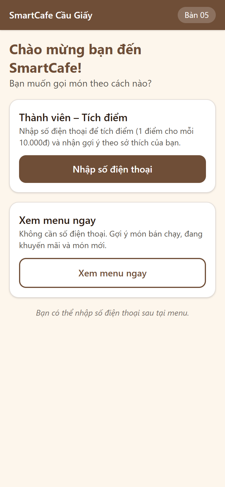

*Mã QR sai, bàn bị khóa hoặc chi nhánh ngừng hoạt động: trang báo "Mã QR không hợp lệ, vui lòng gọi nhân viên".*

### 3.2. Xem menu và gợi ý món
- Trên cùng là khối **"Gợi ý cho bạn"**: AI chọn món bán chạy ở chi nhánh, món đang khuyến mãi, món mới và món hợp thời tiết. Mỗi thẻ có ghi lý do gợi ý.
- Các nút danh mục (Tất cả, Khuyến mãi, Cà phê, Trà…) và ô **Tìm món** (gõ không dấu cũng được) giúp lọc menu.
- Món khuyến mãi có giá gốc bị gạch ngang. Món mới có nhãn **MỚI**. Món tạm hết bị làm mờ, ghi "Tạm hết" và không đặt được.
- Bấm **+** để thêm món vào giỏ; bấm thêm lần nữa để tăng số lượng.
- Khi quán đổi giá, khuyến mãi hoặc tình trạng còn hàng, menu **tự cập nhật** mà không cần tải lại trang.

| Đầu trang menu | Toàn bộ menu |
|:---:|:---:|
| 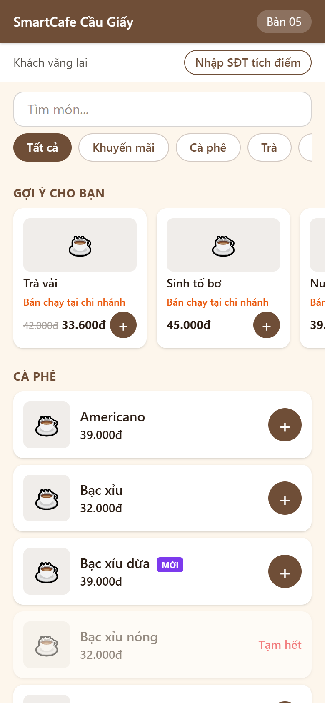 | 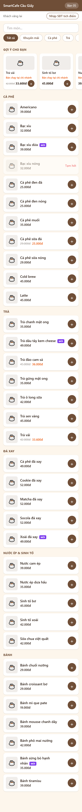 |

### 3.3. Giỏ hàng
Bấm **Giỏ hàng (n)** ở cuối trang.
- Tăng / giảm số lượng bằng **+ / −**. Mỗi món tối đa 20 ly trong một đơn.
- Gõ **ghi chú** cho từng món (VD "Ít đá") và ghi chú cho cả đơn.
- Khối **"Thường gọi kèm"** gợi ý các món khách khác hay gọi cùng món đang có trong giỏ.
- Chọn **phương thức thanh toán** (giả lập): **Ví điện tử** (mặc định) hoặc **Thẻ ngân hàng**.
- Bấm **Thanh toán & gửi đơn**: màn hình hiện "Đang xử lý thanh toán..." khoảng 1,5 giây, rồi đơn được gửi tới quầy Bar.

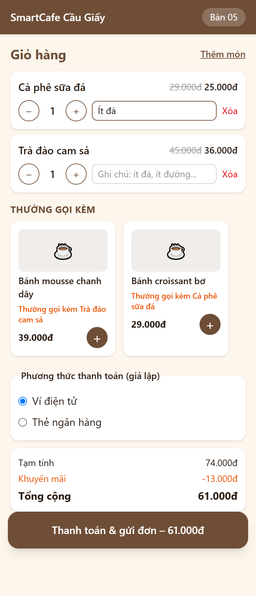

*Nếu giá vừa thay đổi hoặc món vừa hết, hệ thống báo và cập nhật lại giỏ trước khi thanh toán. Giá luôn do máy chủ tính, không dựa vào giá hiển thị trên điện thoại.*

### 3.4. Theo dõi đơn
Sau khi thanh toán, trang **Đơn #CG-xxxx** cho biết:
- thanh trạng thái: **Đang chờ → Đang pha chế → Có thể lấy**;
- vị trí trong hàng đợi;
- trạng thái của từng món.

Trang tự cập nhật, không cần bấm tải lại. Khi đồ xong, điện thoại rung và hiện dải xanh **"Đồ uống đã sẵn sàng – mời bạn đến quầy nhận"**.

| Đang chờ | Đang pha chế | Có thể lấy |
|:---:|:---:|:---:|
| 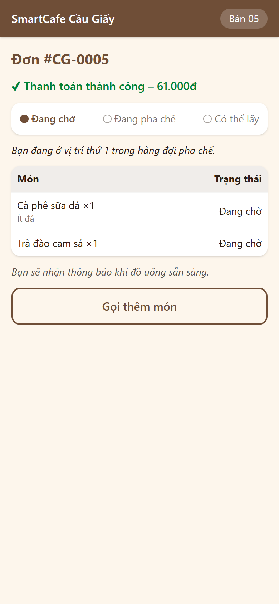 | 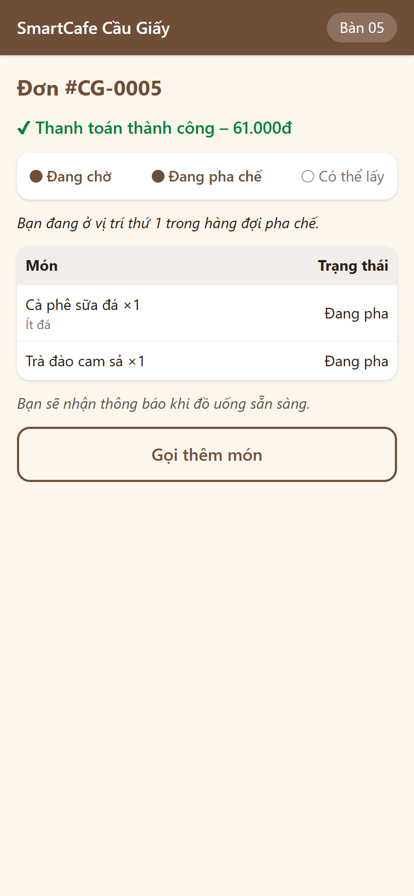 | 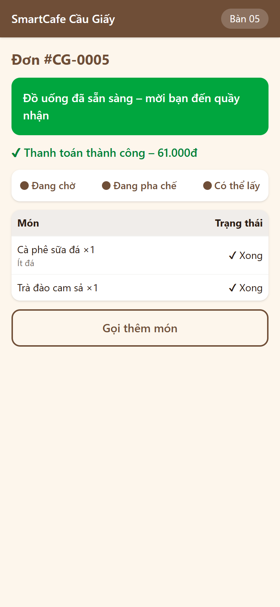 |

- Mất mạng thì trang ghi "Đang kết nối lại…"; có mạng lại thì tự cập nhật trạng thái mới nhất.
- Muốn gọi thêm, bấm **Gọi thêm món**. Đơn mới là một đơn riêng.

### 3.5. Đơn bị hủy
Nếu thu ngân hủy đơn theo yêu cầu của khách (mục 6), trang hiện **"Đơn đã hủy – đã hoàn tiền"** kèm lý do.

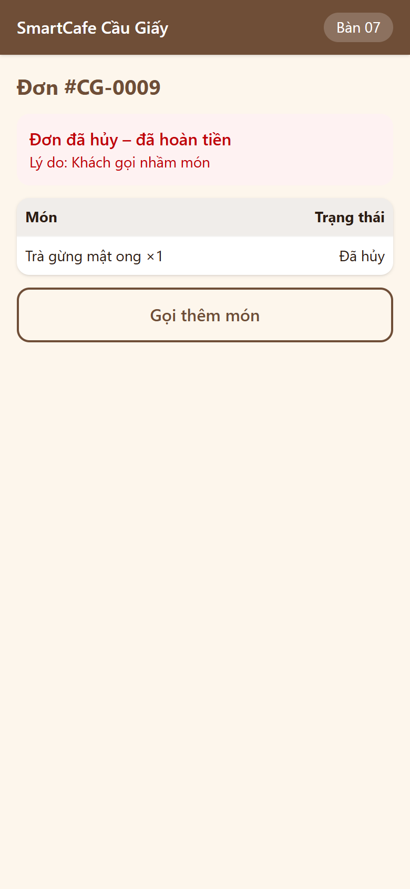

### 3.6. Thành viên – tích điểm
1. Ở màn hình chào bấm **Nhập số điện thoại** (hoặc bấm **Nhập SĐT tích điểm** trên menu), nhập số di động 10 số rồi bấm **Gửi mã OTP**.
2. Nhập 6 số của mã OTP. Bản demo hiện mã ở khung **[DEMO]**, không gửi SMS thật. Mã có hiệu lực 5 phút; được nhập sai tối đa 5 lần; sau 60 giây mới gửi lại mã được.
3. Sau khi xác thực, đầu menu hiện **"Xin chào – X điểm (≈ Yđ)"**. Khối gợi ý có thêm các món **"Bạn hay gọi"** và món tương tự sở thích của bạn.

| Nhập số điện thoại | Nhập mã OTP | Menu thành viên |
|:---:|:---:|:---:|
| 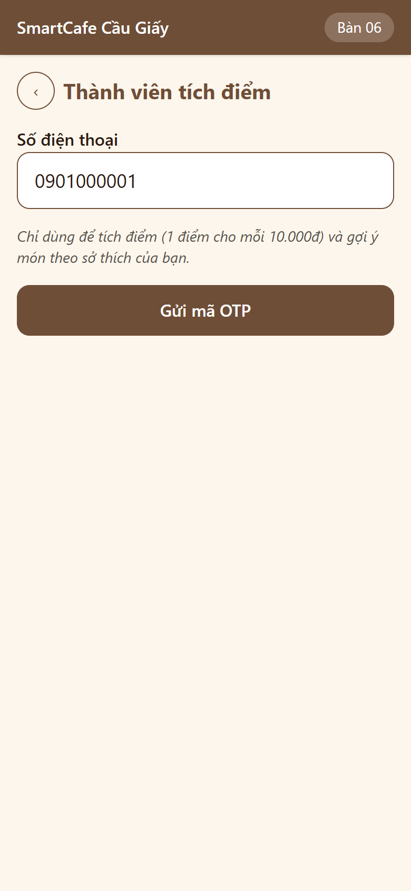 | 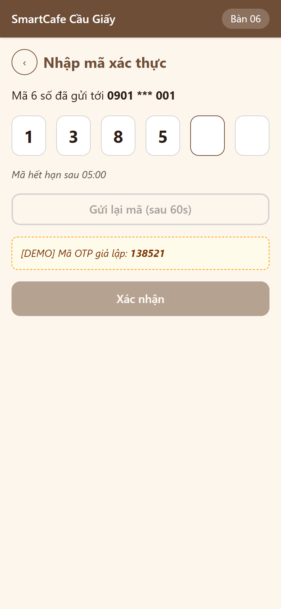 | 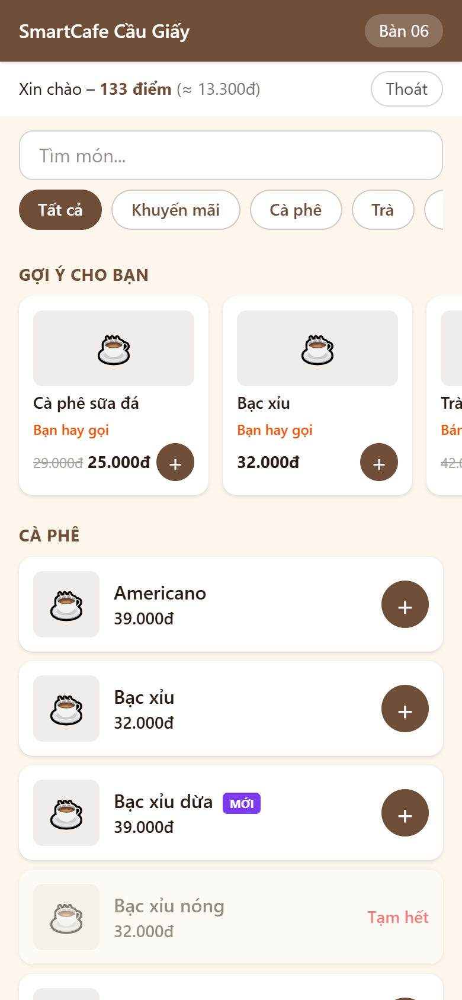 |

4. Giỏ hàng cho biết số điểm sẽ nhận: **1 điểm cho mỗi 10.000đ**, 1 điểm = 100đ. Điểm được cộng khi bạn **nhận đồ** (pha chế bấm "Đã giao"). Hiện chỉ tích và xem điểm, chưa đổi điểm.

| Giỏ hàng thành viên | Được cộng điểm |
|:---:|:---:|
| 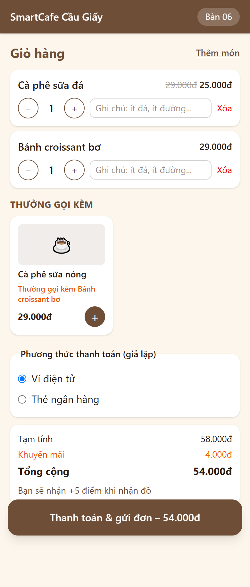 | 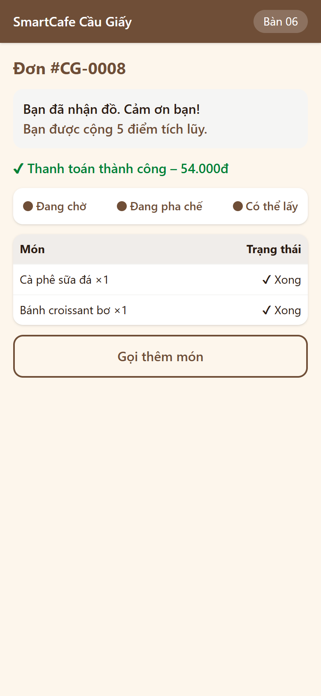 |

- Phiên thành viên kéo dài **1 giờ** và chỉ có trong tab trình duyệt đang mở. Hệ thống không lưu định danh thiết bị, nên lần sau quét QR cần xác thực lại.
- Bấm **Thoát** để quay về chế độ khách vãng lai.

## 4. Nhân viên – đăng nhập
1. Mở **http://localhost:8080/admin/login** (hoặc `http://<IP laptop>:8080/admin/login`).
2. Nhập **Tên đăng nhập** và **Mật khẩu**, bấm **Đăng nhập**.
3. Hệ thống mở màn hình mặc định theo vai trò (bảng mục 2.4). Phiên đăng nhập kéo dài 8 giờ (1 ca làm).
4. Bấm **Đăng xuất** ở góc phải khi hết ca.

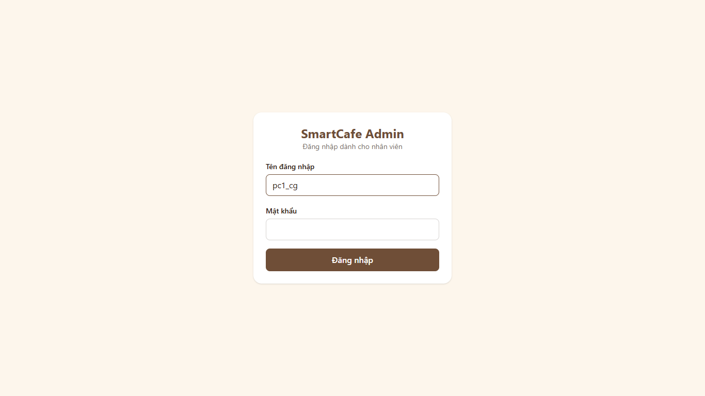

*Mỗi vai trò chỉ thấy các mục được phép trong menu bên trái. Gõ thẳng địa chỉ màn hình không đúng quyền thì nhận thông báo "Bạn không có quyền truy cập màn hình này".*

## 5. Pha chế – màn hình Bar
### 5.1. Hàng đợi
- Bảng **Chờ pha chế** liệt kê từng món của các đơn đã thanh toán, **sắp theo giờ gọi**; các món cùng một đơn đứng liền nhau.
- Mỗi dòng gồm: giờ gọi, số phút đã chờ, bàn, mã đơn, món, số lượng, ghi chú. Món chờ quá **10 phút** tô đỏ.
- Đơn mới đến thì có **âm báo** và dòng "Có món mới – đơn …". Lần đầu mở trang, cần bấm vào trang một lần để trình duyệt cho phép phát âm thanh.
- Góc phải hiện **● Trực tuyến**. Nếu mất kết nối, nhãn đổi thành **● Mất kết nối** và có dải cảnh báo; hàng đợi vẫn tự tải lại mỗi 10 giây.

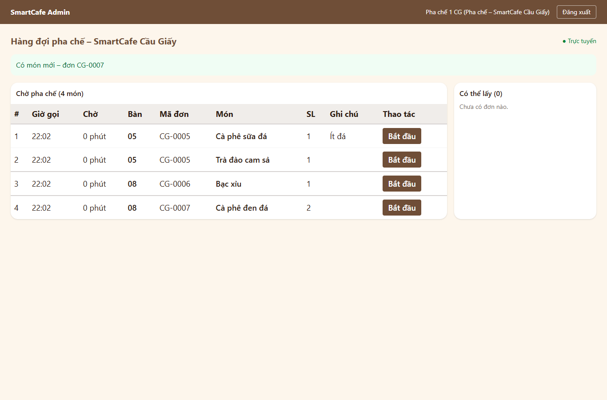

### 5.2. Làm món
1. Bấm **Bắt đầu** ở món sắp làm: dòng chuyển sang **ĐANG PHA** kèm nút **Xong**. Khách thấy đơn "Đang pha chế".
2. Làm xong, bấm **Xong**: món rời hàng đợi. Nút **Hoàn tác** hiện trong 10 giây nếu bấm nhầm; bấm nó thì món quay lại hàng đợi, kể cả món cuối của đơn.
3. Khi mọi món của đơn đã xong, đơn chuyển sang cột **Có thể lấy**. Điện thoại khách báo "Đồ uống đã sẵn sàng".

| Đang pha | Có thể lấy + Hoàn tác |
|:---:|:---:|
| 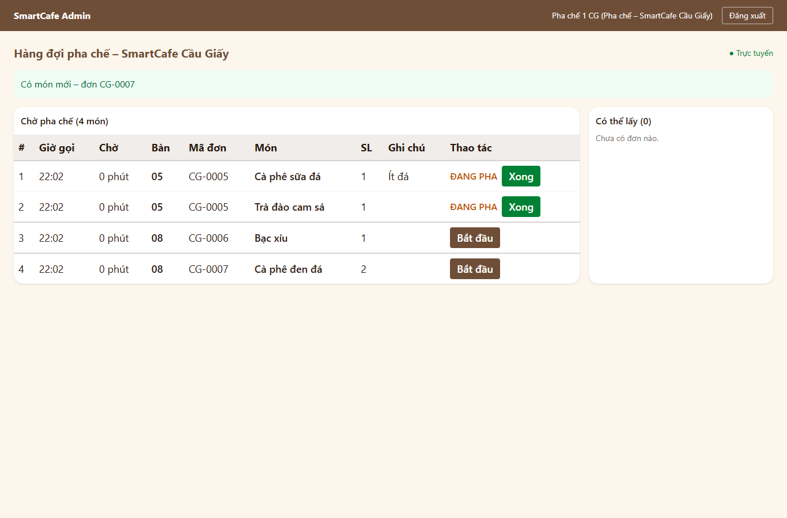 | 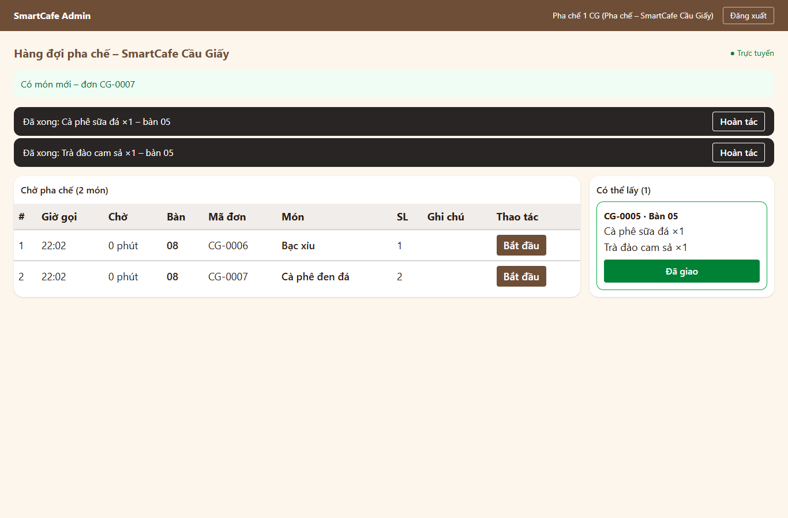 |

### 5.3. Giao đồ
Khách đến quầy, đọc mã đơn (VD CG-0005) hoặc số bàn. Đưa đồ rồi bấm **Đã giao** ở thẻ đơn trong cột "Có thể lấy".
- Nếu là khách thành viên, điểm được cộng ngay và hiện trên điện thoại khách.
- Bấm "Đã giao" hai lần không cộng điểm hai lần.

## 6. Thu ngân – hỗ trợ khách, hủy đơn & hoàn tiền
Thu ngân **không nhận order tại quầy**: mọi đơn đều đi qua QR. Thu ngân chỉ hỗ trợ khách khi có vấn đề.

### 6.1. Tra cứu đơn
Khung **Hỗ trợ khách** ở đầu màn hình Bar tự liệt kê các đơn trong ngày. Có thể lọc theo **Bàn** và/hoặc **Mã đơn** (chỉ cần nhập số, VD `7`), rồi bấm **Tìm**.

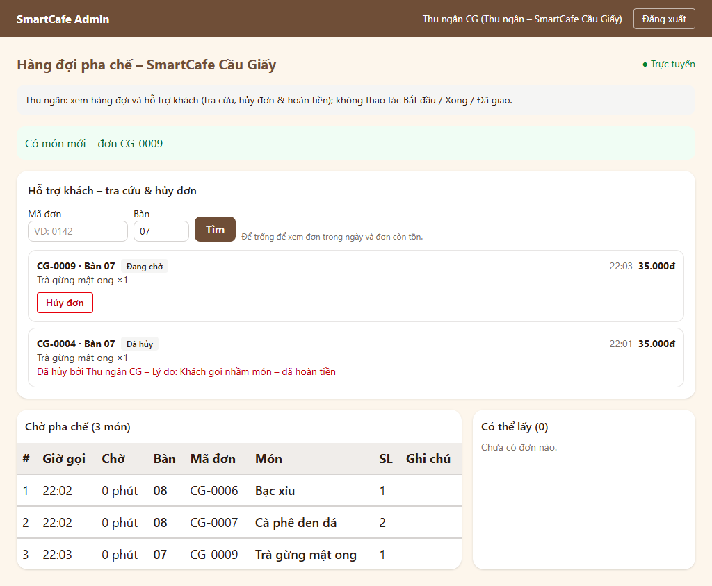

### 6.2. Hủy đơn & hoàn tiền
- Chỉ hủy được đơn **Đang chờ** hoặc **Đang pha chế**. Đơn đã "Có thể lấy" hoặc đã giao thì không có nút hủy.
1. Bấm **Hủy đơn** ở đơn cần hủy.
2. Chọn lý do có sẵn (VD "Khách gọi nhầm món") hoặc tự nhập lý do. Hộp xác nhận ghi rõ số tiền sẽ hoàn.
3. Bấm **Xác nhận hủy & hoàn tiền**.
4. Kết quả: món rời hàng đợi Bar ngay; điện thoại khách báo "Đơn đã hủy – đã hoàn tiền" (giả lập).

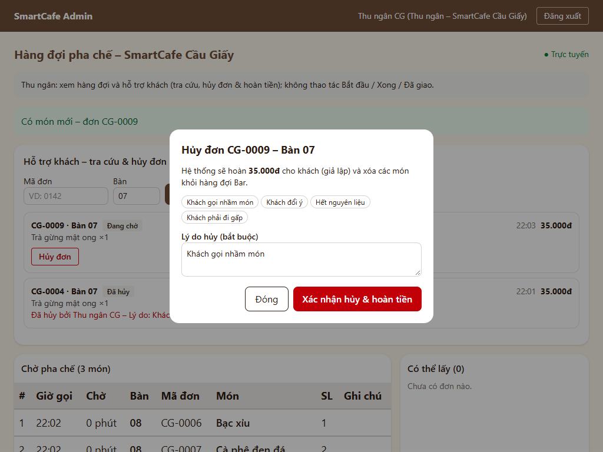

## 7. Quản lý chi nhánh
Quản lý chỉ xem và sửa dữ liệu của **chi nhánh mình**.

### 7.1. Tổng quan (báo cáo bán hàng)
- Số liệu được tổng hợp tự động **lúc 00:05 hằng ngày** và chỉ gồm các ngày đã kết thúc; không có số liệu của hôm nay.
- Chọn khoảng **7 ngày qua / 30 ngày qua**.
- 8 thẻ chỉ số của ngày gần nhất: doanh thu, số đơn, giá trị TB/đơn, thời gian chờ TB, tỉ lệ đơn thành viên, tỉ lệ món từ gợi ý AI, doanh thu khuyến mãi, đơn hủy. Mũi tên **xanh = tốt hơn**, **đỏ = kém hơn** ngày trước; riêng thời gian chờ thì giảm là tốt.
- Bên dưới là biểu đồ doanh thu theo ngày, bảng so sánh chi nhánh và top 5 món.

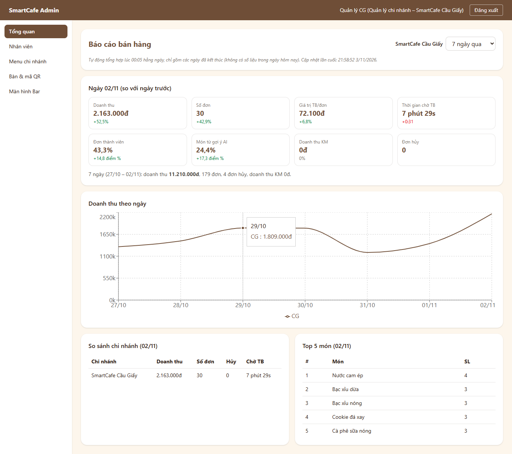

### 7.2. Menu chi nhánh
Danh sách món của menu chung, có lọc theo danh mục và ô tìm món. Mỗi món có:
- **Giá chi nhánh:** để trống nghĩa là dùng giá chung.
- **Còn hàng:** bỏ tích khi hết nguyên liệu, khách thấy "Tạm hết" ngay.

Bấm **Lưu** ở từng dòng sau khi sửa.

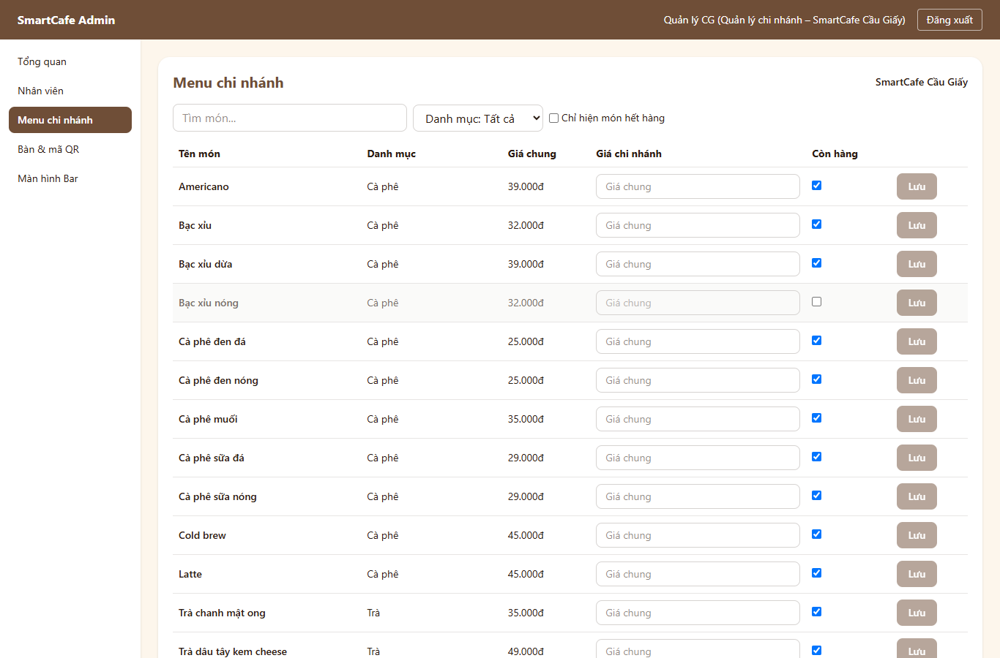

### 7.3. Bàn & mã QR
- **Thêm bàn:** nhập số bàn mới (VD `21`), bấm **+ Thêm bàn**. Hệ thống tự sinh mã QR riêng, khó đoán.
- **Xem QR:** xem ảnh QR có in tên chi nhánh và số bàn; bấm **Tải ảnh PNG** để in. Nút **In tất cả mã QR** mở trang in gồm mã QR của mọi bàn đang dùng.
- **Sửa:** đổi số bàn hoặc bỏ tích **Đang dùng** để khóa bàn. Khách quét QR của bàn đã khóa sẽ được báo mã không hợp lệ.

| Danh sách bàn | Xem mã QR |
|:---:|:---:|
| 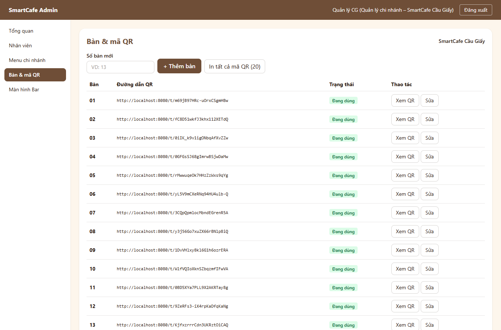 | 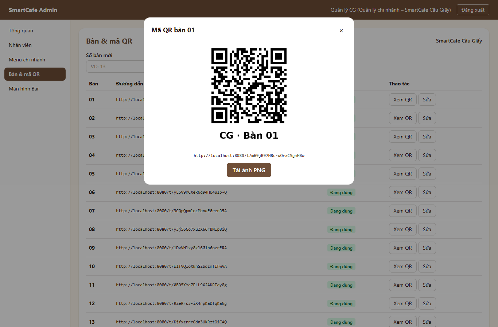 |

### 7.4. Nhân viên
- Quản lý thêm, sửa hoặc khóa tài khoản **pha chế và thu ngân** của chi nhánh mình.
- Mỗi tài khoản gồm: tên đăng nhập, họ tên, SĐT, vai trò, mật khẩu (tối thiểu 8 ký tự).
- Tài khoản bị khóa không đăng nhập được nữa. Không thể tự khóa hoặc tự đổi vai trò của chính mình.

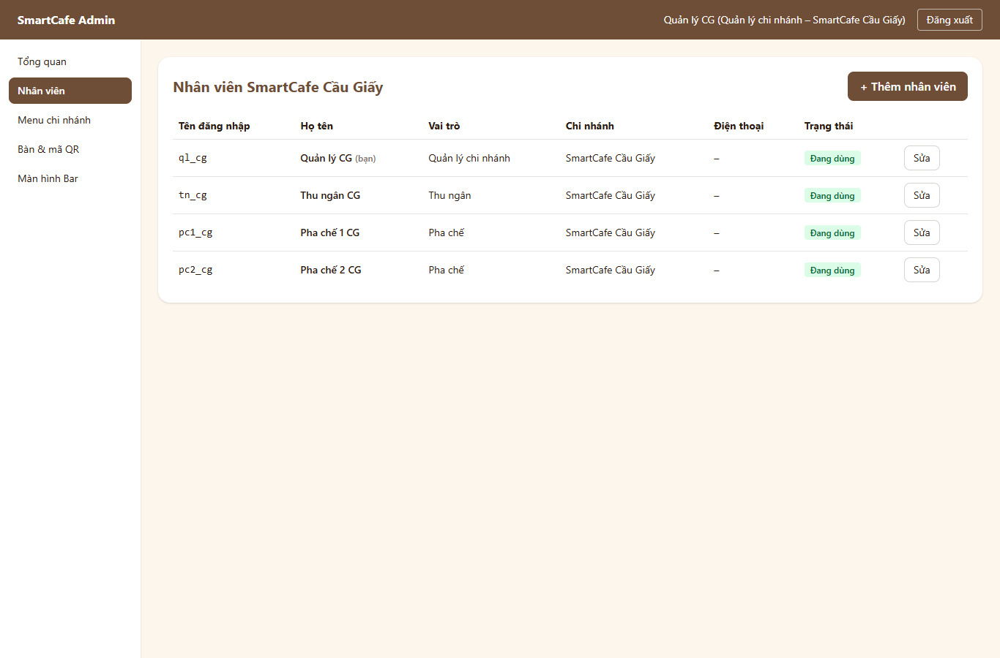

### 7.5. Màn hình Bar
Quản lý dùng được cả hai chức năng: làm món như pha chế (mục 5) và hỗ trợ khách như thu ngân (mục 6). Khung "Hỗ trợ khách" nằm dưới hàng đợi.

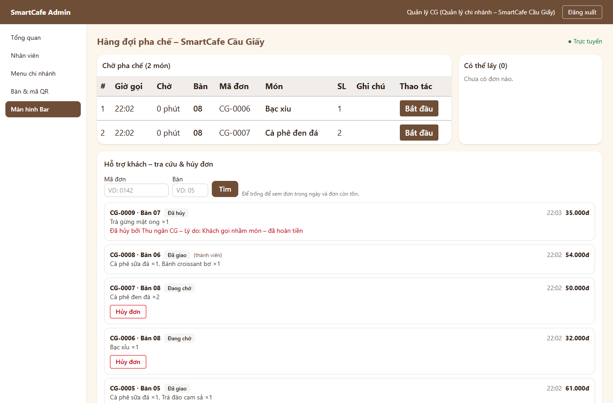

## 8. Quản trị viên (toàn chuỗi)
### 8.1. Tổng quan
Giống mục 7.1, nhưng có thêm:
- ô chọn **Tất cả chi nhánh** hoặc một chi nhánh, để so sánh các chi nhánh trên cùng biểu đồ;
- nút **Tính lại hôm qua**, chạy lại tổng hợp báo cáo cho ngày hôm qua (khi cần sửa số liệu).

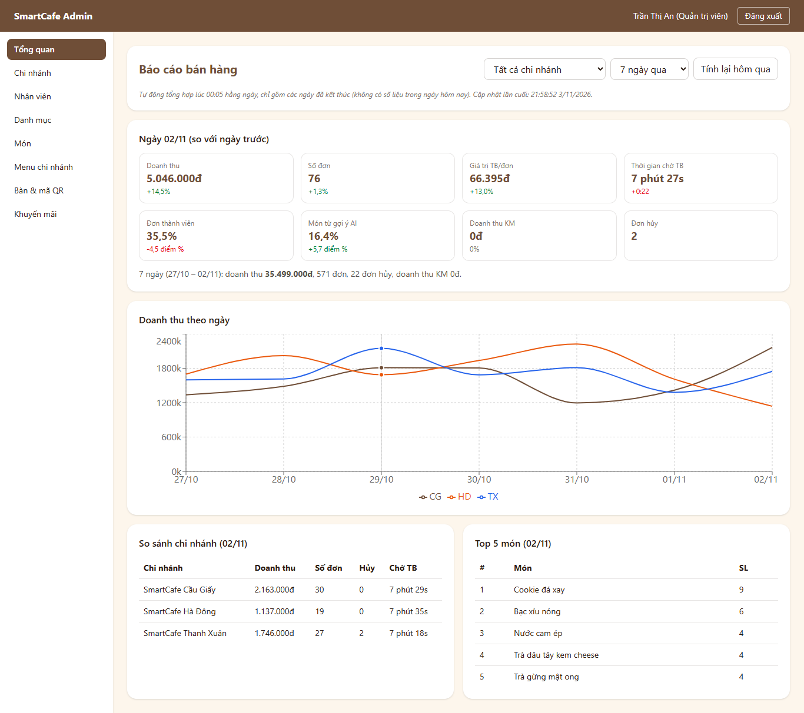

### 8.2. Chi nhánh
- Thêm chi nhánh: **+ Thêm chi nhánh**, gồm mã (VD `CG`, dùng làm tiền tố mã đơn), tên, địa chỉ, tọa độ (dùng cho thời tiết).
- **Sửa** thông tin, hoặc ngừng hoạt động chi nhánh. Chi nhánh ngừng hoạt động thì khách không quét QR được nữa.

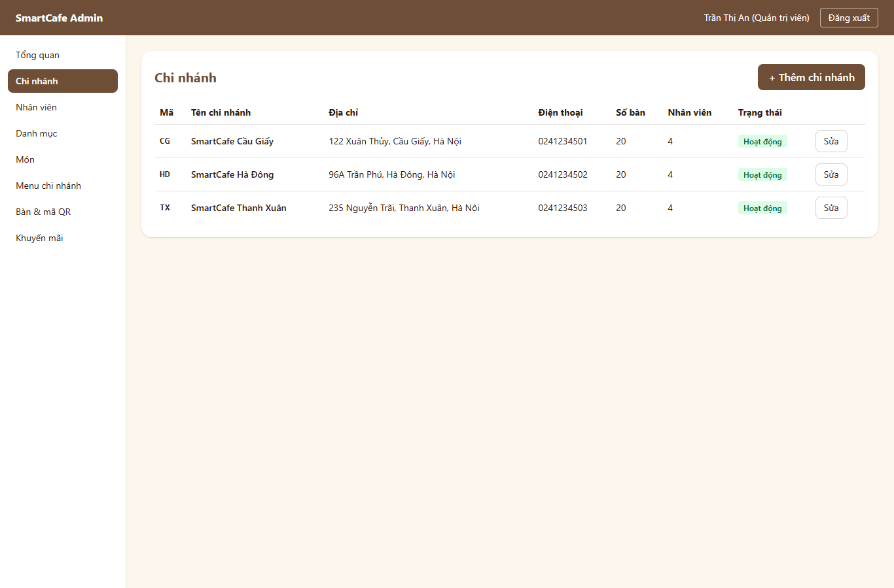

### 8.3. Danh mục
Thêm, sửa hoặc xóa danh mục món (Cà phê, Trà, Đá xay…). Thứ tự hiển thị trên menu khách đi theo cột thứ tự. Danh mục còn món thì không xóa được.

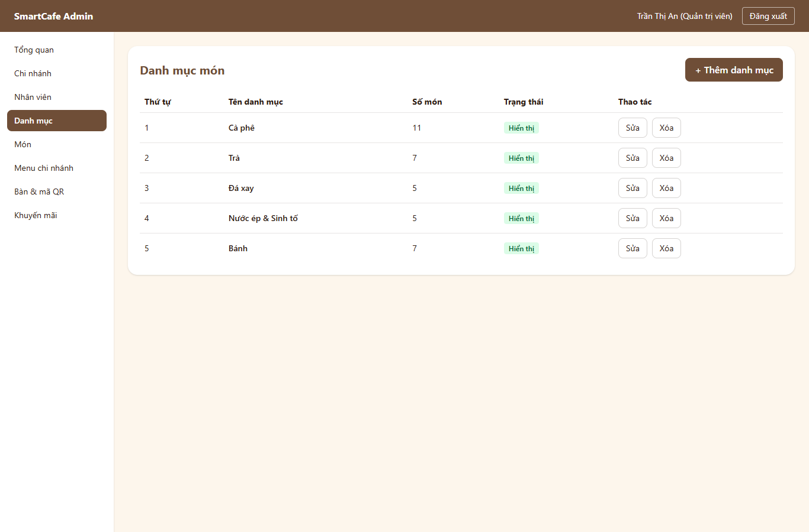

### 8.4. Món (menu chung)
- Danh sách món dùng chung cho cả chuỗi. Có lọc theo danh mục và trạng thái, ô tìm theo tên, và phân trang.
- **+ Thêm món** hoặc **Sửa**, gồm các trường:
  - tên, danh mục, giá gốc, mô tả;
  - loại nóng / lạnh (dùng cho gợi ý theo thời tiết);
  - thẻ (tags, dùng cho gợi ý món tương tự);
  - ảnh: JPG / PNG / WebP, tối đa 2 MB;
  - tích **Đang bán**.
- **Ẩn / Hiện**: tạm bỏ món khỏi menu mà không xóa. **Xóa**: món biến mất khỏi menu và danh sách quản trị, nhưng các đơn cũ và báo cáo vẫn giữ tên món.
- Món tạo trong 30 ngày gần nhất tự có nhãn **MỚI**.

| Danh sách món | Thêm món |
|:---:|:---:|
| 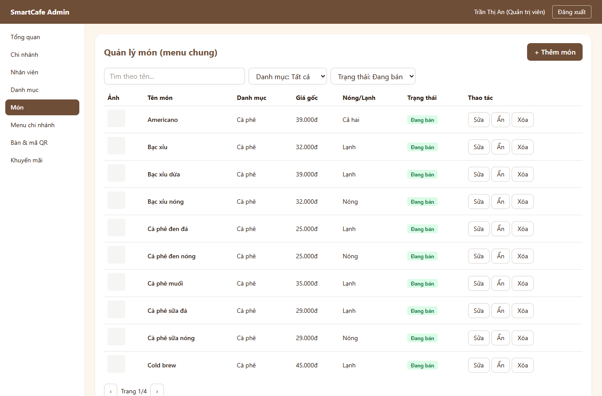 | 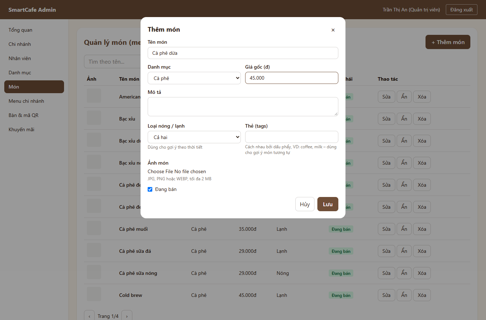 |

### 8.5. Khuyến mãi
- Chỉ **quản trị viên** tạo được khuyến mãi. Danh sách chia theo tab **Đang chạy / Sắp chạy / Đã kết thúc**.
- **+ Tạo chương trình**, gồm:
  - tên, mô tả;
  - **Áp dụng tại:** toàn chuỗi hoặc một chi nhánh;
  - thời gian **Bắt đầu – Kết thúc**;
  - **danh sách món**, mỗi món một **giá khuyến mãi**.
- Giá khuyến mãi phải **thấp hơn giá đang bán**; nếu không, hệ thống báo lỗi và không lưu.
- Khi khuyến mãi bắt đầu hoặc kết thúc, menu khách tự đổi giá.
- Có thể bỏ tích **Kích hoạt** để tạm dừng chương trình.

| Danh sách khuyến mãi | Tạo chương trình |
|:---:|:---:|
| 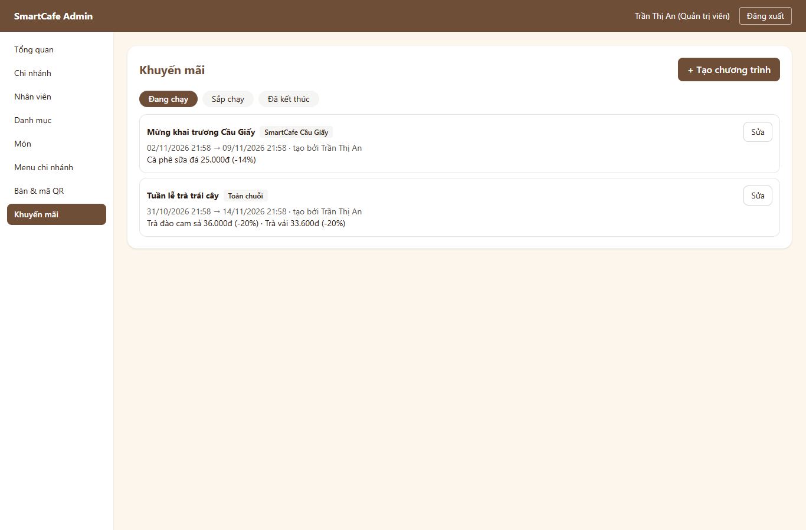 | 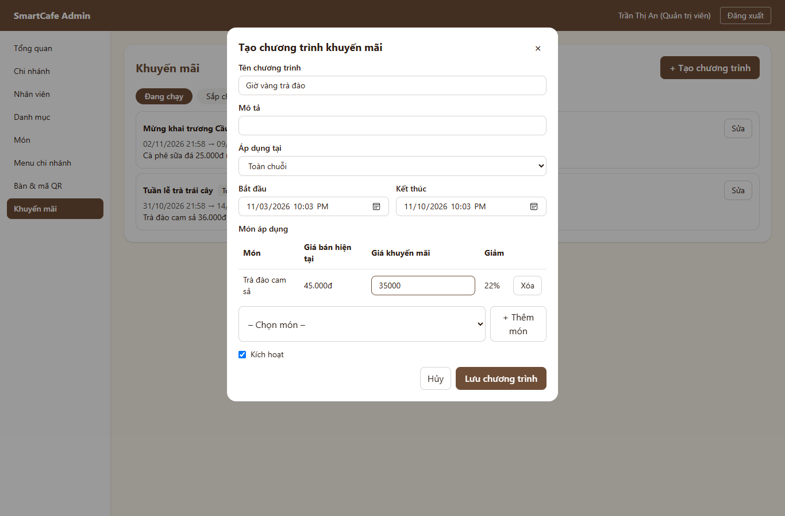 |

*Ô ngày giờ hiển thị theo định dạng ngày giờ của Windows (VD `11/03/2026 10:03 PM` trên máy cài tiếng Anh).*

### 8.6. Nhân viên toàn chuỗi
Như mục 7.4, nhưng quản trị viên chọn được chi nhánh (ô **Lọc chi nhánh**) và tạo được cả tài khoản **quản lý chi nhánh**.

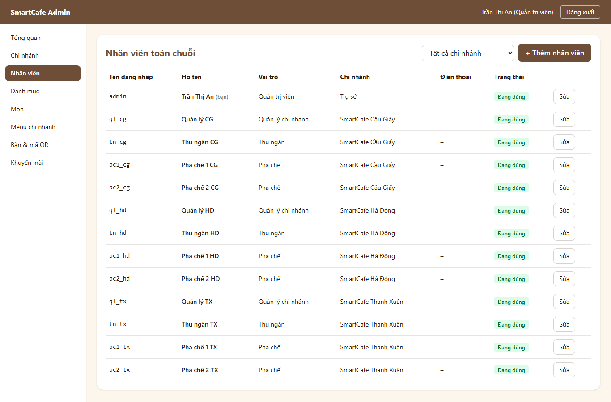

## 9. Sao lưu dữ liệu & xử lý sự cố
### 9.1. Sao lưu trước mỗi buổi demo
```powershell
cd D:\PTIT\HK3\QLDAPM\QLDAPM_Nhom_8\2.San_pham\smartcafe
powershell -ExecutionPolicy Bypass -File scripts\backup_db.ps1
#   → backups\smartcafe_<ngày_giờ>.dump
powershell -ExecutionPolicy Bypass -File scripts\restore_db.ps1 -File backups\smartcafe_<ngày_giờ>.dump
docker compose restart backend      # sau khi khôi phục
```

### 9.2. Chuẩn bị buổi demo
1. Bật Docker Desktop, đợi biểu tượng chuyển xanh.
2. Muốn dữ liệu sạch thì chạy `docker compose down -v`, rồi `docker compose up -d` (đợi khoảng 30–60 giây cho dữ liệu nạp xong).
3. Chạy `scripts\backup_db.ps1` để có bản sao lưu, phòng khi thao tác demo làm hỏng dữ liệu.
4. Mở sẵn các cửa sổ: Màn hình Bar (`pc1_cg`), tablet thu ngân (`tn_cg`), Tổng quan (`admin`), và điện thoại đã quét QR một bàn ở Cầu Giấy.

### 9.3. Sự cố thường gặp
| Hiện tượng | Cách xử lý |
|:---|:---|
| Trang `localhost:8080` không mở được | Kiểm tra Docker Desktop đang chạy; chạy `docker compose ps`, cả 3 dịch vụ phải ở trạng thái "running"; nếu không, chạy `docker compose up -d` |
| Điện thoại quét QR không vào được | Điện thoại và laptop phải cùng Wi-Fi; `PUBLIC_BASE_URL` trong `.env` phải là IP hiện tại của laptop (mục 2.3); tường lửa Windows phải cho phép cổng 8080 |
| Báo "Mã QR không hợp lệ" | Bàn bị khóa hoặc chi nhánh ngừng hoạt động; mở khóa ở **Bàn & mã QR** / **Chi nhánh**. Sau khi chạy `down -v`, mã QR được sinh lại nên phải in lại |
| Màn hình Bar hiện "● Mất kết nối" | Hàng đợi vẫn tự tải lại mỗi 10 giây; kiểm tra mạng; nếu kéo dài thì tải lại trang (F5) |
| Không nhận được mã OTP | Mã hiện ở khung [DEMO] trên điện thoại. Mỗi SĐT chỉ được gửi lại sau 60 giây và tối đa 5 mã/giờ; chờ hoặc dùng SĐT khác |
| Bị đưa về trang đăng nhập | Phiên nhân viên đã hết hạn (8 giờ); đăng nhập lại |
| Dashboard trống / thiếu ngày | Khởi động lại backend (`docker compose restart backend`) để tự tính bù, hoặc quản trị viên bấm **Tính lại hôm qua** |
| Không có âm báo ở Bar | Bấm vào trang Bar một lần để trình duyệt cho phép phát âm thanh; kiểm tra âm lượng máy |

## 10. Câu hỏi thường gặp
- **Khách có phải cài ứng dụng không?** Không, chỉ cần camera và trình duyệt (Chrome, Safari).
- **Khách có bắt buộc cho số điện thoại không?** Không. Chỉ khách muốn tích điểm mới nhập SĐT và xác thực OTP. Hệ thống chỉ lưu số điện thoại, không lưu tên, không lưu định danh thiết bị.
- **Gợi ý món dựa vào đâu?** Với khách vãng lai: món bán chạy ở chi nhánh, món khuyến mãi, món mới, thời tiết. Với thành viên: thêm lịch sử gọi món của chính khách và món tương tự. "Thường gọi kèm" dựa trên các cặp món hay được gọi cùng nhau (học lại mỗi đêm lúc 00:30). Nếu phần gợi ý gặp lỗi, menu và việc đặt món vẫn hoạt động bình thường.
- **Đơn chưa thanh toán thì sao?** Đơn chỉ được gửi tới quầy Bar sau khi thanh toán (trả trước). Quy tắc tự hủy đơn chưa thanh toán sau 15 phút mới ở mức mô tả.
- **Đổi giá / khuyến mãi có ảnh hưởng đơn đã đặt không?** Không. Đơn giữ nguyên giá tại thời điểm đặt; giá mới chỉ áp dụng cho đơn sau.
