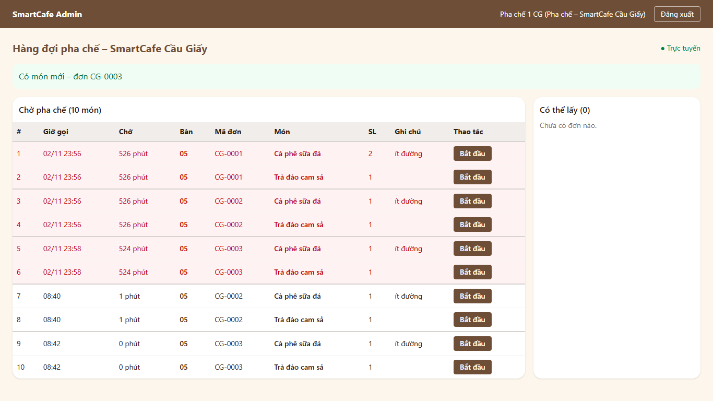
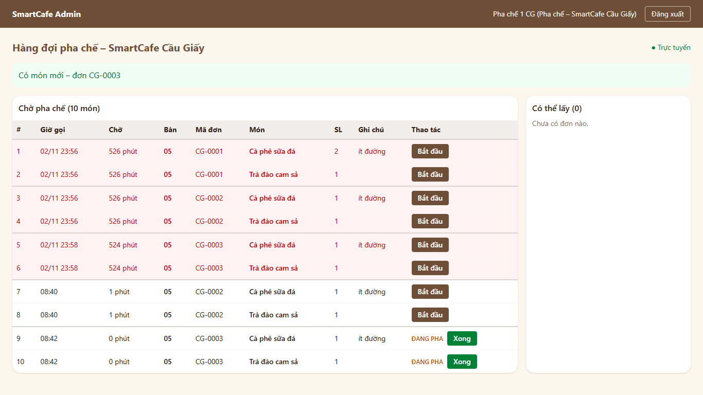
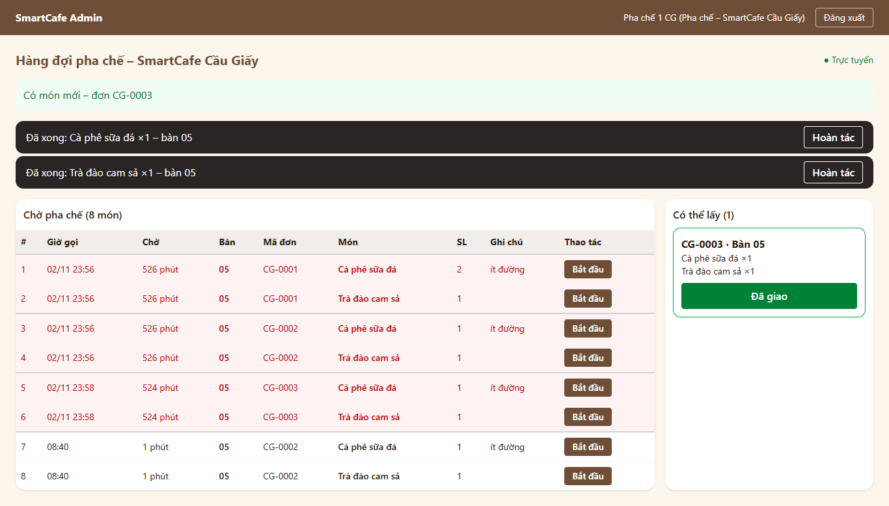
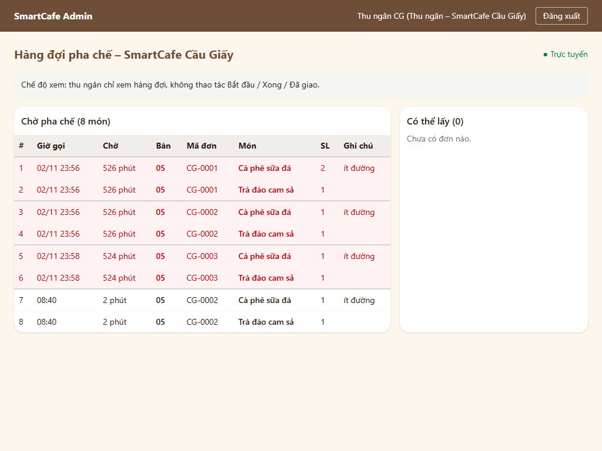
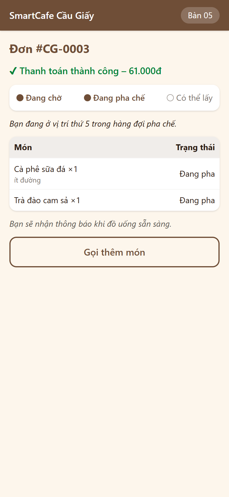
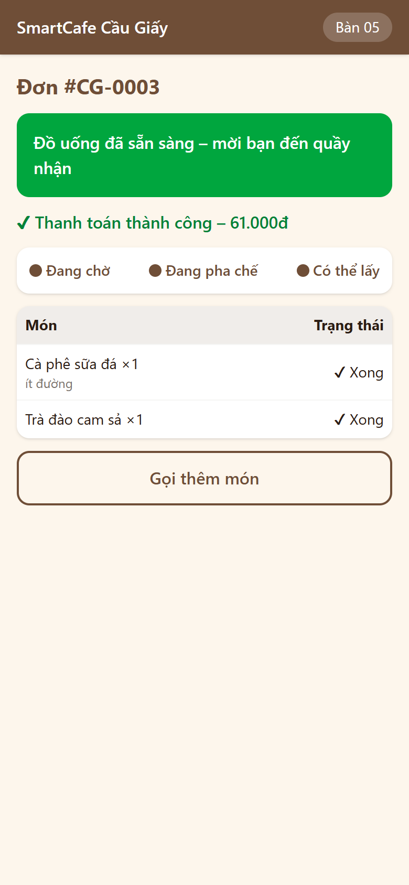
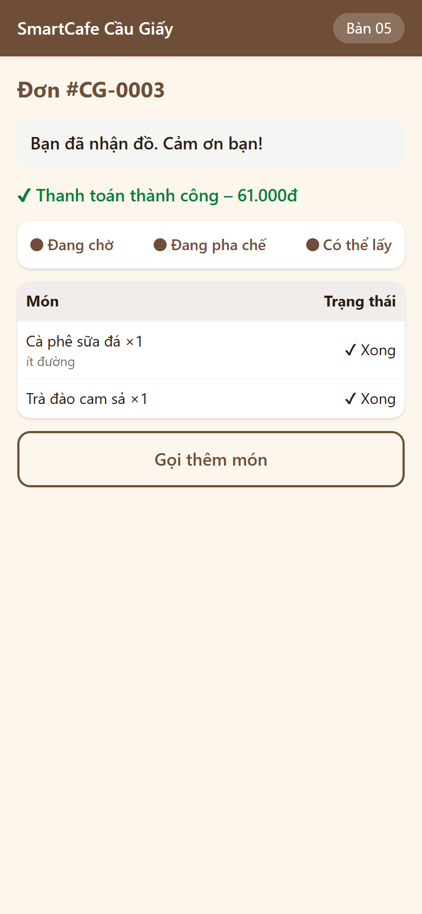

# BIÊN BẢN KIỂM THỬ – LUỒNG F3: MÀN HÌNH QUẦY BAR (HÀNG ĐỢI PHA CHẾ)

## 1. Thông tin chung
| Mục | Nội dung |
|:---|:---|
| Dự án | SmartCafe – Phần mềm quản lý chuỗi quán cà phê thông minh (Nhóm 8) |
| Luồng | **F3 – Màn hình Bar**: UC17 (xem hàng đợi), UC18 (Bắt đầu / Xong / Hoàn tác), UC19 (Đã giao, cộng điểm) – sơ đồ SD04, SD06 (phần giao đồ) |
| Phiên bản | 0.3.0 – nhánh `feature/f2-dat-mon`, đã gộp vào `main` ngày 28/10/2026 (CR-34), mã nguồn `2.San_pham/smartcafe/` |
| Ngày kiểm thử | 27/10/2026 |
| Người lập biên bản | Ngô Duy Đô (D – Tester / QA) |
| Người duyệt | Nguyễn Thanh Bình (A – PM) – đã duyệt 28/10/2026 (CR-34) |
| Tài liệu căn cứ | [III.1 UC17–UC19](../Thiet_ke_he_thong/III.1_Use_Case_Sequence.md), SD04, biểu đồ trạng thái đơn, [IV.2 W04](../Thiet_ke_he_thong/IV.2_Thiet_ke_giao_dien.md), [IV.3 API + WebSocket](../Thiet_ke_he_thong/IV.3_Kien_truc_va_API.md), [IV.1 bảng orders, order_items, order_status_history, loyalty_transactions](../Thiet_ke_he_thong/IV.1_Thiet_ke_CSDL.md); NFR-P4, NFR-R3, NFR-S2; quyết định D8, D11, D15, D19, D20, D28 |
| Tiền đề | F0, F1, F2 đạt ([F0](Bien_ban_kiem_thu_F0_Nen_tang.md), [F1](Bien_ban_kiem_thu_F1_QR_Menu.md), [F2](Bien_ban_kiem_thu_F2_Dat_mon_Thanh_toan.md)) |

## 2. Phạm vi
**Trong phạm vi**
- `GET /api/staff/branches/{id}/queue`: các món WAITING/PREPARING của đơn đã thanh toán, **sắp theo giờ gọi** (giờ thanh toán), món cùng đơn đứng liền nhau; kèm `server_time` để tính số phút đã chờ.
- `GET /api/staff/branches/{id}/orders?status=READY`: cột "Có thể lấy", sắp theo giờ xong.
- `POST /api/staff/order-items/{id}/start | done | undo`: chuyển trạng thái món; đơn PAID → PREPARING → READY; **Hoàn tác trong 10 giây** (server cho thêm 5 giây bù trễ mạng); ghi `order_status_history` (source STAFF, staff_id).
- `POST /api/staff/orders/{id}/complete`: "Đã giao" → COMPLETED; **cộng điểm** `floor(tổng / 10.000)` cho khách thành viên, mỗi đơn đúng 1 lần (D11, D15).
- Phân quyền: thu ngân, quản trị viên chỉ xem; pha chế, quản lý chi nhánh thao tác; chỉ trên chi nhánh của mình.
- Nhiều pha chế bấm cùng lúc (khóa dòng `orders`).
- WebSocket `/ws/bar/{branch_id}?token=<JWT>`; sự kiện tới khách: `ITEM_PREPARING`, `ITEM_DONE`, `ORDER_READY`, `ORDER_COMPLETED`, `QUEUE_POSITION`.
- Giao diện **W04** (`/admin/bar`): bảng hàng đợi, món chờ quá 10 phút tô đỏ, âm báo món mới, Hoàn tác, cột "Có thể lấy", chế độ xem của thu ngân, tự kết nối lại. **W03**: vị trí hàng đợi cập nhật realtime, số điểm được cộng khi hoàn tất.

**Ngoài phạm vi**: thu ngân tra cứu & hủy đơn, hoàn tiền (F5); khách đăng nhập OTP (F4 – ở F3 gắn khách thành viên trực tiếp vào đơn trong test để kiểm phần cộng điểm).

## 3. Môi trường & cách chạy
Giống [biên bản F2 – Mục 3](Bien_ban_kiem_thu_F2_Dat_mon_Thanh_toan.md#3-môi-trường--cách-chạy). E2E dùng 3 trình duyệt Edge cùng lúc: điện thoại khách (390×844), màn hình Bar của pha chế (laptop 1366×768), máy thu ngân (tablet 1024×768).
```powershell
cd backend;  .\.venv\Scripts\python -m pytest -v tests/f3
cd frontend; npx vitest run src/pages/admin/BarPage.test.tsx src/pages/qr/OrderPage.test.tsx src/lib/beep.test.ts
cd backend;  .\.venv\Scripts\python -m scripts.smoke_test --qr-token <token bàn CG>
```

## 4. Danh sách test case

### 4.1. Backend – Hàng đợi UC17 (cấp: Tích hợp, PostgreSQL thật)
| Mã TC | Căn cứ | Mô tả / dữ liệu | Kết quả mong đợi | Kết quả thực tế | KQ | Test tự động |
|:---|:---|:---|:---|:---|:---:|:---|
| F3-01 | UC17 bước 1 | Đơn CG-0001 (2 món, ghi chú "ít đường", ghi chú đơn "Mang đi") thanh toán **sau** đơn CG-0002 30 giây | Hàng đợi: CG-0002 trước, 2 món của CG-0001 liền nhau; đủ bàn, SL, ghi chú món, ghi chú đơn, giờ gọi | Đúng | Đạt | `test_queue.py::test_F3_01_...` |
| F3-02 | UC17, SD04 | Có đơn chưa thanh toán (CG) và đơn đã thanh toán ở HD | Hàng đợi CG chỉ có đơn đã thanh toán của CG; có `server_time` | Đúng | Đạt | `test_F3_02_...` |
| F3-03 | UC17 bước 3–4 | Xong món 1, rồi món 2 | Món xong rời hàng đợi; đơn sang "Có thể lấy" với đủ món, bàn, tổng tiền, `is_member` | Đúng | Đạt | `test_F3_03_...` |
| F3-04 | UC17 | 2 đơn READY | Cột "Có thể lấy" sắp theo giờ xong | Đúng | Đạt | `test_F3_04_...` |
| F3-05a…d | UC17 (thu ngân chỉ xem) | Pha chế, quản lý, thu ngân CG, quản trị viên xem hàng đợi CG | 200 cả 4 | Đúng | Đạt | `test_F3_05_...[4 tham số]` |
| F3-06 | NFR-S2 | Không đăng nhập; pha chế HD xem CG; `status=SAI` | 401 `UNAUTHORIZED`; 403 `FORBIDDEN`; 422 `VALIDATION_ERROR` | Đúng | Đạt | `test_F3_06_...` |

### 4.2. Backend – Bắt đầu / Xong / Hoàn tác UC18
| Mã TC | Căn cứ | Mô tả / dữ liệu | Kết quả mong đợi | Kết quả thực tế | KQ | Test tự động |
|:---|:---|:---|:---|:---|:---:|:---|
| F3-07 | UC18 bước 2, biểu đồ trạng thái | Bắt đầu món đầu tiên, rồi món thứ 2 (pha chế khác) | Món PREPARING + `started_at`; đơn PAID → PREPARING, lịch sử ghi (STAFF, staff_id) **1 lần**; khách thấy PREPARING | Đúng | Đạt | `test_actions.py::test_F3_07_...` |
| F3-08 | UC18 bước 3–4 | Xong lần lượt 2 món | Món 1: DONE + `done_at`, đơn vẫn PREPARING; món cuối: đơn READY + `ready_at`, lịch sử PREPARING → READY; khách hết vị trí hàng đợi | Đúng | Đạt | `test_F3_08_...` |
| F3-09a…e | Biểu đồ trạng thái | Bắt đầu 2 lần; Xong khi chưa Bắt đầu; Xong 2 lần; Hoàn tác món đang chờ; Hoàn tác món đang pha | 409 `INVALID_STATE_TRANSITION` với thông báo đúng từng trường hợp | Đúng cả 5 (sau khi sửa BUG-F3-01) | Đạt | `test_F3_09_...[5 tham số]` |
| F3-10 | UC20 (đơn đã hủy) | Bắt đầu món của đơn chưa thanh toán; Bắt đầu / Xong món của đơn đã hủy | 409, `details.order_status` = PENDING_PAYMENT / CANCELLED; đơn hủy không còn trong hàng đợi | Đúng | Đạt | `test_F3_10_...` |
| F3-11 | UC18 – 3a | Xong rồi Hoàn tác ngay | Món về PREPARING, xóa `done_at`, quay lại đúng vị trí trong hàng đợi | Đúng | Đạt | `test_F3_11_...` |
| F3-12 | UC18 – 3a, **P15** | Hoàn tác món cuối (đơn đã READY) | Đơn READY → PREPARING, xóa `ready_at`, lịch sử ghi; rời cột "Có thể lấy"; khách có lại vị trí hàng đợi | Đúng | Đạt | `test_F3_12_...` |
| F3-13 | UC18 – 3a | `done_at` lùi 16 giây; rồi 12 giây | 16 giây: 409 `UNDO_EXPIRED`; 12 giây (trong 10 + 5 giây bù trễ): 200 | Đúng | Đạt | `test_F3_13_...` |
| F3-14 | UC19 | Hoàn tác sau khi đã "Đã giao" | 409, `order_status` = COMPLETED | Đúng | Đạt | `test_F3_14_...` |
| F3-15a…d | Ma trận RBAC (III.1), D19 | Thu ngân, quản trị viên, pha chế HD, quản lý CG bấm Bắt đầu món của CG | 403 / 403 / 403 (món vẫn WAITING) / 200 | Đúng | Đạt | `test_F3_15_...[4 tham số]` |
| F3-16 | IV.3 Mục 2.4 | Món / đơn không tồn tại; không đăng nhập | 404 `ITEM_NOT_FOUND`, 404 `ORDER_NOT_FOUND`, 401 | Đúng | Đạt | `test_F3_16_...` |

### 4.3. Backend – Đã giao & cộng điểm UC19
| Mã TC | Căn cứ | Mô tả / dữ liệu | Kết quả mong đợi | Kết quả thực tế | KQ | Test tự động |
|:---|:---|:---|:---|:---|:---:|:---|
| F3-17 | UC19, D20 | Đơn ẩn danh READY, pha chế bấm "Đã giao" | COMPLETED, `completed_at`, `completed_by` = pha chế; `points_earned` = null; không có giao dịch điểm | Đúng | Đạt | `test_complete.py::test_F3_17_...` |
| F3-18 | UC19 bước 3, D15 | Khách thành viên (đang có 5 điểm), đơn 94.000đ (sau KM) | Trước khi giao chưa có điểm; sau khi giao +9 điểm → 14; 1 giao dịch EARN gắn đơn; W03 hiện `points_earned` = 9; cột "Có thể lấy" đánh dấu thành viên | Đúng | Đạt | `test_F3_18_...` |
| F3-19 | UC19 (mỗi đơn 1 lần) | Bấm "Đã giao" 2 lần | Lần 2: 409; điểm vẫn 3, chỉ 1 giao dịch | Đúng | Đạt | `test_F3_19_...` |
| F3-20 | D15 | Đơn thành viên 9.000đ | 0 điểm, không tạo giao dịch điểm, W03 `points_earned` = 0 | Đúng | Đạt | `test_F3_20_...` |
| F3-21 | UC19, D19 | "Đã giao" khi đơn mới PAID; thu ngân, pha chế HD bấm; quản lý CG bấm | 409 (`order_status` PAID); 403; 403; 200 | Đúng | Đạt | `test_F3_21_...` |

### 4.4. Backend – Realtime (WebSocket) & đồng thời
| Mã TC | Căn cứ | Mô tả / dữ liệu | Kết quả mong đợi | Kết quả thực tế | KQ | Test tự động |
|:---|:---|:---|:---|:---|:---:|:---|
| F3-22a…d | IV.3 Mục 2.3, NFR-S2 | Kết nối `/ws/bar/{CG}` bằng: token rác; nhân viên không tồn tại; pha chế HD; token khách thành viên | Đóng mã 4401 / 4401 / 4403 / 4401 | Đúng | Đạt | `test_realtime.py::test_F3_22_...[4 tham số]` |
| F3-23 | NFR-S2 | Tài khoản pha chế bị khóa | Đóng mã 4401 | Đúng | Đạt | `test_F3_23_...` |
| F3-24 | SD04 | Màn hình Bar mở sẵn; khách thanh toán → Bắt đầu → Xong → Đã giao | Nhận lần lượt `QUEUE_ITEM_ADDED` (mã đơn, bàn, ghi chú), `ITEM_UPDATED`, `ORDER_READY`, `ORDER_COMPLETED`; ngắt thì rời kênh | Đúng | Đạt | `test_F3_24_...` |
| F3-25 | UC17 | Thu ngân, quản lý, quản trị viên kết nối kênh Bar | Được chấp nhận | Đúng | Đạt | `test_F3_25_...` |
| F3-26 | UC06, SD04 | Trang theo dõi đơn của khách mở sẵn | Nhận `ITEM_PREPARING`, `ITEM_DONE`, `ORDER_READY`, `ORDER_COMPLETED`, mỗi sự kiện kèm toàn bộ đơn | Đúng | Đạt | `test_F3_26_...` |
| F3-27 | UC06 (vị trí hàng đợi) | 3 đơn A, B, C; A xong hết món | B nhận `QUEUE_POSITION` = 1, C nhận = 2 | Đúng | Đạt | `test_F3_27_...` |
| F3-28 | Toàn vẹn dữ liệu | **6 pha chế, 6 kết nối CSDL thật** cùng bấm: Bắt đầu 1 món; Xong 6 món khác nhau của 1 đơn; Đã giao 1 đơn thành viên 120.000đ | Bắt đầu: đúng 1 thành công, 5 nhận 409; đơn READY đúng 1 lần (lịch sử 5 bước không lặp); Đã giao: 1 thành công, điểm +12 **đúng 1 lần** | Đúng. *Kiểm chứng test có hiệu lực: tạm bỏ khóa `FOR UPDATE` thì cả 6 người "Bắt đầu" đều thành công → test báo đỏ (chạy 3 lần đều đỏ); đã khôi phục khóa* | Đạt | `test_concurrency.py::test_F3_28_...` |

### 4.5. Frontend – W04, W03 (cấp: Giao diện, API và WebSocket giả lập)
| Mã TC | Căn cứ | Mô tả | Kết quả mong đợi | KQ | Test tự động |
|:---|:---|:---|:---|:---:|:---|
| F3-FE-01 | W04, UC17 | Mở `/admin/bar` bằng tài khoản pha chế | Bảng đủ cột (#, giờ gọi 08:00, chờ 12 phút, bàn, mã đơn, món, SL, ghi chú, "Đơn: Mang đi"), đúng thứ tự; kết nối `ws://…/ws/bar/1?token=tok` | Đạt | `BarPage.test.tsx` |
| F3-FE-02 | UC17 quy tắc | Món chờ 12 phút và 2 phút | Món chờ > 10 phút tô đỏ, món còn lại không | Đạt | 〃 |
| F3-FE-03 | UC18 | Bấm "Bắt đầu" | Gọi `POST …/start` kèm `Bearer`; dòng hiện "ĐANG PHA" + nút "Xong" | Đạt | 〃 |
| F3-FE-04 | UC18 – 3a | Bấm "Xong" rồi "Hoàn tác" | Món rời bảng, hiện "Đã xong: Cà phê sữa đá ×2 – bàn 05 [Hoàn tác]"; bấm thì gọi `undo`, món quay lại | Đạt | 〃 |
| F3-FE-05 | UC18 – 3a | Chờ sau khi bấm "Xong" | Ở giây thứ 9 vẫn còn nút, sau 10 giây tự ẩn | Đạt | 〃 |
| F3-FE-06 | UC19 | Bấm "Đã giao" ở cột "Có thể lấy" (đơn thành viên) | Gọi `complete`; báo "Đã giao đơn CG-0000 – khách thành viên được cộng 9 điểm"; đơn rời cột | Đạt | 〃 |
| F3-FE-07 | UC17 quy tắc | Nhận `QUEUE_ITEM_ADDED` | Phát âm báo, hiện "Có món mới – đơn CG-0003", món mới hiện ngay | Đạt | 〃 |
| F3-FE-08 | SD04 | Nhận `ITEM_UPDATED` (pha chế khác thao tác) | Tải lại hàng đợi, không phát âm báo | Đạt | 〃 |
| F3-FE-09 | Biểu đồ trạng thái | API trả 409 | Hiện thông báo lỗi của server, tải lại hàng đợi | Đạt | 〃 |
| F3-FE-10 | UC17 (thu ngân chỉ xem) | Thu ngân mở W04 | Có dòng "Chế độ xem…"; không có cột Thao tác, nút Bắt đầu / Xong / Đã giao | Đạt | 〃 |
| F3-FE-11 | IV.2 Mục 2 | Quản trị viên (không thuộc chi nhánh) mở W04 | Thông báo màn hình dành cho nhân viên chi nhánh; không gọi API, không mở WebSocket | Đạt | 〃 |
| F3-FE-12 | NFR-R3 | Rớt WebSocket; sau đó bị từ chối mã 4401 | Hiện "Đang kết nối lại…", tự kết nối lại và tải lại hàng đợi; bị từ chối thì không thử lại | Đạt | 〃 |
| F3-FE-13 | UC06 | W03 nhận `QUEUE_POSITION` | Vị trí cập nhật ngay, không gọi lại REST | Đạt | `OrderPage.test.tsx` |
| F3-FE-14 | UC19, D11 | W03 nhận `ORDER_COMPLETED` có / không có điểm | "Bạn đã nhận đồ. Cảm ơn bạn!" + "Bạn được cộng 9 điểm tích lũy."; khách ẩn danh không hiện dòng điểm | Đạt | 〃 |
| F3-FE-15 | UC17 quy tắc | Âm báo Web Audio | Bíp 880 Hz, 0,25 giây; dùng chung 1 AudioContext; trình duyệt không hỗ trợ / chặn âm thanh thì bỏ qua, không lỗi | Đạt | `beep.test.ts` |
| F3-FE-16 | Hồi quy BUG-F3-02 | Hàng đợi có đơn CG-0002 của hôm trước và đơn hôm nay | Đơn hôm trước hiện "26/10 08:00", đơn hôm nay chỉ hiện "08:10" | Đạt | `BarPage.test.tsx` |

### 4.6. Kiểm thử khói trên hệ thống chạy thật (qua Nginx, `docker compose`)
| Mã TC | Mô tả | Kết quả thực tế | KQ |
|:---|:---|:---|:---:|
| SM-17 | Pha chế `pc1_cg` đăng nhập; hàng đợi Bar có 2 món của đơn vừa thanh toán | 8 món trong hàng đợi (có đơn tồn từ các lần test trước) | Đạt |
| SM-18 | Bấm Bắt đầu → trang theo dõi của khách nhận "Đang pha chế" ≤ 2 giây | **49 ms** | Đạt |
| SM-19 | Màn hình Bar khác nhận `ITEM_UPDATED` qua WebSocket | Đúng món | Đạt |
| SM-20 | Xong món cuối → khách nhận "Có thể lấy" ≤ 2 giây (NFR-P4) | **29 ms**, đơn READY | Đạt |
| SM-21 | Đơn xuất hiện ở cột "Có thể lấy" | Có | Đạt |
| SM-22 | Thu ngân bấm "Đã giao" | 403 | Đạt |
| SM-23 | Pha chế bấm "Đã giao" → COMPLETED, khách nhận `ORDER_COMPLETED` | Đúng | Đạt |

Log: [logs/F3_smoke_test.txt](logs/F3_smoke_test.txt) (chạy cả SM-01…23).

### 4.7. Kiểm thử đầu-cuối trên trình duyệt (Playwright + Edge, 3 thiết bị cùng lúc)
| Mã TC | Mô tả | Kết quả thực tế | KQ |
|:---|:---|:---|:---:|
| E2E-12 | Pha chế đăng nhập → vào thẳng `/admin/bar`, trạng thái "● Trực tuyến" | Đúng | Đạt |
| E2E-13 | Khách đặt 2 món trên điện thoại → đơn tự hiện trên màn hình Bar, không tải lại trang | CG-0003 hiện 2 dòng (thời gian đo gồm cả 1,5 giây giả lập thanh toán) | Đạt |
| E2E-14 | Thông báo "Có món mới – đơn CG-0003"; ghi chú "ít đường" hiển thị | Đúng | Đạt |
| E2E-23 | (Hồi quy BUG-F3-02) đơn CG-0002 của hôm trước còn trong hàng đợi hiện giờ gọi kèm ngày | 2 dòng hiện "02/11 23:56", tô đỏ | Đạt |
| E2E-15 | Bắt đầu → điện thoại khách đổi "Đang pha" ≤ 2 giây | **28 ms** | Đạt |
| E2E-16 | Xong món cuối → điện thoại hiện "Đồ uống đã sẵn sàng" ≤ 2 giây (NFR-P4) | **37 ms** | Đạt |
| E2E-17 | Đơn sang cột "Có thể lấy", có thanh Hoàn tác | Đúng | Đạt |
| E2E-18 | Hoàn tác món cuối → món quay lại hàng đợi, đơn rời cột "Có thể lấy", điện thoại hết hiện "Có thể lấy" | Đúng | Đạt |
| E2E-19 | Thanh Hoàn tác tự ẩn sau 10 giây | Đúng | Đạt |
| E2E-20 | "Đã giao" → đơn rời cột; điện thoại hiện "Bạn đã nhận đồ. Cảm ơn bạn!" | Đúng | Đạt |
| E2E-21 | Thu ngân `tn_cg` đăng nhập → chế độ xem, không có nút thao tác | Đúng | Đạt |
| E2E-22 | W04 không tràn ngang ở màn hình tablet 1024px | Đúng | Đạt |

Log: [logs/F3_e2e_trinh_duyet.txt](logs/F3_e2e_trinh_duyet.txt). Ảnh chụp:

| Màn hình | Ảnh |
|:---|:---|
| W04 – có món mới (đơn tồn hôm trước tô đỏ, kèm ngày) |  |
| W04 – đang pha |  |
| W04 – đơn sang "Có thể lấy", thanh Hoàn tác |  |
| W04 – thu ngân (chế độ xem, tablet 1024px) |  |
| W03 – điện thoại khách: đang pha / có thể lấy / hoàn tất |    |

## 5. Tổng hợp kết quả
| Nhóm | Số ca | Đạt | Không đạt |
|:---|:---:|:---:|:---:|
| Backend (pytest, `tests/f3`) | 41 | 41 | 0 |
| Frontend (Vitest: W04, W03, âm báo) | 16 | 16 | 0 |
| Kiểm thử khói (SM-17…23) | 7 | 7 | 0 |
| Kiểm thử đầu-cuối trên trình duyệt (E2E-12…23) | 12 | 12 | 0 |
| **Tổng F3** | **76** | **76** | **0** |
| *Hồi quy F0 + F1 + F2 (backend 98, frontend 47, SM-01…16, E2E-01…11)* | *172* | *172* | *0* |

**Độ bao phủ mã** (log: [logs/F3_backend_pytest.txt](logs/F3_backend_pytest.txt), [logs/F3_frontend_vitest.txt](logs/F3_frontend_vitest.txt)):
| Phần | Câu lệnh | Ghi chú |
|:---|:---:|:---|
| `app/modules/bar` (router, service, schemas) | **100%** | |
| `app/modules/order`, `app/ws/hub.py` | 100% | |
| Backend toàn bộ | 88% | Giảm 1 điểm so với F2 vì `scripts/smoke_test.py` (công cụ kiểm thử khói, không chạy trong pytest) dài thêm |
| Frontend toàn bộ | 99,2% (nhánh 93,4%) | `BarPage` 99,6%, `beep.ts` 100%, `format.ts` 100% |

## 6. Lỗi phát hiện
| Mã lỗi | Mức độ | Mô tả | Phát hiện bởi | Nguyên nhân | Cách sửa | Kiểm tra lại | Trạng thái |
|:---|:---|:---|:---|:---|:---|:---|:---|
| BUG-F3-01 | Thấp | Bấm "Xong" khi món chưa "Bắt đầu" (đơn còn PAID) báo sai "Đơn không còn trong hàng đợi" thay vì "Cần bấm Bắt đầu trước" | Test F3-09b | `done_item` chỉ chấp nhận đơn PREPARING nên kiểm tra trạng thái đơn chặn trước kiểm tra trạng thái món | Kiểm tra đơn còn trong hàng đợi (PAID/PREPARING) trước, rồi mới kiểm tra món | F3-09a…e đạt | Đã đóng |
| BUG-F3-02 | Trung bình | Màn hình Bar hiện **2 đơn cùng mã CG-0002** (một đơn tối 26/10 còn tồn, một đơn sáng 27/10), pha chế không phân biệt được vì cột giờ gọi chỉ có giờ:phút | E2E-13 (locator tìm thấy 4 dòng thay vì 2) | Mã đơn đếm lại mỗi ngày (D28) nên đơn tồn từ hôm trước có thể trùng mã đơn hôm nay | Đơn không thuộc ngày hiện tại (theo giờ server, múi giờ VN) hiện giờ gọi kèm ngày "dd/MM HH:mm" | F3-FE-16, E2E-23 đạt | Đã đóng |

## 7. Tồn tại / ghi chú
- **P15 – đã chốt → D30 (CR-34, 28/10):** "Hoàn tác" món cuối cùng (đã làm đơn chuyển "Có thể lấy") thì **đơn quay lại "Đang pha chế"** (READY → PREPARING, có ghi lịch sử, khách thấy lại "Đang pha"). Đã bổ sung chuyển READY → PREPARING vào biểu đồ trạng thái đơn. Đã cài theo phương án này (F3-12, E2E-18). Phương án thay thế: không cho hoàn tác khi đơn đã "Có thể lấy".
- Thời gian hoàn tác: nút hiện **10 giây** đúng UC18 – 3a; server chấp nhận tới 15 giây để bù trễ mạng (chi tiết kỹ thuật, không đổi quy tắc nghiệp vụ).
- **Đơn tồn từ hôm trước** (đã thanh toán nhưng chưa pha) vẫn nằm trong hàng đợi và tô đỏ. Thực tế quán cần hủy & hoàn tiền các đơn này (UC20 – làm ở F5); hiện đã hiển thị kèm ngày để không nhầm (BUG-F3-02).
- **Âm báo** dùng Web Audio; trình duyệt chỉ cho phát âm thanh sau lần bấm đầu tiên vào trang. Khi mở ca, pha chế cần bấm vào màn hình 1 lần (bấm bất kỳ nút nào cũng được); thông báo chữ "Có món mới" luôn hiện.
- Màn hình Bar tải lại hàng đợi qua REST mỗi khi nhận sự kiện hoặc kết nối lại (thay vì tự ghép từng sự kiện), để nhiều màn hình luôn khớp CSDL; phù hợp quy mô 1 chi nhánh.
- API / WebSocket bổ sung so với IV.3: `server_time` trong hàng đợi; mã lỗi `ITEM_NOT_FOUND`, `UNDO_EXPIRED`; mã đóng WebSocket 4401 / 4403; dữ liệu các sự kiện `ITEM_UPDATED`, `QUEUE_POSITION`; `points_earned` trong dữ liệu đơn – đã cập nhật [IV.3](../Thiet_ke_he_thong/IV.3_Kien_truc_va_API.md).
- Cộng điểm đã kiểm bằng khách thành viên gắn trực tiếp vào đơn; luồng khách tự đăng nhập OTP rồi đặt món sẽ kiểm lại đầu-cuối ở F4.

## 8. Kết luận
**Luồng F3: ĐẠT.** 76/76 ca kiểm thử đạt, hồi quy F0 + F1 + F2 172/172 đạt; 2 lỗi (mức Thấp, Trung bình) đã sửa, đều có test hồi quy. Đề xuất P15 đã được PM chốt theo phương án đã cài (D30). Đủ điều kiện chuyển sang **F4 – OTP & tích điểm** khi PM duyệt.

| Vai trò | Họ tên | Ngày | Ký xác nhận |
|:---|:---|:---|:---|
| Người lập (Tester / QA) | Ngô Duy Đô (D) | 27/10/2026 | |
| PM duyệt | Nguyễn Thanh Bình (A) | 28/10/2026 | |
