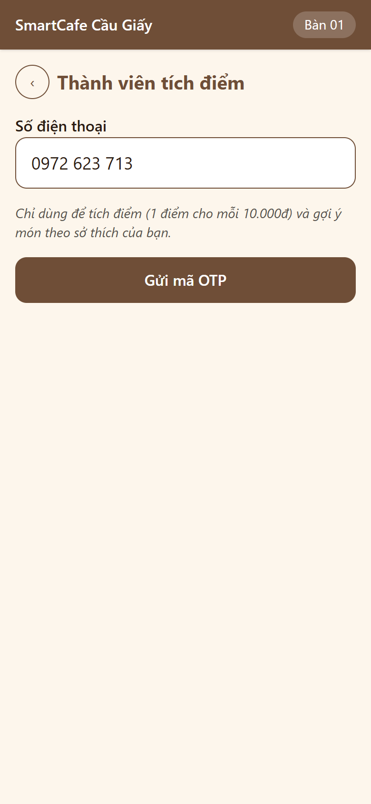
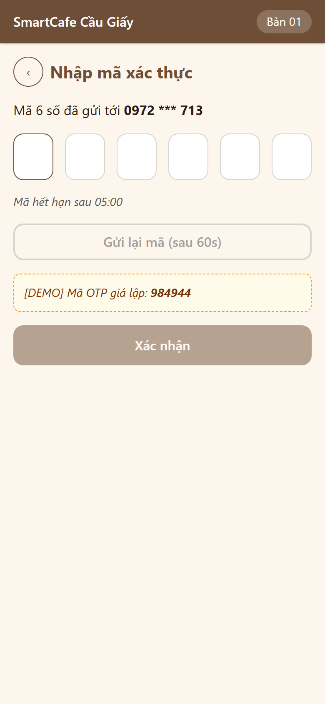
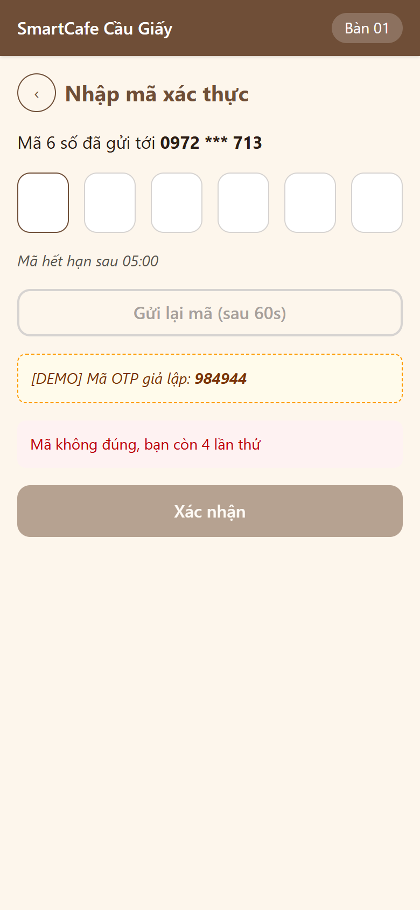
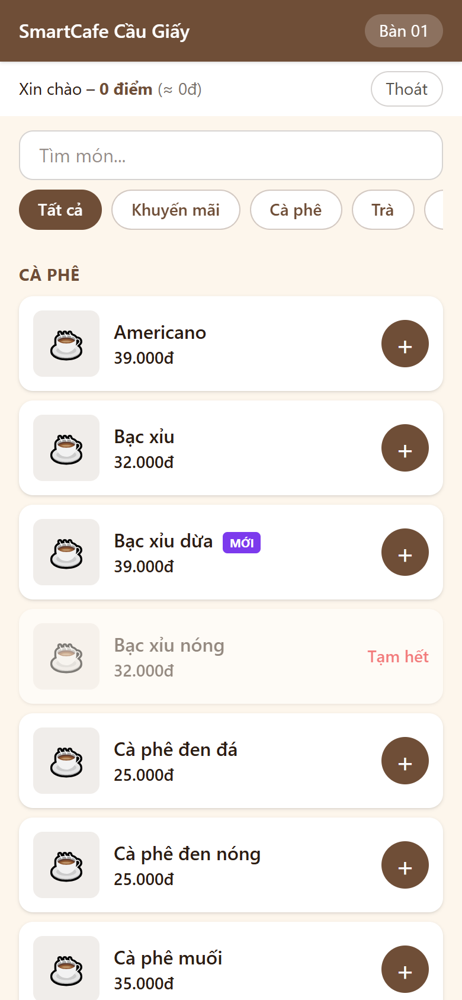
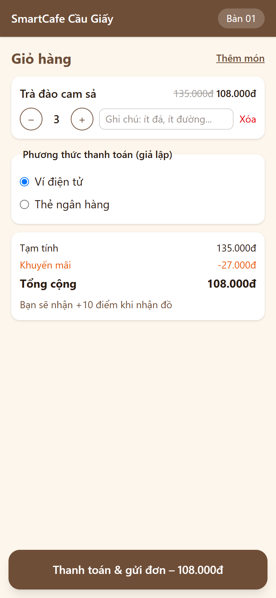
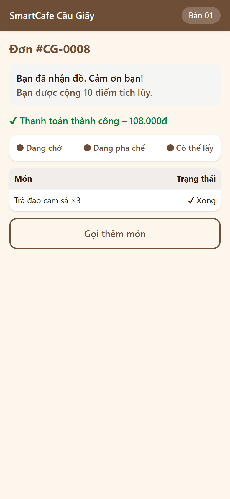

# BIÊN BẢN KIỂM THỬ – LUỒNG F4: KHÁCH THÀNH VIÊN (OTP GIẢ LẬP & TÍCH ĐIỂM)

## 1. Thông tin chung
| Mục | Nội dung |
|:---|:---|
| Dự án | SmartCafe – Phần mềm quản lý chuỗi quán cà phê thông minh (Nhóm 8) |
| Luồng | **F4 – OTP & tích điểm**: UC02 (xác thực SĐT bằng OTP giả lập), UC07 (xem điểm), phần thành viên của UC05/UC06 (đặt món gắn khách, điểm sẽ nhận / đã cộng) – sơ đồ SD01 |
| Phiên bản | 0.4.0 – nhánh `feature/f4-otp-tich-diem` (tách từ `main` sau khi gộp F2 + F3, CR-34), mã nguồn `2.San_pham/smartcafe/` |
| Ngày kiểm thử | 03/11/2026 |
| Người lập biên bản | Thành viên A (PM) |
| Người review | Thành viên D (Tester/QA) – *chờ review* |
| Tài liệu căn cứ | [III.1 UC01 (quy tắc), UC02, UC05, UC06, UC07](../Thiet_ke_he_thong/III.1_Use_Case_Sequence.md), SD01, [III.2 NFR-S2, NFR-S4, NFR-S7, NFR-R4](../Thiet_ke_he_thong/III.2_Yeu_cau_phi_chuc_nang_Data_Model.md), [IV.2 W00a, W01, W02](../Thiet_ke_he_thong/IV.2_Thiet_ke_giao_dien.md), [IV.3 API](../Thiet_ke_he_thong/IV.3_Kien_truc_va_API.md), [IV.1 bảng customers, otp_requests, loyalty_transactions](../Thiet_ke_he_thong/IV.1_Thiet_ke_CSDL.md); quyết định D4, D9, D11, D12, D15, D18 |
| Tiền đề | F0 → F3 đạt ([F0](Bien_ban_kiem_thu_F0_Nen_tang.md), [F1](Bien_ban_kiem_thu_F1_QR_Menu.md), [F2](Bien_ban_kiem_thu_F2_Dat_mon_Thanh_toan.md), [F3](Bien_ban_kiem_thu_F3_Man_hinh_Bar.md)) |

## 2. Phạm vi
**Trong phạm vi**
- `POST /api/public/otp/request`: chuẩn hóa SĐT di động VN (dấu cách, chấm, gạch, +84), sinh mã 6 số bằng `secrets`, **chỉ lưu băm** (HMAC-SHA256), hạn 5 phút; giới hạn **gửi lại sau 60 giây, tối đa 5 mã / giờ / SĐT**; response giống nhau cho SĐT mới và SĐT đã là thành viên; gửi qua cổng SMS giả lập (ghi log, SĐT đã che); trả `demo_code` khi `OTP_DEMO_MODE` bật.
- `POST /api/public/otp/verify`: sai mã tăng số lần thử (lưu cả khi trả lỗi), **sai 5 lần thì hủy mã**, mã hết hạn, mã đã dùng; đúng thì tạo `customers` nếu SĐT mới (chỉ tạo sau khi OTP đúng – NFR-S7) và cấp **customer token 1 giờ** (D18).
- `GET /api/public/me`: tên, SĐT che, điểm, giá trị quy đổi (× 100đ – D15), 5 giao dịch gần nhất.
- `POST /api/public/orders` nhận customer token tùy chọn → gắn `customer_id`, trả `expected_points`; token hết hạn / sai → 401, không tạo đơn. `GET /api/public/orders/{id}` có `expected_points`.
- Phân quyền token: token khách không gọi được API nhân viên và ngược lại.
- Đồng thời: nhiều request gửi mã / đoán mã / dùng mã cùng lúc (khóa advisory theo SĐT + `FOR UPDATE`).
- Giao diện **W00a** (nhập SĐT, 6 ô OTP, đếm ngược, gửi lại, khung [DEMO], quay lại); **W01** dòng thành viên "Xin chào – X điểm (≈ Yđ)" + Thoát, tự hết phiên; **W02** "Bạn sẽ nhận +X điểm"; **W03** điểm sẽ nhận / đã cộng.

**Ngoài phạm vi**: gửi SMS thật (D12 – chỉ có interface `SmsSender`), đổi điểm (D11), gợi ý theo sở thích thành viên (F7), nhập tên khách (không làm – D31).

## 3. Môi trường & cách chạy
Giống [biên bản F2 – Mục 3](Bien_ban_kiem_thu_F2_Dat_mon_Thanh_toan.md#3-môi-trường--cách-chạy). Kiểm thử khói và E2E chạy trên bản `docker compose up -d --build` mới (backend có `OTP_DEMO_MODE=true`), E2E dùng Edge giả lập điện thoại 390×844.
```powershell
cd backend;  .\.venv\Scripts\python -m pytest -v tests/f4
cd frontend; npx vitest run src/pages/qr/OtpPage.test.tsx
cd backend;  .\.venv\Scripts\python -m scripts.smoke_test --qr-token <token bàn CG>
```
Kiểm thử đồng thời (F4-33…35) dùng 8 luồng, mỗi luồng 1 kết nối CSDL riêng, dữ liệu commit thật rồi tự dọn. Các test về thời gian (60 giây, 5 phút, 1 giờ) dùng đồng hồ giả của service (`_now`), không phải chờ thật.

## 4. Danh sách test case

### 4.1. Backend – Hàm thuần (cấp: Đơn vị)
| Mã TC | Căn cứ | Mô tả / dữ liệu | Kết quả mong đợi | Kết quả thực tế | KQ | Test tự động |
|:---|:---|:---|:---|:---|:---:|:---|
| F4-01a…g | UC02 bước 2 | `0912345678`, `0912 345 678`, `0912.345.678`, `0912-345-678`, `+84912345678`, `84912345678`, `+84 912 345 678` | Đều chuẩn hóa thành `0912345678` | Đúng | Đạt | `test_unit.py::test_F4_01_...[7 tham số]` |
| F4-02a…i | UC02 bước 2 | rỗng, `abc`, 9 số, 11 số, đầu 02 / 01 / 1, `+1 …`, có chữ | Không hợp lệ | Đúng | Đạt | `test_F4_02_...[9 tham số]` |
| F4-03 | W00a | Che SĐT | `0912 *** 678` | Đúng | Đạt | `test_F4_03_...` |
| F4-04 | NFR-S4 | Băm mã OTP | Không chứa mã rõ; cùng mã khác SĐT → khác băm | Đúng | Đạt | `test_F4_04_...` |
| F4-05 | D18, NFR-S2 | Customer token | `typ=customer`, `role=CUSTOMER`, hết hạn sau đúng 3.600 giây; sửa token → bị từ chối | Đúng | Đạt | `test_F4_05_...` |

### 4.2. Backend – Gửi OTP (cấp: Tích hợp, PostgreSQL thật)
| Mã TC | Căn cứ | Mô tả / dữ liệu | Kết quả mong đợi | Kết quả thực tế | KQ | Test tự động |
|:---|:---|:---|:---|:---|:---:|:---|
| F4-06 | UC02 bước 2, SD01 | Gửi mã cho `0912 345 678` | 200 `{expires_in: 300, resend_after: 60, phone_masked, demo_code 6 số}`; CSDL lưu SĐT đã chuẩn hóa + mã băm, hạn đúng 5 phút; **chưa tạo khách** | Đúng | Đạt | `test_otp_request.py::test_F4_06_...` |
| F4-07 | UC02 bước 2 | SĐT `12345` | 422 `VALIDATION_ERROR` "Số điện thoại không hợp lệ…"; không lưu OTP | Đúng | Đạt | `test_F4_07_...` |
| F4-08 | UC02 – 2a, NFR-S4 | Gửi lại sau 45 giây; rồi sau 60 giây | 429 `OTP_RATE_LIMITED`, `retry_after` = 15, thông báo "đợi 15 giây"; đủ 60 giây thì gửi được | Đúng | Đạt | `test_F4_08_...` |
| F4-09 | UC02 – 2a, NFR-S4 | 5 mã cách nhau 61 giây, rồi mã thứ 6 | Mã thứ 6: 429 "quá 5 mã trong 1 giờ", `retry_after` = 3.295 giây (tính từ mã đầu); hết 1 giờ thì gửi được | Đúng | Đạt | `test_F4_09_...` |
| F4-10 | NFR-S4 | 2 SĐT khác nhau gửi liền nhau | Giới hạn tính riêng từng SĐT – cả 2 đều 200 | Đúng | Đạt | `test_F4_10_...` |
| F4-11 | NFR-S4 | SĐT mới và SĐT đã là thành viên (120 điểm) | Response cùng cấu trúc, cùng giá trị – không lộ SĐT đã đăng ký | Đúng | Đạt | `test_F4_11_...` |
| F4-12 | IV.2 W00a | Tắt `OTP_DEMO_MODE` | `demo_code` = null | Đúng | Đạt | `test_F4_12_...` |
| F4-13 | D12, SD01 | Thay cổng SMS bằng bản giả để theo dõi; dùng bản Mock mặc định | Cổng nhận đúng (SĐT, mã); Mock ghi log "[Mock SMS] Gửi tới 0912 *** 678: … là <mã>", **không ghi SĐT đầy đủ** | Đúng (sau khi sửa BUG-F4-03) | Đạt | `test_F4_13_...` |

### 4.3. Backend – Xác thực OTP
| Mã TC | Căn cứ | Mô tả / dữ liệu | Kết quả mong đợi | Kết quả thực tế | KQ | Test tự động |
|:---|:---|:---|:---|:---|:---:|:---|
| F4-14 | UC02 bước 4 | SĐT mới nhập đúng mã | 200: token (sub = id khách mới), 0 điểm, `expires_at`; tạo `customers` + `last_verified_at`; OTP có `verified_at` | Đúng | Đạt | `test_otp_verify.py::test_F4_14_...` |
| F4-15 | UC02 bước 4 | SĐT đã có 120 điểm | Trả 120 điểm, token của đúng khách cũ, không tạo khách trùng | Đúng | Đạt | `test_F4_15_...` |
| F4-16 | UC02 – 4a | Nhập sai 1 lần rồi nhập đúng | 400 `OTP_INVALID` `{reason: WRONG, attempts_left: 4}` "còn 4 lần thử"; số lần sai **được lưu** dù request lỗi; nhập lại đúng vẫn được | Đúng | Đạt | `test_F4_16_...` |
| F4-17 | UC02 – 4a | Sai 5 lần, rồi nhập đúng, rồi xin mã mới | Lần 1–4 báo còn 4…1 lần; lần 5 `LOCKED` "mã đã bị hủy"; nhập đúng vẫn `LOCKED`, số lần thử dừng ở 5; mã mới dùng được | Đúng | Đạt | `test_F4_17_...` |
| F4-18 | UC02 – 4b | Sau 4 phút 59 giây; đúng 5 phút | Còn hạn (báo sai mã); đúng 5 phút → `EXPIRED` "Mã đã hết hạn" | Đúng | Đạt | `test_F4_18_...` |
| F4-19 | NFR-S4 | Dùng lại mã đã đăng nhập thành công | `NOT_FOUND` | Đúng | Đạt | `test_F4_19_...` |
| F4-20 | UC02 | Xin mã mới sau 60 giây | Mã cũ không dùng được nữa, mã mới dùng được | Đúng | Đạt | `test_F4_20_...` |
| F4-21 | UC02 | Xác thực khi chưa xin mã | `NOT_FOUND` | Đúng | Đạt | `test_F4_21_...` |
| F4-22 | IV.3 | Mã `12345`, `1234567`, `12a456`, rỗng | 422 `VALIDATION_ERROR`; **không tính là lần thử** | Đúng | Đạt | `test_F4_22_...` |
| F4-23 | UC02 | Gửi bằng `+84 912 345 678`, xác thực bằng `0912.345.678` | Thành công, khách lưu `0912345678` | Đúng | Đạt | `test_F4_23_...` |
| F4-24 | NFR-S4 | Dùng mã của SĐT khác | `WRONG` | Đúng | Đạt | `test_F4_24_...` |

### 4.4. Backend – Xem điểm, đặt món thành viên, cộng điểm, đồng thời
| Mã TC | Căn cứ | Mô tả / dữ liệu | Kết quả mong đợi | Kết quả thực tế | KQ | Test tự động |
|:---|:---|:---|:---|:---|:---:|:---|
| F4-25 | UC07 | Khách mới xem điểm; sau đó 7 đơn được giao | Ban đầu 0 điểm, chưa có giao dịch; sau 7 đơn: 77 điểm, `points_value` 7.700đ, trả **5 giao dịch mới nhất** (20, 17, 14, 11, 8) kèm mã đơn | Đúng | Đạt | `test_member.py::test_F4_25_...` |
| F4-26a…e | NFR-S2 | `/me` không token; token rác; token hết hạn; token nhân viên; token của khách không tồn tại | 401 `UNAUTHORIZED` / `UNAUTHORIZED` / `TOKEN_EXPIRED` / `UNAUTHORIZED` / `UNAUTHORIZED` | Đúng | Đạt | `test_F4_26_...` |
| F4-27 | NFR-S2 | Token khách gọi `/api/auth/me`, hàng đợi Bar | 403 `FORBIDDEN` | Đúng | Đạt | `test_F4_27_...` |
| F4-28 | UC05 bước 3 | Thành viên đặt 2 Cà phê sữa đá + 1 Trà đào (94.000đ) | 201, `expected_points` = 9; đơn có `customer_id`; xem đơn có `expected_points` 9, `points_earned` null | Đúng | Đạt | `test_F4_28_...` |
| F4-29 | D4 | Đặt món không gửi token (dù CSDL đã có khách) | Đơn ẩn danh, `expected_points` null | Đúng | Đạt | `test_F4_29_...` |
| F4-30a…c | UC06 (phiên thành viên) | Đặt món bằng token hết hạn; token nhân viên; token rác | 401 `TOKEN_EXPIRED` / `UNAUTHORIZED` / `UNAUTHORIZED`; **không tạo đơn nào** (không tự đặt ẩn danh làm khách mất điểm) | Đúng | Đạt | `test_F4_30_...` |
| F4-31 | SD01 + UC05 + UC19 + UC07 | Khách có 120 điểm: OTP → đặt 94.000đ → thanh toán → pha chế → "Đã giao" → `/me`; bấm "Đã giao" lần 2 | +9 điểm → 129 (≈ 12.900đ); W03 `points_earned` 9; giao dịch mới nhất mang mã đơn; lần 2: 409, điểm vẫn 129 (NFR-R4) | Đúng | Đạt | `test_F4_31_...` |
| F4-32 | UC06 (phiên thành viên) | Đặt đơn 108.000đ khi còn phiên; token hết hạn trước lúc giao | Vẫn cộng 10 điểm cho khách; `/me` với token hết hạn → 401 | Đúng | Đạt | `test_F4_32_...` |
| F4-33 | NFR-S4 | **8 request gửi mã cùng lúc** cho 1 SĐT | Đúng 1 thành công, 7 nhận `OTP_RATE_LIMITED`; CSDL chỉ có 1 mã | Đúng | Đạt | `test_concurrency.py::test_F4_33_...` |
| F4-34 | NFR-S4 | **8 request đoán sai cùng lúc** | Đúng 4 `WRONG` + 4 `LOCKED`, số lần thử dừng ở 5; mã đúng sau đó bị từ chối | Đúng | Đạt | `test_F4_34_...` |
| F4-35 | Toàn vẹn dữ liệu | **8 request dùng mã đúng cùng lúc** | Đúng 1 đăng nhập thành công, 7 nhận `NOT_FOUND`; chỉ 1 khách được tạo | Đúng | Đạt | `test_F4_35_...` |

### 4.5. Frontend – W00a, W01, W02, W03 (cấp: Giao diện, API và WebSocket giả lập)
| Mã TC | Căn cứ | Mô tả | Kết quả mong đợi | KQ | Test tự động |
|:---|:---|:---|:---|:---:|:---|
| F4-FE-01 | W00a, UC02 | Từ W00 bấm "Nhập số điện thoại", nhập SĐT, gửi mã | Có dòng mục đích sử dụng; gửi đúng SĐT; hiện "0912 *** 678", khung [DEMO] 482107, "Mã hết hạn sau 05:00", "Gửi lại mã (sau 60s)" bị khóa, "Xác nhận" khóa khi chưa đủ 6 số | Đạt | `OtpPage.test.tsx` |
| F4-FE-02 | UC02 bước 2 | SĐT quá ngắn; server báo SĐT sai | Nút gửi khóa; hiện lỗi của server, vẫn ở bước nhập SĐT | Đạt | 〃 |
| F4-FE-03 | UC02 bước 5, NFR-S7 | Dán mã 6 số vào ô đầu, Xác nhận | Gửi đúng `{phone, code}`; về `/menu`, "Xin chào – 120 điểm (≈ 12.000đ)", không còn nút "Nhập SĐT"; token ở sessionStorage, localStorage trống | Đạt | 〃 |
| F4-FE-04 | UC02 – 4a | Sai mã | Hiện "còn 4 lần thử", xóa 6 ô, vẫn ở W00a | Đạt | 〃 |
| F4-FE-05 | UC02 – 2a | Gửi lại mã bị giới hạn (`retry_after` 1.800) | Hiện thông báo, nút đổi thành "Gửi lại mã (sau 1800s)" và khóa | Đạt (sau khi sửa BUG-F4-02) | 〃 |
| F4-FE-06 | W00a, UC02 – 4b | Gõ từng số; Backspace ở ô trống; mã hết hạn | Tự chuyển ô; quay lại ô trước; "Mã đã hết hạn, vui lòng gửi lại mã"; server báo hết hạn thì hiện lỗi | Đạt | 〃 |
| F4-FE-07 | W00a | Nút quay lại ở bước nhập mã, rồi ở bước nhập SĐT | Về bước nhập SĐT (giữ SĐT đã nhập), rồi về màn hình chào; **không gửi xác thực** | Đạt (sau khi sửa BUG-F4-01) | 〃 |
| F4-FE-08 | UC07, W01 | Mở menu khi đang là thành viên; bấm "Thoát" | Gọi `/me` kèm `Bearer`, cập nhật 129 điểm (≈ 12.900đ); Thoát → khách vãng lai, xóa phiên | Đạt | 〃 |
| F4-FE-09 | UC06 (phiên) | `/me` trả 401 | Về ẩn danh, báo "Phiên thành viên đã hết hạn…" | Đạt | 〃 |
| F4-FE-10 | D18 | Phiên hết hạn trong lúc đang ở menu | Tự về ẩn danh đúng giờ hết hạn, có thông báo | Đạt | 〃 |
| F4-FE-11 | D18 | Mở lại trang khi phiên trong sessionStorage đã hết hạn | Vào thẳng ẩn danh, không gọi `/me`, xóa phiên cũ | Đạt | 〃 |
| F4-FE-12 | UC05 bước 1 | Thành viên, giỏ 50.000đ | "Bạn sẽ nhận +5 điểm khi nhận đồ"; tạo đơn kèm `Bearer cust-tok` | Đạt | 〃 |
| F4-FE-13 | D4 | Khách ẩn danh | Không hiện điểm, tạo đơn không có `Authorization` | Đạt | 〃 |
| F4-FE-14 | UC06 (phiên) | Tạo đơn trả 401 `TOKEN_EXPIRED`; bấm thanh toán lại | Báo "Phiên thành viên đã hết hạn (1 giờ)…" + link "Nhập lại SĐT", ẩn dòng điểm, ở lại giỏ; lần sau đặt ẩn danh (không token) | Đạt | 〃 |
| F4-FE-15 | UC06 bước 4 | W03 đơn thành viên đang chờ; nhận `ORDER_COMPLETED` | "Đơn thành viên: bạn sẽ nhận +5 điểm khi nhận đồ" → "Bạn được cộng 5 điểm tích lũy.", ẩn dòng sẽ nhận | Đạt | 〃 |

### 4.6. Kiểm thử khói trên hệ thống chạy thật (qua Nginx, `docker compose`)
| Mã TC | Mô tả | Kết quả thực tế | KQ |
|:---|:---|:---|:---:|
| SM-24 | Gửi OTP giả lập cho SĐT ngẫu nhiên: hạn 5 phút, chờ 60 giây, có mã [DEMO] | `0914 *** 575` | Đạt |
| SM-25 | Gửi lại ngay → 429 | "Vui lòng đợi 60 giây rồi gửi lại mã" | Đạt |
| SM-26 | Sai mã → `OTP_INVALID`, còn 4 lần | Đúng | Đạt |
| SM-27 | Nhập đúng mã → customer token, 0 điểm | Đúng | Đạt |
| SM-28 | `/api/public/me` | 0 điểm, SĐT đã che | Đạt |
| SM-29 | Customer token gọi hàng đợi Bar → 403 | 403 | Đạt |
| SM-30 | Đặt 3 Trà đào ở chế độ thành viên | CG-0006, 108.000đ, `expected_points` 10 | Đạt |
| SM-31 | Pha chế xử lý + "Đã giao" → `/me` | +10 điểm, tổng 10, giao dịch mang mã CG-0006 | Đạt |

Log: [logs/F4_smoke_test.txt](logs/F4_smoke_test.txt) (chạy cả SM-01…31, **31/31 đạt**). Ngoài ra đã kiểm tra `docker compose logs backend` có dòng `[Mock SMS] Gửi tới 0914 *** 575: Mã xác thực SmartCafe của bạn là …` (hồi quy BUG-F4-03).

### 4.7. Kiểm thử đầu-cuối trên trình duyệt (Playwright + Edge, điện thoại 390×844)
| Mã TC | Mô tả | Kết quả thực tế | KQ |
|:---|:---|:---|:---:|
| E2E-24 | W00 → "Nhập số điện thoại" → gửi mã: hiện SĐT che, khung [DEMO], đếm ngược, nút gửi lại bị khóa | Đúng | Đạt |
| E2E-34 | W00a không tràn ngang ở 390px | Đúng | Đạt |
| E2E-25 | Nhập sai mã bằng bàn phím → "còn 4 lần thử", các ô được xóa | Đúng | Đạt |
| E2E-26 | Nhập mã [DEMO] → menu "Xin chào – 0 điểm (≈ 0đ)" + nút Thoát | Đúng | Đạt |
| E2E-27 | Phiên chỉ trong sessionStorage; localStorage trống, không cookie (NFR-S7) | Đúng | Đạt |
| E2E-28 | Thêm 3 Trà đào (108.000đ) → giỏ "Bạn sẽ nhận +10 điểm khi nhận đồ" | Đúng | Đạt |
| E2E-29 | Thanh toán → W03 "sẽ nhận +10 điểm khi nhận đồ" | Đúng | Đạt |
| E2E-30 | Pha chế xử lý và bấm "Đã giao" → điện thoại tự hiện "Bạn được cộng 10 điểm tích lũy." (WebSocket) | Đúng | Đạt |
| E2E-31 | Quay lại menu → "Xin chào – 10 điểm (≈ 1.000đ)" | Đúng | Đạt |
| E2E-32 | Mở tab mới trên cùng điện thoại → chế độ ẩn danh (phiên gắn với tab, không lưu định danh thiết bị – D9, D18) | Đúng | Đạt |
| E2E-33 | Bấm "Thoát" → khách vãng lai, xóa phiên | Đúng | Đạt |
| E2E-35 | Khách ẩn danh có món trong giỏ → "Nhập SĐT tích điểm" → đăng nhập → giỏ vẫn còn món (UC01 – quy tắc) | Đúng | Đạt |

Log: [logs/F4_e2e_trinh_duyet.txt](logs/F4_e2e_trinh_duyet.txt). Ảnh chụp:

| Màn hình | Ảnh |
|:---|:---|
| W00a – nhập SĐT / nhập mã ([DEMO], đếm ngược) / sai mã |    |
| W01 – thành viên (0 điểm) / sau khi được cộng điểm |   |
| W02 – điểm sẽ nhận |  |
| W03 – được cộng điểm |  |

## 5. Tổng hợp kết quả
| Nhóm | Số ca | Đạt | Không đạt |
|:---|:---:|:---:|:---:|
| Backend (pytest, `tests/f4`) | 49 | 49 | 0 |
| Frontend (Vitest: W00a, W01, W02, W03) | 15 | 15 | 0 |
| Kiểm thử khói (SM-24…31) | 8 | 8 | 0 |
| Kiểm thử đầu-cuối trên trình duyệt (E2E-24…35) | 12 | 12 | 0 |
| **Tổng F4** | **84** | **84** | **0** |
| *Hồi quy F0 → F3 (backend 139, frontend 63, SM-01…23, E2E-01…11 của F2)* | *236* | *236* | *0* |

*E2E-12…23 (màn hình Bar, F3) không chạy lại bằng trình duyệt vì kịch bản phụ thuộc dữ liệu đơn tồn của ngày trước; luồng Bar đã được hồi quy bằng backend F3 (41 ca), SM-17…23 và E2E-30 (pha chế giao đơn thành viên).*

**Độ bao phủ mã** (log: [logs/F4_backend_pytest.txt](logs/F4_backend_pytest.txt), [logs/F4_frontend_vitest.txt](logs/F4_frontend_vitest.txt)):
| Phần | Câu lệnh | Ghi chú |
|:---|:---:|:---|
| `app/modules/customer` (router, service, deps, phone, sms, schemas) | **100%** | |
| `app/modules/order` | 100% | |
| Backend toàn bộ | 88% | Phần chưa phủ chủ yếu là `scripts/smoke_test.py` (công cụ kiểm thử khói, không chạy trong pytest) |
| Frontend toàn bộ | 99,0% (nhánh 93,2%) | `OtpPage` 98,4%, `MemberBar` 100%, `api/customer.ts` 100%, `CartPage` 100% |

## 6. Lỗi phát hiện
| Mã lỗi | Mức độ | Mô tả | Phát hiện bởi | Nguyên nhân | Cách sửa | Kiểm tra lại | Trạng thái |
|:---|:---|:---|:---|:---|:---|:---|:---|
| BUG-F4-01 | Trung bình | Ở bước nhập mã, bấm nút "Quay lại" lại **gửi form xác thực** (khách đã nhập đủ 6 số thì bị đăng nhập luôn thay vì quay lại) | Test F4-FE-07 | Nút "‹" nằm trong `<form>` nhưng không khai báo `type="button"` nên mặc định là nút submit | Thêm `type="button"` cho nút quay lại | F4-FE-07 đạt | Đã đóng |
| BUG-F4-02 | Thấp | Gửi lại mã bị giới hạn: nút hiển thị sai số giây chờ (lệch thêm thời gian từ lần gửi trước) cho tới nhịp đồng hồ kế tiếp | Test F4-FE-05 | Số giây còn lại tính từ biến `now` cũ (chỉ cập nhật mỗi giây) | Cập nhật `now` ngay khi nhận `retry_after` | F4-FE-05 đạt | Đã đóng |
| BUG-F4-03 | Thấp | Cổng SMS giả lập không ghi mã OTP ra log backend (trái SD01: "mã ghi ra log"), và log nghiệp vụ `smartcafe.*` không hiện trong `docker compose logs` → khi tắt chế độ DEMO không có cách lấy mã | Test F4-13 (log trống) | Bản Mock ban đầu cố ý không ghi mã; logger `smartcafe` chưa được cấu hình handler/level | Mock ghi "tin nhắn" kèm mã, SĐT đã che; cấu hình logger `smartcafe` (INFO, stdout) khi khởi động app | F4-13 đạt; kiểm tra tay `docker compose logs backend` | Đã đóng |

## 7. Tồn tại / ghi chú
- **Tên khách – P16 đã chốt → D31 (CR-35, 03/11):** không thu thập tên, thành viên chỉ định danh bằng SĐT. Đã bỏ cột `customers.name` (migration `0003`) và trường `name` khỏi API `/otp/verify`, `/me`; lời chào giữ "Xin chào – X điểm (≈ Yđ)". Đã chạy lại toàn bộ test sau thay đổi (xem Mục 5).
- **Phiên thành viên hết hạn lúc đặt món:** server trả 401 thay vì âm thầm tạo đơn ẩn danh; giao diện báo cho khách và cho chọn đặt không tích điểm hoặc nhập lại SĐT (theo UC06 – "hết phiên thì về ẩn danh", nhưng không để khách mất điểm mà không biết). Đơn đã đặt khi còn phiên vẫn được cộng điểm (F4-32).
- **Mã OTP băm bằng HMAC-SHA256** (khóa `JWT_SECRET`, gắn với SĐT) thay vì bcrypt: mã chỉ sống 5 phút và bị khóa sau 5 lần sai nên không cần thuật toán chậm; so sánh bằng `hmac.compare_digest`.
- **Giới hạn gửi / thử dùng khóa advisory theo SĐT** trong transaction (F4-33…35): nhiều request cùng lúc không vượt giới hạn, không tạo khách trùng.
- Khi tắt `OTP_DEMO_MODE`, người demo lấy mã bằng `docker compose logs backend | findstr "Mock SMS"` (đã ghi vào `.env.example` và README mã nguồn).
- API bổ sung so với IV.3: `phone_masked` (gửi mã, xác thực), `expires_at` (xác thực), cấu trúc `/me`, `details.reason` + `attempts_left` của `OTP_INVALID`, `retry_after` của `OTP_RATE_LIMITED`, `expected_points` trong dữ liệu đơn, 401 khi tạo đơn bằng token hết hạn – đã cập nhật [IV.3](../Thiet_ke_he_thong/IV.3_Kien_truc_va_API.md).

## 8. Kết luận
**Luồng F4: ĐẠT.** 84/84 ca kiểm thử đạt, hồi quy F0 → F3 236/236 đạt; 3 lỗi (1 Trung bình, 2 Thấp) đã sửa, đều có test hồi quy. Đề xuất P16 đã được PM chốt: không thu thập tên (D31). Đủ điều kiện chuyển sang **F5 – Thu ngân hỗ trợ** khi PM duyệt.

| Vai trò | Họ tên | Ngày | Ký xác nhận |
|:---|:---|:---|:---|
| Người lập | Thành viên A | 03/11/2026 | |
| Tester/QA review | Thành viên D | | |
