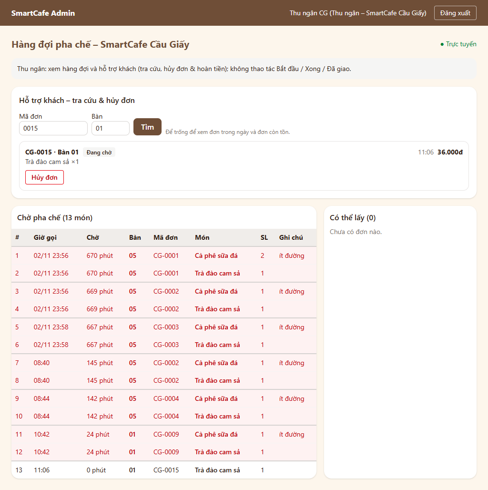
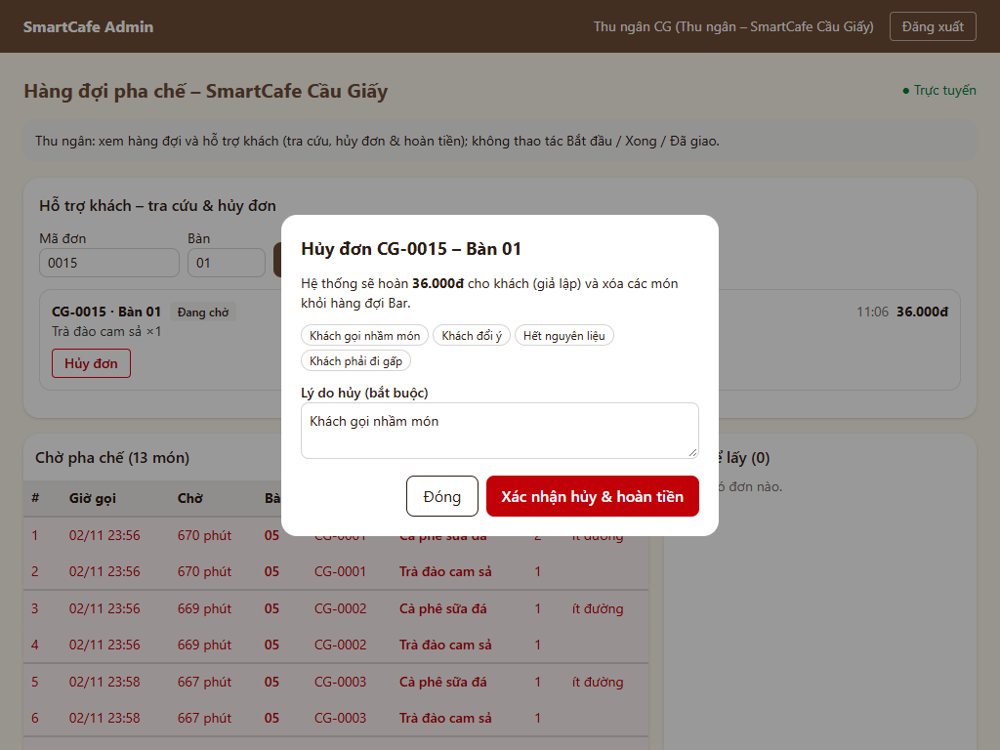
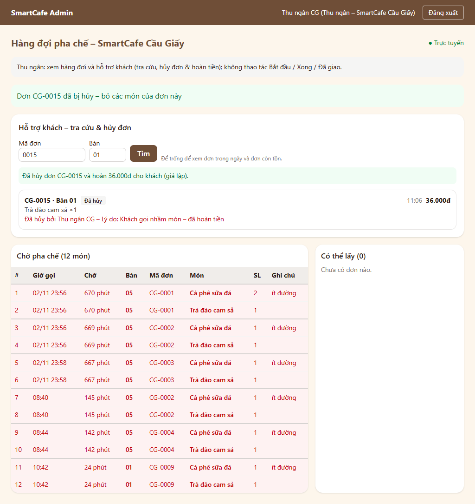
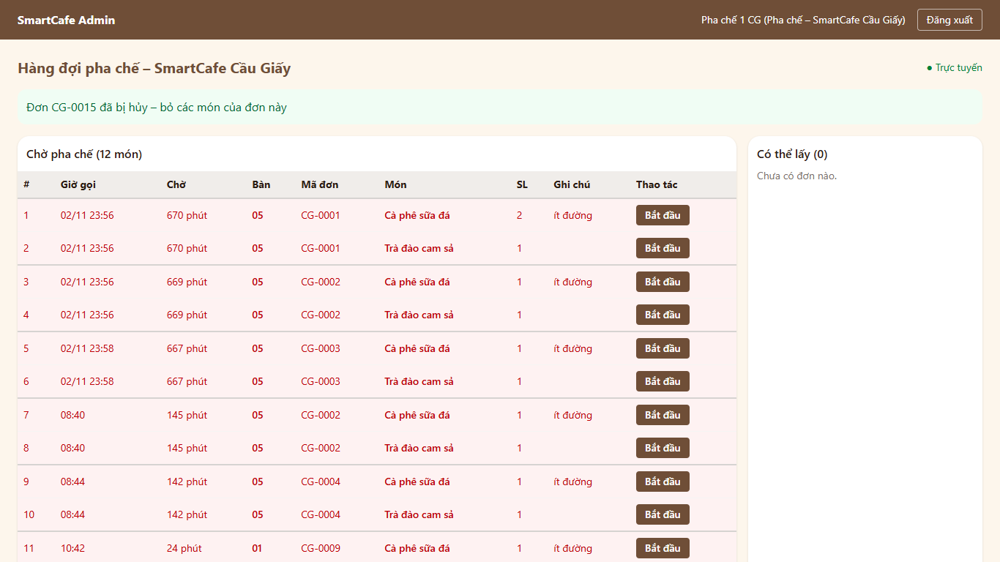
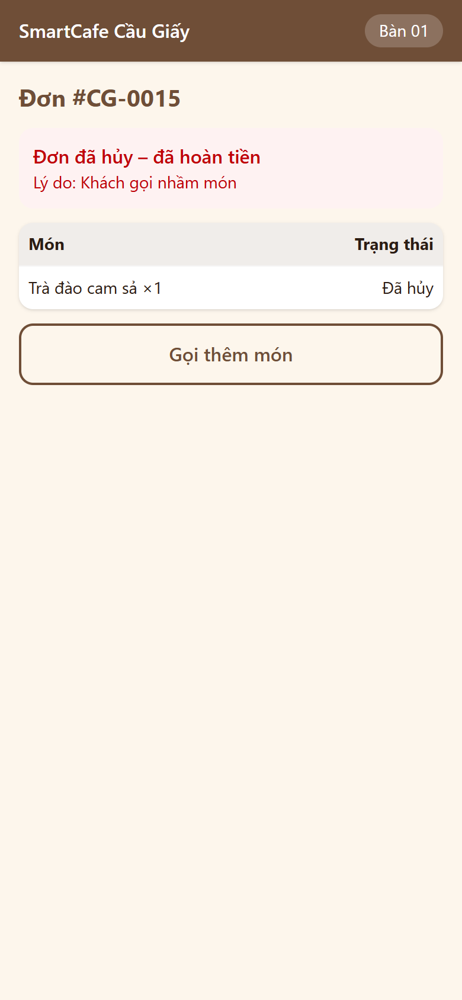

# BIÊN BẢN KIỂM THỬ – LUỒNG F5: THU NGÂN HỖ TRỢ KHÁCH (TRA CỨU, HỦY ĐƠN & HOÀN TIỀN)

## 1. Thông tin chung
| Mục | Nội dung |
|:---|:---|
| Dự án | SmartCafe – Phần mềm quản lý chuỗi quán cà phê thông minh (Nhóm 8) |
| Luồng | **F5 – Thu ngân hỗ trợ khách**: UC20 (tra cứu đơn, hủy đơn & hoàn tiền giả lập) – sơ đồ SD06 (phần hủy đơn), biểu đồ trạng thái đơn (PAID / PREPARING → CANCELLED) |
| Phiên bản | 0.5.0 – nhánh `feature/f5-thu-ngan` (tách từ `main` sau khi gộp F4, CR-35), mã nguồn `2.San_pham/smartcafe/` |
| Ngày kiểm thử | 03/11/2026 |
| Người lập biên bản | Thành viên D (Tester / QA) |
| Người duyệt | Thành viên A (PM) – đã duyệt 03/11/2026 (CR-36) |
| Tài liệu căn cứ | [III.1 UC20, ma trận RBAC, UC06 (đơn bị hủy)](../Thiet_ke_he_thong/III.1_Use_Case_Sequence.md), SD06, [III.2 quy tắc 6 (1 thanh toán / đơn)](../Thiet_ke_he_thong/III.2_Yeu_cau_phi_chuc_nang_Data_Model.md), [IV.2 W04](../Thiet_ke_he_thong/IV.2_Thiet_ke_giao_dien.md), [IV.3 API + WebSocket](../Thiet_ke_he_thong/IV.3_Kien_truc_va_API.md), [IV.1 bảng orders, payments, order_status_history](../Thiet_ke_he_thong/IV.1_Thiet_ke_CSDL.md); quyết định D5, D11, D19 |
| Tiền đề | F0 → F4 đạt ([F3](Bien_ban_kiem_thu_F3_Man_hinh_Bar.md), [F4](Bien_ban_kiem_thu_F4_OTP_Tich_diem.md)) |

## 2. Phạm vi
**Trong phạm vi**
- `GET /api/staff/orders/search?code=&table=`: tra cứu trong chi nhánh của nhân viên – đơn đã thanh toán **trong ngày** và đơn **ngày trước còn dở** (chờ / đang pha / có thể lấy – để xử lý đơn tồn, xem BUG-F3-02); lọc theo mã đơn (khớp một phần, không phân biệt hoa thường) và / hoặc số bàn.
- `POST /api/staff/orders/{id}/cancel {reason}`: chỉ đơn **PAID / PREPARING**; lý do bắt buộc 5–255 ký tự; hoàn tiền qua cổng thanh toán giả lập (`payments.status` → REFUNDED, `refunded_at`); đơn và mọi món → CANCELLED, ghi `cancel_reason`, `cancelled_by`, `cancelled_at`, lịch sử trạng thái (STAFF); cổng từ chối hoàn tiền thì không đổi gì.
- Phân quyền theo ma trận RBAC: **thu ngân, quản lý chi nhánh** được tra cứu / hủy; pha chế, quản trị viên không; chỉ trong chi nhánh của mình.
- Realtime: `ORDER_CANCELLED` tới màn hình Bar và trang theo dõi của khách, `QUEUE_POSITION` cho đơn phía sau.
- Đồng thời: thu ngân hủy đúng lúc pha chế bấm "Xong" món cuối; 2 người cùng hủy 1 đơn.
- Giao diện **W04**: khung "Hỗ trợ khách" (tìm theo mã / bàn, danh sách đơn, hộp xác nhận hủy có lý do nhanh và số tiền hoàn) – thu ngân ở trên cùng, quản lý ở dưới, pha chế không có.

**Ngoài phạm vi**: job tự hủy đơn chưa thanh toán sau 15 phút (D22 – chỉ mô tả, mức Could); hoàn tiền thật qua cổng thanh toán.

## 3. Môi trường & cách chạy
Giống [biên bản F2 – Mục 3](Bien_ban_kiem_thu_F2_Dat_mon_Thanh_toan.md#3-môi-trường--cách-chạy). Bản `docker compose up -d --build` mới (backend tự chạy migration `0003` của D31). E2E dùng 3 trình duyệt Edge cùng lúc: điện thoại khách (390×844), tablet thu ngân (1024×768), laptop pha chế (1366×768).
```powershell
cd backend;  .\.venv\Scripts\python -m pytest -v tests/f5
cd frontend; npx vitest run src/pages/admin/SupportPanel.test.tsx src/pages/admin/BarPage.test.tsx
cd backend;  .\.venv\Scripts\python -m scripts.smoke_test --qr-token <token bàn CG>
```

## 4. Danh sách test case

### 4.1. Backend – Tra cứu đơn (cấp: Tích hợp, PostgreSQL thật)
| Mã TC | Căn cứ | Mô tả / dữ liệu | Kết quả mong đợi | Kết quả thực tế | KQ | Test tự động |
|:---|:---|:---|:---|:---|:---:|:---|
| F5-01 | UC20 | 2 đơn đã thanh toán ở CG, 1 đơn CG chưa thanh toán, 1 đơn HD | Chỉ 2 đơn đã thanh toán của CG, mới thanh toán trước | Đúng | Đạt | `test_search.py::test_F5_01_...` |
| F5-02 | UC20 | Lọc `code=0002`, `code=cg-0001`, `table=06`, mã + bàn không khớp, mã không tồn tại | Đúng đơn; không phân biệt hoa thường; rỗng khi không khớp | Đúng | Đạt | `test_F5_02_...` |
| F5-03 | UC20, BUG-F3-02 | Đơn hôm qua còn chờ pha; đơn hôm qua đã giao; đơn hôm nay đã giao | Có đơn tồn hôm qua và đơn đã giao hôm nay; không có đơn đã giao hôm qua | Đúng (sau khi sửa dữ liệu test, xem Mục 6 – ghi chú) | Đạt | `test_F5_03_...` |
| F5-04 | UC20 | Đơn thành viên, 2 món (có ghi chú), trả thẻ | Đủ bàn, trạng thái, tổng, `is_member`, `can_cancel`, phương thức + mã giao dịch thanh toán, từng món | Đúng | Đạt | `test_F5_04_...` |
| F5-05a…d | RBAC | Thu ngân, quản lý, pha chế, quản trị viên tra cứu | 200 / 200 / 403 / 403 | Đúng | Đạt | `test_F5_05_...[4 tham số]` |
| F5-06 | NFR-S2 | Không đăng nhập; thu ngân HD tra đơn CG; mã đơn dài 21 ký tự | 401; danh sách rỗng; 422 | Đúng | Đạt | `test_F5_06_...` |
| F5-07 | UC20 | Tra cứu đơn đã hủy | `CANCELLED`, không được hủy nữa, lý do + người hủy + giờ hủy; thanh toán REFUNDED | Đúng | Đạt | `test_F5_07_...` |

### 4.2. Backend – Hủy đơn & hoàn tiền
| Mã TC | Căn cứ | Mô tả / dữ liệu | Kết quả mong đợi | Kết quả thực tế | KQ | Test tự động |
|:---|:---|:---|:---|:---|:---:|:---|
| F5-08 | UC20, SD06 | Thu ngân hủy đơn đang chờ (2 món), lý do có khoảng trắng thừa | 200: đơn + 2 món CANCELLED, thanh toán REFUNDED + `refunded_at`, lý do đã cắt khoảng trắng, `cancelled_by` = thu ngân; lịch sử PAID → CANCELLED (STAFF, staff_id); món rời hàng đợi Bar; khách xem đơn thấy CANCELLED + lý do, không còn vị trí hàng đợi | Đúng | Đạt | `test_cancel.py::test_F5_08_...` |
| F5-09 | UC20 | Quản lý hủy đơn đang pha (1 món đã xong, 1 món đang pha) | Mọi món CANCELLED, REFUNDED; pha chế bấm "Xong" món đó sau khi hủy → 409 | Đúng | Đạt | `test_F5_09_...` |
| F5-10a…d | UC20 ngoại lệ, biểu đồ trạng thái | Hủy đơn chưa thanh toán / có thể lấy / đã giao / đã hủy | 409 `CANNOT_CANCEL`, thông báo riêng từng trường hợp, `details.order_status`; dữ liệu không đổi | Đúng | Đạt | `test_F5_10_...[4 tham số]` |
| F5-11a…d | UC20 | Lý do rỗng, toàn khoảng trắng, 2 ký tự, 256 ký tự | 422 `VALIDATION_ERROR`; đơn vẫn PAID, thanh toán SUCCESS | Đúng | Đạt | `test_F5_11_...[4 tham số]` |
| F5-12a…c | RBAC | Pha chế, quản trị viên, thu ngân chi nhánh HD hủy đơn CG | 403 `FORBIDDEN`, đơn vẫn PAID | Đúng | Đạt | `test_F5_12_...[3 tham số]` |
| F5-13 | IV.3 Mục 2.4 | Đơn không tồn tại; không đăng nhập | 404 `ORDER_NOT_FOUND`; 401 | Đúng | Đạt | `test_F5_13_...` |
| F5-14 | NFR-M4 | Cổng thanh toán từ chối hoàn tiền | 502 `REFUND_FAILED`; cổng được gọi đúng mã giao dịch + số tiền; đơn, món, thanh toán **không đổi** | Đúng | Đạt | `test_F5_14_...` |
| F5-15 | D11 | Hủy đơn thành viên (khách đang có 7 điểm) | Không có giao dịch điểm, điểm vẫn 7, W03 `points_earned` null | Đúng | Đạt | `test_F5_15_...` |
| F5-16 | SD06, UC06 | Màn hình Bar + trang theo dõi của đơn bị hủy + đơn phía sau đang mở | Bar nhận `ORDER_CANCELLED {order_id, order_code}`; khách nhận `ORDER_CANCELLED` kèm lý do; đơn phía sau nhận `QUEUE_POSITION` 2 → 1 | Đúng | Đạt | `test_F5_16_...` |

### 4.3. Backend – Đồng thời (mỗi bên một kết nối CSDL thật)
| Mã TC | Căn cứ | Mô tả / dữ liệu | Kết quả mong đợi | Kết quả thực tế | KQ | Test tự động |
|:---|:---|:---|:---|:---|:---:|:---|
| F5-17 | Toàn vẹn dữ liệu | **5 vòng**: thu ngân hủy đúng lúc pha chế bấm "Xong" món cuối | Mỗi vòng nhất quán: hoặc (hủy thành công, món CANCELLED, REFUNDED, hoàn tiền 1 lần, pha chế nhận 409) hoặc (pha chế thắng, đơn READY, thanh toán SUCCESS, thu ngân nhận `CANNOT_CANCEL`, không hoàn tiền) | Đúng | Đạt | `test_concurrency.py::test_F5_17_...` |
| F5-18 | Toàn vẹn dữ liệu | Thu ngân và quản lý cùng hủy 1 đơn | 1 thành công + 1 `CANNOT_CANCEL`; **cổng hoàn tiền chỉ được gọi 1 lần** | Đúng | Đạt | `test_F5_18_...` |

*Kiểm chứng test đồng thời có hiệu lực: tạm bỏ khóa `FOR UPDATE` trên `orders` và `payments` thì cả F5-17 và F5-18 báo đỏ (chạy 3 lần đều đỏ); đã khôi phục khóa, chạy lại 3 lần đều xanh.*

### 4.4. Frontend – W04 khung "Hỗ trợ khách" (cấp: Giao diện, API và WebSocket giả lập)
| Mã TC | Căn cứ | Mô tả | Kết quả mong đợi | KQ | Test tự động |
|:---|:---|:---|:---|:---:|:---|
| F5-FE-01 | IV.2 W04 | Thu ngân mở `/admin/bar` | Khung "Hỗ trợ khách" đứng trước bảng hàng đợi, tự tải đơn (kèm `Bearer`); dòng "CG-0002 · Bàn 05 · Đang chờ (thành viên) · 86.000đ · Cà phê sữa đá ×2"; chỉ đơn đang chờ có nút "Hủy đơn", đơn "Có thể lấy" không có | Đạt | `SupportPanel.test.tsx` |
| F5-FE-02 | UC20 | Tìm theo mã `0001`; tìm theo bàn `07` | Gọi đúng `?code=0001`, `?table=07`; hiện đúng đơn / "Không tìm thấy đơn phù hợp." | Đạt | 〃 |
| F5-FE-03 | UC20, SD06 | Bấm "Hủy đơn", nhập "ab" rồi chọn lý do nhanh "Khách đổi ý", xác nhận | Hộp thoại nêu "hoàn 86.000đ cho khách"; nút xác nhận khóa khi lý do < 5 ký tự; gửi `{reason: "Khách đổi ý"}` kèm `Bearer`; báo "Đã hủy đơn CG-0002 và hoàn 86.000đ…"; dòng đơn hiện "Đã hủy bởi Thu ngân CG – Lý do: Khách đổi ý – đã hoàn tiền", mất nút hủy | Đạt | 〃 |
| F5-FE-04 | UC20 ngoại lệ | Server trả 409 (đơn vừa "Có thể lấy") | Lỗi hiện trong hộp thoại, hộp thoại không tự đóng; bấm "Đóng" thì đóng | Đạt | 〃 |
| F5-FE-05 | SD06 | Màn hình nhận `ORDER_CANCELLED` (người khác vừa hủy) | Báo "Đơn CG-0002 đã bị hủy – bỏ các món của đơn này", tải lại danh sách tra cứu | Đạt | 〃 |
| F5-FE-06 | RBAC, IV.2 | Quản lý chi nhánh mở W04 | Không có dòng "Thu ngân: …"; có khung hỗ trợ khách ở **dưới** bảng hàng đợi, có nút hủy | Đạt | 〃 |
| F5-FE-07 | RBAC | Pha chế mở W04 | Không có khung hỗ trợ khách, không gọi API tra cứu | Đạt | 〃 |
| F5-FE-08 | UC20 | API tra cứu trả lỗi | Hiện thông báo lỗi trong khung | Đạt | 〃 |
| F5-FE-09 | UC20 | Đơn đã hủy từ trước | Hiện người hủy, lý do, "đã hoàn tiền"; không có nút hủy | Đạt | 〃 |
| F5-FE-10 | Hồi quy BUG-F5-01 | Hủy thành công nhưng lần tải lại danh sách sau đó không về được | Dòng đơn vẫn đổi ngay sang "Đã hủy…" và mất nút "Hủy đơn" (lấy từ kết quả trả về) | Đạt | 〃 |

*F3-FE-10 (W04 – thu ngân) được sửa câu kiểm tra dòng chú thích: từ "Chế độ xem: thu ngân chỉ xem hàng đợi" thành "Thu ngân: xem hàng đợi và hỗ trợ khách…" vì F5 bổ sung quyền tra cứu / hủy đơn cho thu ngân theo UC20; các kiểm tra "không có nút Bắt đầu / Xong / Đã giao" giữ nguyên.*

### 4.5. Kiểm thử khói trên hệ thống chạy thật (qua Nginx, `docker compose`)
| Mã TC | Mô tả | Kết quả thực tế | KQ |
|:---|:---|:---|:---:|
| SM-32 | Thu ngân `tn_cg` tra cứu đơn vừa thanh toán theo mã: PAID, được phép hủy | CG-0012 | Đạt |
| SM-33 | Pha chế gọi API hủy đơn → 403 | 403 | Đạt |
| SM-34 | Thu ngân hủy & hoàn tiền → trang theo dõi của khách nhận "Đơn đã hủy" kèm lý do ≤ 2 giây | **70 ms**, thanh toán REFUNDED | Đạt |
| SM-35 | Màn hình Bar nhận `ORDER_CANCELLED` | Đúng đơn | Đạt |
| SM-36 | Món của đơn đã hủy rời hàng đợi Bar | Đúng | Đạt |
| SM-37 | Hủy lần 2 → 409 `CANNOT_CANCEL` | Đúng | Đạt |

Log: [logs/F5_smoke_test.txt](logs/F5_smoke_test.txt) (chạy cả SM-01…37, **37/37 đạt**; backend tự chạy migration `0003` khi khởi động – đã kiểm trong `docker compose logs backend`).

### 4.6. Kiểm thử đầu-cuối trên trình duyệt (Playwright + Edge, 3 thiết bị cùng lúc)
| Mã TC | Mô tả | Kết quả thực tế | KQ |
|:---|:---|:---|:---:|
| E2E-36 | Khách đặt 1 món trên điện thoại; thu ngân đăng nhập tablet → W04 có khung "Hỗ trợ khách" ở trên, có đơn vừa đặt | CG-0015 | Đạt |
| E2E-37 | Tìm theo mã đơn + bàn → đúng 1 đơn "Đang chờ", có nút "Hủy đơn" | Đúng | Đạt |
| E2E-38 | W04 của thu ngân không tràn ngang ở 1024px | Đúng | Đạt |
| E2E-39 | Hộp xác nhận nêu số tiền hoàn; chưa có lý do thì không bấm xác nhận được | Đúng | Đạt |
| E2E-40 | Xác nhận hủy → thông báo hoàn tiền, dòng đơn "Đã hủy bởi … – Lý do … – đã hoàn tiền" | Đúng (sau khi sửa BUG-F5-01) | Đạt |
| E2E-41 | Laptop pha chế: hiện "Đơn … đã bị hủy", món rời hàng đợi, không tải lại trang | Đúng | Đạt |
| E2E-42 | Điện thoại khách tự hiện "Đơn đã hủy – đã hoàn tiền" + "Lý do: Khách gọi nhầm món" | Đúng | Đạt |
| E2E-43 | Đơn thứ 2 được pha chế làm xong ("Có thể lấy") → thu ngân tra cứu thấy "Có thể lấy", không có nút hủy | CG-0016 | Đạt |

Log: [logs/F5_e2e_trinh_duyet.txt](logs/F5_e2e_trinh_duyet.txt). Ảnh chụp:

| Màn hình | Ảnh |
|:---|:---|
| W04 thu ngân – tra cứu theo mã + bàn (tablet 1024px) |  |
| W04 – hộp xác nhận hủy & hoàn tiền |  |
| W04 – sau khi hủy |  |
| W04 pha chế – nhận thông báo hủy |  |
| W03 điện thoại khách – đơn đã hủy |  |

## 5. Tổng hợp kết quả
| Nhóm | Số ca | Đạt | Không đạt |
|:---|:---:|:---:|:---:|
| Backend (pytest, `tests/f5`) | 29 | 29 | 0 |
| Frontend (Vitest: khung Hỗ trợ khách trên W04) | 10 | 10 | 0 |
| Kiểm thử khói (SM-32…37) | 6 | 6 | 0 |
| Kiểm thử đầu-cuối trên trình duyệt (E2E-36…43) | 8 | 8 | 0 |
| **Tổng F5** | **53** | **53** | **0** |
| *Hồi quy F0 → F4 (backend 188, frontend 78, SM-01…31) – sau cả thay đổi D31* | *297* | *297* | *0* |

*E2E-01…35 của các luồng trước không chạy lại bằng trình duyệt ở F5; các luồng đó được hồi quy bằng test backend / frontend và SM-01…31. E2E-36…43 đi lại các bước đặt món (F2), màn hình Bar (F3) trên bản build mới.*

**Độ bao phủ mã** (log: [logs/F5_backend_pytest.txt](logs/F5_backend_pytest.txt), [logs/F5_frontend_vitest.txt](logs/F5_frontend_vitest.txt)):
| Phần | Câu lệnh | Ghi chú |
|:---|:---:|:---|
| `app/modules/support` (router, service, schemas) | **100%** | |
| Backend toàn bộ | 87% | Phần chưa phủ chủ yếu là `scripts/smoke_test.py` (công cụ kiểm thử khói, không chạy trong pytest) |
| Frontend toàn bộ | 99,1% (nhánh 93,7%) | `SupportPanel` 100%, `api/support.ts` 100%, `BarPage` 100% |

## 6. Lỗi phát hiện
| Mã lỗi | Mức độ | Mô tả | Phát hiện bởi | Nguyên nhân | Cách sửa | Kiểm tra lại | Trạng thái |
|:---|:---|:---|:---|:---|:---|:---|:---|
| BUG-F5-01 | Thấp | Ngay sau khi hủy thành công, dòng đơn trong khung "Hỗ trợ khách" vẫn hiện "Đang chờ" và nút "Hủy đơn" cho tới khi danh sách tải lại xong – thu ngân có thể bấm hủy lần 2 (server trả 409) và hiểu nhầm là chưa hủy được | E2E-40 (ảnh chụp ngay sau thông báo vẫn còn nút hủy) | Giao diện chỉ dựa vào lần tải lại danh sách, không dùng kết quả hủy server đã trả về | Cập nhật ngay dòng đơn từ kết quả của API hủy, rồi mới tải lại | F5-FE-10 (đã kiểm: bỏ phần sửa thì test đỏ), E2E-40 đạt | Đã đóng |

*Ghi chú: F5-03 lần chạy đầu lỗi `UniqueViolation (order_code, order_date)` do **dữ liệu test** (chuyển 2 đơn cùng mã CG-0001 về hôm qua lần lượt), không phải lỗi sản phẩm; đã sửa thứ tự tạo dữ liệu trong test.*

## 7. Tồn tại / ghi chú
- **Phạm vi tra cứu** (chi tiết không có trong thiết kế, đã cài theo hướng hỗ trợ khách tại quầy): đơn trong ngày + đơn ngày trước còn dở, tối đa 50 đơn; không tra cứu đơn chưa thanh toán (chưa phát sinh tiền, hệ thống tự hủy theo D22). Đơn tồn từ hôm trước (BUG-F3-02) giờ đã hủy & hoàn tiền được từ khung này.
- **Lý do hủy** bắt buộc 5–255 ký tự, có 4 lý do nhanh ("Khách gọi nhầm món", "Khách đổi ý", "Hết nguyên liệu", "Khách phải đi gấp") để thu ngân bấm chọn.
- **Hoàn tiền giả lập** luôn thành công (MockPaymentGateway); nhánh cổng từ chối đã kiểm bằng cổng giả (F5-14). Mã lỗi mới `REFUND_FAILED` (502) – đã bổ sung vào IV.3.
- Khóa dòng `orders` (dùng chung với màn hình Bar) + `payments` khi hủy: hủy đồng thời với "Xong" / hủy 2 lần đều nhất quán, hoàn tiền đúng 1 lần (F5-17, F5-18).
- CSDL demo trên laptop đang có nhiều đơn thử từ các lần kiểm thử (nhiều đơn tồn tô đỏ trên W04). Trước buổi demo nên làm sạch bằng `docker compose down -v` rồi `up -d` (nạp lại dữ liệu mẫu), hoặc dùng chính khung "Hỗ trợ khách" để hủy các đơn tồn.
- API bổ sung so với IV.3: phạm vi và dữ liệu trả về của tra cứu, ràng buộc lý do, dữ liệu `ORDER_CANCELLED` trên kênh Bar, `REFUND_FAILED` – đã cập nhật [IV.3](../Thiet_ke_he_thong/IV.3_Kien_truc_va_API.md); mô tả khung "Hỗ trợ khách" – đã cập nhật [IV.2 W04](../Thiet_ke_he_thong/IV.2_Thiet_ke_giao_dien.md).

## 8. Kết luận
**Luồng F5: ĐẠT.** 53/53 ca kiểm thử đạt, hồi quy F0 → F4 297/297 đạt; 1 lỗi (mức Thấp) đã sửa, có test hồi quy. Đủ điều kiện chuyển sang **F6 – Quản trị** khi PM duyệt.

| Vai trò | Họ tên | Ngày | Ký xác nhận |
|:---|:---|:---|:---|
| Người lập (Tester / QA) | Thành viên D | 03/11/2026 | |
| PM duyệt | Thành viên A | 03/11/2026 | |
