# BIÊN BẢN KIỂM THỬ – LUỒNG F6: QUẢN TRỊ (DANH MỤC, MÓN, CHI NHÁNH, NHÂN VIÊN, MENU CHI NHÁNH, BÀN & QR, KHUYẾN MÃI)

## 1. Thông tin chung
| Mục | Nội dung |
|:---|:---|
| Dự án | SmartCafe – Phần mềm quản lý chuỗi quán cà phê thông minh (Nhóm 8) |
| Luồng | **F6 – Quản trị**: UC09 (danh mục), UC10 (món – menu chung), UC11 (chi nhánh), UC12 (nhân viên & phân quyền), UC13 (menu chi nhánh), UC14 (bàn & mã QR), UC15 (khuyến mãi) – sơ đồ SD05; màn hình A03–A06, W05–W07; sự kiện `MENU_UPDATED` (UC03 – Quy tắc) |
| Phiên bản | 0.6.0 – nhánh `feature/f6-quan-tri` (tách từ `main` sau khi gộp F5, CR-36), mã nguồn `2.San_pham/smartcafe/` |
| Ngày kiểm thử | 03/11/2026 |
| Người lập biên bản | Thành viên D (Tester / QA) |
| Người duyệt | Thành viên A (PM) – đã duyệt 03/11/2026 (CR-37) |
| Tài liệu căn cứ | [III.1 UC09–UC15, ma trận RBAC, UC03](../Thiet_ke_he_thong/III.1_Use_Case_Sequence.md), SD05, [III.2 NFR-S1, S2, S3, S5; quy tắc dữ liệu 2.2](../Thiet_ke_he_thong/III.2_Yeu_cau_phi_chuc_nang_Data_Model.md), [IV.1 bảng categories, menu_items, branches, staff, branch_menu_items, dining_tables, promotions, promotion_items](../Thiet_ke_he_thong/IV.1_Thiet_ke_CSDL.md), [IV.2 A03–A06, W05–W07](../Thiet_ke_he_thong/IV.2_Thiet_ke_giao_dien.md), [IV.3 API + WebSocket](../Thiet_ke_he_thong/IV.3_Kien_truc_va_API.md); quyết định D3, D10, D14, D16, D27 |
| Tiền đề | F0 → F5 đạt ([F5](Bien_ban_kiem_thu_F5_Thu_ngan.md)) |

## 2. Phạm vi
**Trong phạm vi**
- API quản trị `/api/staff/categories`, `/menu-items` (+ upload ảnh), `/branches`, `/staff`, `/branches/{id}/menu`, `/branches/{id}/tables`, `/tables/{id}/qr.png`, `/promotions` – kiểm tra dữ liệu vào, quy tắc nghiệp vụ, phân quyền theo ma trận RBAC.
- Kênh realtime công khai `/ws/menu/{branch_id}`: `MENU_UPDATED` khi đổi món / danh mục / chi nhánh / menu chi nhánh / khuyến mãi; menu khách (W01) tự tải lại.
- Đồng thời: 2 quản lý sửa cùng 1 món của chi nhánh; 2 người tạo trùng tên / số bàn / tên đăng nhập cùng lúc; 2 quản trị viên sửa cùng 1 KM.
- Giao diện Web Admin: menu trái theo vai trò, chặn mở màn hình sai quyền bằng URL; A03, A04, A05, W05, W06, A06 (xem / tải / in QR), W07.

**Ngoài phạm vi**: W08 dashboard (F8); thẻ tags dùng cho gợi ý món (F7 – F6 chỉ nhập và lưu).

## 3. Môi trường & cách chạy
Giống [biên bản F2 – Mục 3](Bien_ban_kiem_thu_F2_Dat_mon_Thanh_toan.md#3-môi-trường--cách-chạy). Bản `docker compose up -d --build` mới: backend thêm thư viện `python-multipart`, `qrcode[pil]`, phông `fonts-dejavu-core`; volume `uploads` lưu ảnh món. E2E dùng Edge: 2 laptop 1366×800 (quản trị viên, quản lý CG), điện thoại khách 390×844 đang mở menu bàn CG 01, tablet 1024×768 (pha chế mới tạo).
```powershell
cd backend;  .\.venv\Scripts\python -m pytest -v tests/f6
cd frontend; npx vitest run src/pages/admin/AdminPages.test.tsx src/pages/admin/AdminPages2.test.tsx
cd backend;  .\.venv\Scripts\python -m scripts.smoke_test --qr-token <token bàn CG>
```

## 4. Danh sách test case

### 4.1. Backend – Danh mục & món (cấp: Tích hợp, PostgreSQL thật) – `tests/f6/test_catalog.py`
| Mã TC | Căn cứ | Mô tả / dữ liệu | Kết quả mong đợi | KQ |
|:---|:---|:---|:---|:---:|
| F6-01 | UC09 | Tạo "  Đá   xay " thứ tự 3, sửa ẩn; xem danh sách | Tên đã gọn khoảng trắng; danh sách theo thứ tự, đếm số món (không tính món đã xóa) | Đạt |
| F6-02a…c | UC09 | Tạo / sửa tên trùng "Cà phê", "cà PHÊ", "  Cà  phê " | 409 `DUPLICATE_VALUE` (không phân biệt hoa thường, khoảng trắng) | Đạt |
| F6-03a…d | NFR-S5 | Tên rỗng, toàn khoảng trắng, 51 ký tự, thứ tự âm | 422 | Đạt |
| F6-04 | UC09 | Xóa danh mục trống; còn 2 món; chỉ còn món đã xóa mềm; không tồn tại | 204; 409 `CATEGORY_IN_USE` (`item_count` 2); 409 "chỉ có thể ẩn"; 404 | Đạt |
| F6-05 | UC03 | Ẩn danh mục Trà | Menu khách không còn món của danh mục Trà | Đạt |
| F6-06 | UC10, D16 | Tạo món, tags " Matcha ", "SWEET", trùng, rỗng | 201; tags chuẩn hóa `["matcha","sweet"]`; menu khách **mọi chi nhánh** có món, nhãn MỚI | Đạt |
| F6-07 | UC10 | Sửa giá chung 29.000 → 32.000; ẩn món | Menu khách giá mới; ẩn thì biến mất; lọc `status=hidden` thấy món | Đạt |
| F6-08 | III.2 – 2.2 | Xóa món đã có trong đơn | Xóa mềm; biến mất khỏi menu + danh sách quản trị; **đơn cũ vẫn xem đủ tên món**; sửa / xóa lại → 404; tạo món mới trùng tên món đã xóa → được | Đạt |
| F6-09a…g | NFR-S5 | Tên rỗng / 101 ký tự, giá âm / > 10 triệu, loại nhiệt sai, thẻ > 30 ký tự, > 10 thẻ | 422, chỉ đúng trường lỗi | Đạt |
| F6-10 | UC10 | Tạo / sửa trùng tên món; danh mục không tồn tại | 409 (`field = name`); 404 `CATEGORY_NOT_FOUND` | Đạt |
| F6-11 | UC10 | Lọc danh sách theo danh mục / trạng thái; trạng thái sai | Sắp theo danh mục, tên tiếng Việt; 422 | Đạt |
| F6-12a…c | W05 | Upload ảnh PNG / JPG / WEBP (tên file `.bin`) | Nhận diện theo nội dung; lưu file, `image_url = /api/uploads/menu/{id}-….{đuôi}`; menu khách có ảnh | Đạt |
| F6-13 | W05 | Upload ảnh lần 2 | Tên file mới (tránh cache), **ảnh cũ bị xóa** | Đạt |
| F6-14a…c | NFR-S5 | GIF; file HTML đổi đuôi `.png`; PNG > 2 MB | 422 / 422 / 413 `INVALID_IMAGE`; không ghi file nào | Đạt |

### 4.2. Backend – Chi nhánh, menu chi nhánh, bàn & QR – `tests/f6/test_branches.py`
| Mã TC | Căn cứ | Mô tả / dữ liệu | Kết quả mong đợi | KQ |
|:---|:---|:---|:---|:---:|
| F6-15 | UC11 | Tạo chi nhánh mã "td"; tạo mã "CG" đã có | 201, mã thành "TD"; 409 (`field = code`) | Đạt |
| F6-16a…h | NFR-S5 | Mã 1 ký tự / có dấu "-" / 11 ký tự, tên rỗng, địa chỉ trắng, SĐT sai, vĩ độ 91, kinh độ −181 | 422 | Đạt |
| F6-17 | UC11, UC01-2a | Sửa chi nhánh (gửi kèm mã "ZZ"), ngừng hoạt động | Mã giữ "CG"; quét QR bàn của chi nhánh → 404; menu khách 404; chi nhánh không tồn tại → 404 | Đạt |
| F6-18 | RBAC | Quản trị viên / quản lý xem danh sách | Quản trị viên: CG, HD; quản lý: chỉ CG, số nhân viên đang làm = 3 | Đạt |
| F6-19 | UC13 | Menu chi nhánh có giá riêng 39.000, món tạm hết | Đủ món, giá chung + giá riêng + còn hàng; món chưa cấu hình: giá riêng null, còn hàng | Đạt |
| F6-20 | UC13, SD05, UC05-3a | Đặt giá riêng 39.000; bỏ giá riêng + tắt còn hàng | Menu khách CG giá 39.000, HD vẫn 45.000; sau đó 45.000 + Tạm hết; khách đặt món đó → 409 `ITEM_UNAVAILABLE` | Đạt |
| F6-21a…c | NFR-S5 | Giá riêng âm / > 10 triệu; còn hàng không phải boolean | 422 | Đạt |
| F6-22 | RBAC | Món không tồn tại / đã ẩn toàn chuỗi; quản lý CG sửa menu HD; quản trị viên sửa menu HD | 404 `MENU_ITEM_NOT_FOUND`; 403; 200 | Đạt |
| F6-23 | UC14, NFR-S3 | Thêm bàn " 12 "; trùng "05"; "05" ở chi nhánh khác | 201, `qr_token` ≥ 22 ký tự ngẫu nhiên, `qr_url` đúng, khách quét được ngay; 409; 201 | Đạt |
| F6-24a…d | NFR-S5 | Số bàn rỗng, có dấu cách, 11 ký tự, có "/" | 422 | Đạt |
| F6-25 | UC14 | Đổi số bàn 05 → "5a"; trùng 06; khóa bàn; bàn chi nhánh khác | "5A", **giữ nguyên mã QR**; 409; quét QR → 404; 403 / 404 | Đạt |
| F6-26 | A06 | Bàn 10, 2, 1, 05 | Sắp 1, 2, 05, 10 (theo số, không theo chữ) | Đạt |
| F6-27 | UC14 | Tải `qr.png` | PNG, tên file `QR_CG_Ban_05.png`, có dòng chữ dưới mã; **so từng ô của mã QR trong ảnh với ma trận QR của URL bàn: khớp hoàn toàn** | Đạt |
| F6-28 | RBAC | Quản lý CG tải QR bàn HD; quản trị viên; bàn không tồn tại; không đăng nhập | 403; 200; 404; 401 | Đạt |
| F6-61 | Hồi quy BUG-F6-01 | Phông chữ dưới mã QR | Có đủ chữ "à ạ ư ơ đ À Đ" (không vẽ ô vuông); kiểm chứng phông mặc định của Pillow đúng là thiếu "à" | Đạt |
| F6-62 | BUG-F6-01 | Máy không có phông tiếng Việt | Bỏ dấu "CG - Ban 05" thay vì ô vuông, vẫn tạo được PNG | Đạt |

### 4.3. Backend – Nhân viên – `tests/f6/test_staff.py`
| Mã TC | Căn cứ | Mô tả / dữ liệu | Kết quả mong đợi | KQ |
|:---|:---|:---|:---|:---:|
| F6-29 | UC12, NFR-S1 | Quản trị viên tạo " PC_Moi " (pha chế CG) | 201, tên đăng nhập "pc_moi"; không trả mật khẩu; đăng nhập được ngay; mật khẩu lưu bcrypt cost 12 | Đạt |
| F6-30 | UC12, ràng buộc `chk_staff_branch` | Quản trị viên có / không chi nhánh; pha chế không chi nhánh; chi nhánh không tồn tại; "TN_CG" đã có | 201; 422; 422 (`field = branch_id`); 404; 409 (`field = username`) | Đạt |
| F6-31a…g | NFR-S5 | Tên đăng nhập 2 ký tự / có dấu / 51 ký tự, mật khẩu 7 ký tự, họ tên trắng, vai trò lạ, SĐT sai | 422 | Đạt |
| F6-32 | RBAC | Quản lý tạo thu ngân (không gửi chi nhánh); tạo quản lý / quản trị viên / pha chế chi nhánh HD | 201, mặc định chi nhánh mình; 403 cả 3 | Đạt |
| F6-33 | RBAC | Quản lý xem danh sách (kể cả gửi `branch_id` HD); sửa pha chế CG; sửa nhân viên HD, quản lý HD, quản trị viên; nâng thu ngân lên quản lý; chuyển sang HD | Chỉ 3 người CG; 200; 403 cho các trường hợp còn lại | Đạt |
| F6-34 | UC12 | Quản trị viên xem / lọc chi nhánh HD + Pha chế | 6 người, trụ sở đứng đầu; đúng `pc_hd` | Đạt |
| F6-35 | UC12, NFR-S2 | Khóa pha chế đang đăng nhập; mở khóa | **Token cũ bị từ chối ngay (401)**; đăng nhập → 403 `ACCOUNT_LOCKED`; mở khóa đăng nhập lại được | Đạt |
| F6-36 | UC12 | Đặt lại mật khẩu; lần sửa sau không gửi mật khẩu | Mật khẩu cũ hết hiệu lực, mới dùng được; không gửi = giữ nguyên | Đạt |
| F6-37a…e | UC12 | Quản trị viên tự khóa / tự hạ vai trò; quản lý tự khóa / đổi vai trò / đổi chi nhánh | 409 `CANNOT_MODIFY_SELF` | Đạt |
| F6-38 | UC12 | Quản lý tự đổi họ tên + mật khẩu; nhân viên không tồn tại | 200, đăng nhập bằng mật khẩu mới; 404 | Đạt |

### 4.4. Backend – Khuyến mãi – `tests/f6/test_promotions.py`
| Mã TC | Căn cứ | Mô tả / dữ liệu | Kết quả mong đợi | KQ |
|:---|:---|:---|:---|:---:|
| F6-39 | UC15, SD05 | KM CG: Trà đào 45.000 → 36.000, đang chạy | 201, `running`, giảm 20%; menu khách CG có giá KM + `promotion_id`, HD không; đơn 2 ly: giảm 18.000, tổng 72.000 | Đạt |
| F6-40 | UC15 | KM toàn chuỗi | Cả CG và HD có giá KM | Đạt |
| F6-41 | UC15 | KM bắt đầu ngày mai | `upcoming`, menu khách chưa có giá KM (tự có hiệu lực theo giờ) | Đạt |
| F6-42a…c | UC15 | Kết thúc trước / bằng bắt đầu; đã kết thúc | 422 `PROMOTION_INVALID`, `field = end_at` | Đạt |
| F6-43 | UC15 | Giá KM = giá bán; KM CG 40.000 khi CG có giá riêng 39.000; cùng giá đó cho HD / toàn chuỗi | 422 kèm tên món + giá hiện tại "45.000đ"; 422; 201; 201 | Đạt |
| F6-44 | D27 | CG giá riêng 35.000, KM toàn chuỗi 40.000 | CG bán 35.000 **không nhãn KM**; HD 40.000 có nhãn KM | Đạt |
| F6-45a…e | NFR-S5 | Tên rỗng, không món, giá âm, giờ thiếu múi giờ, mô tả 256 ký tự | 422 `VALIDATION_ERROR` | Đạt |
| F6-46 | UC15 | Món trùng trong 1 KM; món không tồn tại; chi nhánh không tồn tại | 422; 422 kèm `menu_item_id`; 404 | Đạt |
| F6-47 | UC15 | Sửa KM đang chạy: đổi tên, đổi giá 1 món, bỏ 1 món, thêm 1 món | Danh sách món đúng bản mới; menu khách cập nhật (món bị bỏ hết KM) | Đạt |
| F6-48 | UC15 | Tắt KM; sửa KM đã kết thúc; KM không tồn tại | Menu khách hết giá KM; 409 `PROMOTION_ENDED`; 404 | Đạt |
| F6-49 | W07 | 3 KM đang chạy / sắp chạy (HD) / đã kết thúc; lọc theo tab và chi nhánh | Mỗi tab đúng 1 KM; lọc CG = toàn chuỗi + KM của CG; trạng thái sai → 422; xem chi tiết đúng | Đạt |

### 4.5. Backend – Phân quyền & realtime – `tests/f6/test_rbac_realtime.py`
| Mã TC | Căn cứ | Mô tả | Kết quả mong đợi | KQ |
|:---|:---|:---|:---|:---:|
| F6-50 (30 ca) | RBAC | 10 thao tác chỉ dành cho quản trị viên × quản lý / thu ngân / pha chế | 403 `FORBIDDEN` | Đạt |
| F6-51 (10 ca) | RBAC | 10 thao tác đó với quản trị viên | 200 / 201 / 204 | Đạt |
| F6-52 (40 ca) | RBAC | 10 thao tác của quản trị viên + quản lý × 4 vai trò | Quản trị viên, quản lý: được; thu ngân, pha chế: 403 | Đạt |
| F6-53a…c | RBAC | Quản lý CG xem menu / bàn, thêm bàn của HD | 403 | Đạt |
| F6-54 | NFR-S2 | Không đăng nhập; dùng token khách thành viên | 401; 403 | Đạt |
| F6-55 | UC03 | Mở `/ws/menu/` chi nhánh không tồn tại / ngừng hoạt động | Đóng mã 4404 | Đạt |
| F6-56 | UC03 | Mở menu CG và HD; quản lý sửa menu CG; quản trị viên thêm danh mục | CG nhận `MENU_UPDATED {branch_id: CG, reason: BRANCH_MENU}`, HD không; thay đổi toàn chuỗi thì cả 2 nhận; đóng kết nối thì hết người nghe | Đạt |
| F6-57a…e | UC03 | Sửa món, xóa món, KM toàn chuỗi, KM chi nhánh HD, sửa chi nhánh HD | Menu HD nhận `MENU_UPDATED` đúng lý do | Đạt |

### 4.6. Backend – Đồng thời (API thật, mỗi request một kết nối CSDL) – `tests/f6/test_concurrency.py`
| Mã TC | Mô tả | Kết quả mong đợi | KQ |
|:---|:---|:---|:---:|
| F6-58 | **5 vòng**: 2 quản lý cùng lúc sửa 1 món của chi nhánh (giá riêng vs tắt còn hàng) | Cả 2 nhận 200; chỉ **1 dòng** `branch_menu_items`, nội dung đúng 1 trong 2 bản (UPSERT) | Đạt |
| F6-59 | **5 vòng** × 3: 2 người cùng tạo danh mục trùng tên / bàn trùng số / tên đăng nhập trùng | Mỗi lần đúng 1 × 201 + 1 × 409 (không 500); cuối cùng đúng 5 bản ghi mỗi loại | Đạt |
| F6-60 | **10 vòng**: KM đang có 1 món [A]; 2 quản trị viên cùng lúc thay bằng [B, C] và [C, D] | Cả 2 nhận 200; danh sách món đúng 1 trong 2 bản, **không trộn** | Đạt |

*Kiểm chứng test có hiệu lực: tạm bỏ khóa dòng `FOR UPDATE` của KM thì F6-60 đỏ (3/3 lần); bỏ bước bắt lỗi UNIQUE thì F6-59 đỏ (3/3 lần, trả 500). Đã khôi phục, chạy lại đều xanh. Lần kiểm chứng đầu, F6-60 bản cũ (5 vòng, 2 danh sách không chung món) vẫn xanh khi bỏ khóa – test chưa đủ nhạy nên đã viết lại như trên.*

### 4.7. Frontend – Web Admin (cấp: Giao diện, API và WebSocket giả lập)
| Mã TC | Màn hình | Mô tả | Kết quả mong đợi | KQ |
|:---|:---|:---|:---|:---:|
| F6-FE-01 | Khung | Quản trị viên đăng nhập | Menu trái: Tổng quan, Chi nhánh, Nhân viên, Danh mục, Món, Menu chi nhánh, Bàn & mã QR, Khuyến mãi | Đạt |
| F6-FE-02 | Khung | Quản lý chi nhánh; gõ URL `/admin/promotions` | Menu: Tổng quan, Nhân viên, Menu chi nhánh, Bàn & mã QR, Màn hình Bar; báo "Bạn không có quyền truy cập màn hình này." | Đạt |
| F6-FE-03 | Khung | Pha chế gõ URL `/admin/tables` | Không có menu quản trị, bị chặn | Đạt |
| F6-FE-04 | A05 | Thêm "Đá xay" thứ tự 3; sửa ẩn "Trà" | Gửi đúng dữ liệu kèm `Bearer`; danh sách cập nhật, nhãn "Đã ẩn" | Đạt |
| F6-FE-05 | A05 | Xóa danh mục còn món (server 409); lưu khi tên trống | Hiện lỗi server; không gửi request khi tên trống | Đạt |
| F6-FE-06 | W05 | Mặc định / tìm "bac xiu" / lọc ngừng bán | Mặc định ẩn món ngừng bán; tìm không dấu; lọc đúng | Đạt |
| F6-FE-07 | W05 | Thêm món kèm ảnh | Gửi món (giá "55.000" → 55000, tags tách dấu phẩy) rồi upload `FormData` (chỉ header `Authorization`, không ép JSON) | Đạt |
| F6-FE-08 | W05 | Giá "45k"; ảnh > 2 MB | Báo lỗi tại form, không gửi gì | Đạt |
| F6-FE-09 | W05 | Ẩn món, xóa món (xác nhận), sửa trùng tên (server 409) | Đúng request; hộp xác nhận nêu "Đơn cũ vẫn giữ lịch sử"; lỗi trùng hiện trong form | Đạt |
| F6-FE-10 | A03 | Thêm chi nhánh mã "td"; mở sửa chi nhánh | Gửi mã "TD", tọa độ dạng số; ô mã bị khóa khi sửa | Đạt |
| F6-FE-11 | A03 | Bỏ tích "Đang hoạt động" | Hỏi xác nhận (khách quét QR sẽ báo không hợp lệ); từ chối thì không gửi | Đạt |
| F6-FE-12 | A04 | Quản lý mở danh sách, thêm nhân viên | Chỉ nút Sửa cho cấp dưới + chính mình; vai trò chỉ "Thu ngân / Pha chế"; chi nhánh cố định; gửi đúng dữ liệu | Đạt |
| F6-FE-13 | A04 | Khóa tài khoản; đặt lại mật khẩu 3 ký tự rồi 8 ký tự | `is_active: false`, `password: null` lần đầu; báo "tối thiểu 8 ký tự"; lần sau gửi mật khẩu mới | Đạt |
| F6-FE-14 | A04 | Tự sửa tài khoản mình | Ô vai trò, ô khóa bị vô hiệu, có dòng giải thích | Đạt |
| F6-FE-15 | A04 | Quản trị viên: lọc chi nhánh, tạo quản lý HD, thử vai trò Quản trị viên | 4 vai trò; Quản trị viên → chi nhánh "Trụ sở"; gửi `MANAGER`, `branch_id` 2 | Đạt |
| F6-FE-16 | W06 | Sửa giá "27.000" + tắt còn hàng; xóa giá riêng | Nút Lưu chỉ bật khi có thay đổi; PATCH `{27000, false}`; xóa giá → `price_override: null` | Đạt |
| F6-FE-17 | W06 | Lọc "Chỉ hiện món hết hàng"; giá "abc"; quản trị viên đổi chi nhánh | Chỉ món hết hàng; lỗi ngay trên dòng; tải menu chi nhánh 2 | Đạt |
| F6-FE-18 | A06 | Thêm bàn "1 2" rồi "12"; khóa bàn 05 | Báo lỗi định dạng, không gửi; POST / PUT đúng | Đạt |
| F6-FE-19 | A06 | Xem QR; "In tất cả mã QR" | Ảnh tải kèm `Bearer` (blob), nút "Tải ảnh PNG"; tờ in chỉ gồm bàn đang dùng | Đạt |
| F6-FE-20 | W07 | 3 tab; mở KM đã kết thúc | Đúng tab, phạm vi, giá KM + %; KM đã kết thúc chỉ xem, không có nút Lưu | Đạt |
| F6-FE-21 | W07 | Tạo KM CG, Trà đào giá 40.000 rồi 31.200 | So với **giá chi nhánh 39.000đ** (chặn 40.000); tự tính 20%; gửi giờ dạng ISO, đúng món + giá | Đạt |
| F6-FE-22 | W07 | Chưa có món; kết thúc trước bắt đầu; lỗi server | Báo lỗi tại form, không gửi; lỗi server hiện trong form | Đạt |
| F6-FE-23 | W07 | Hàm % giảm, đổi giờ ISO ↔ ô ngày giờ | Đúng | Đạt |
| F6-FE-24 | W01 | Menu khách nhận `MENU_UPDATED` trên `/ws/menu/1` | Tự tải lại menu, món vừa hết hiện "Tạm hết" (mất nút thêm) | Đạt |

*Sửa dùng chung: `mockFetch` (test/utils) trả đúng `Response` rỗng cho mã 204 (trước đây chưa có API nào trả 204).*

### 4.8. Kiểm thử khói trên hệ thống chạy thật (qua Nginx, `docker compose`)
| Mã TC | Mô tả | Kết quả thực tế | KQ |
|:---|:---|:---|:---:|
| SM-38 | Quản lý tắt "Còn hàng" Bạc xỉu → menu khách nhận `MENU_UPDATED` ≤ 2 giây, món "Tạm hết" (sau đó bật lại) | **75 ms** | Đạt |
| SM-39 | Quản lý thêm bàn → mã QR mới quét được ngay | Bàn S995 | Đạt |
| SM-40 | Tải ảnh QR qua Nginx | PNG 7.662 byte | Đạt |
| SM-41 | Khóa bàn → quét QR báo không hợp lệ | 404 | Đạt |
| SM-42 | Upload ảnh món (món thử ở trạng thái ẩn) → ảnh phục vụ qua Nginx `/api/uploads/...` | `image/png` | Đạt |
| SM-43 | Quản lý thêm món menu chung → 403 | 403 | Đạt |
| SM-44 | Tạo KM CG → menu khách có giá KM ngay | Đúng `promotion_id` | Đạt |
| SM-45 | Tắt KM → menu khách về giá thường | Đúng | Đạt |
| SM-46 | Quản lý tạo pha chế → đăng nhập được; khóa → token cũ bị từ chối ngay | Đúng | Đạt |

Log: [logs/F6_smoke_test.txt](logs/F6_smoke_test.txt) (chạy cả SM-01…46, **46/46 đạt**). Các ca SM-38…46 tự trả lại dữ liệu như cũ (hoặc để ở trạng thái ẩn / khóa) để chạy lại nhiều lần vẫn đúng.

### 4.9. Kiểm thử đầu-cuối trên trình duyệt (Playwright + Edge, nhiều thiết bị cùng lúc)
| Mã TC | Mô tả | Kết quả thực tế | KQ |
|:---|:---|:---|:---:|
| E2E-44 | Quản trị viên: menu đủ 8 mục; quản lý: 5 mục | Đúng | Đạt |
| E2E-45 | W05 thêm món kèm ảnh PNG thật → ảnh hiện trong danh sách (tải qua Nginx, đúng 64×64) | Đúng | Đạt |
| E2E-46 | W06 quản lý tắt "Còn hàng" Bạc xỉu → **điện thoại khách đang mở menu** hiện "Tạm hết" không cần tải lại | Đúng | Đạt |
| E2E-47 | W07 giá KM 99.000 ≥ giá bán bị chặn; tạo KM 30.000 → điện thoại khách thấy 30.000đ + giá gốc gạch ngang ngay | Đúng | Đạt |
| E2E-48 | A06 thêm bàn → xem QR, tải PNG; mở đường dẫn trong QR trên điện thoại → vào đúng bàn mới | Đúng | Đạt |
| E2E-49 | Khóa bàn → quét lại QR báo "Mã QR không hợp lệ, vui lòng gọi nhân viên" | Đúng | Đạt |
| E2E-50 | A04 quản lý tạo pha chế (chỉ chọn được Thu ngân / Pha chế); pha chế đăng nhập tablet → W04 trực tuyến; quản lý khóa → pha chế mở lại trang bị đẩy về đăng nhập | Đúng | Đạt |
| E2E-51 | Quản lý gõ URL `/admin/promotions` → bị chặn | Đúng | Đạt |
| E2E-52 | A03 không sửa được mã chi nhánh; 7 màn hình quản trị không tràn ngang ở 1366px | Đúng | Đạt |

Log: [logs/F6_e2e_trinh_duyet.txt](logs/F6_e2e_trinh_duyet.txt). Ảnh chụp:

| Màn hình | Ảnh |
|:---|:---|
| A03 – Chi nhánh | 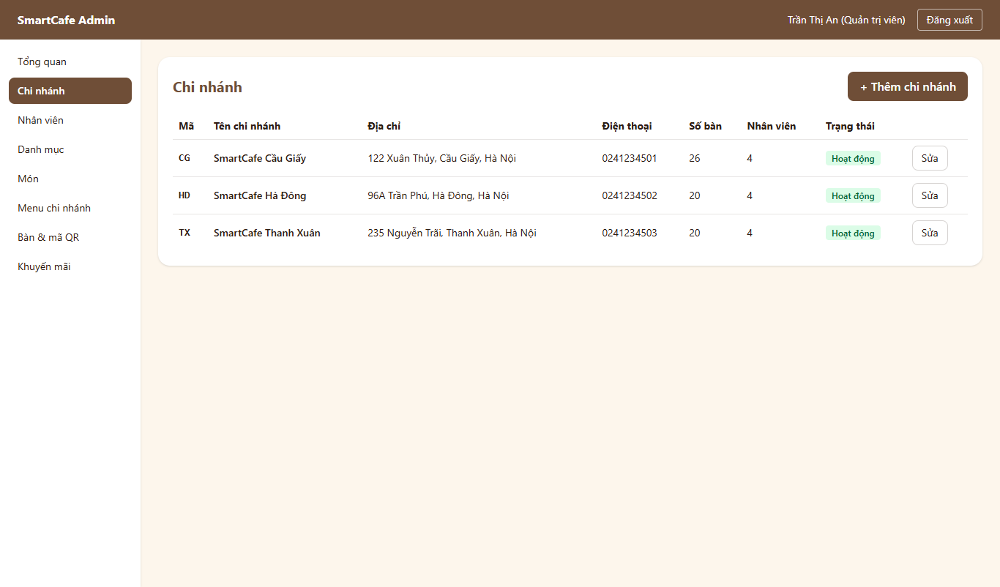 |
| A04 – Nhân viên (quản lý chi nhánh) | 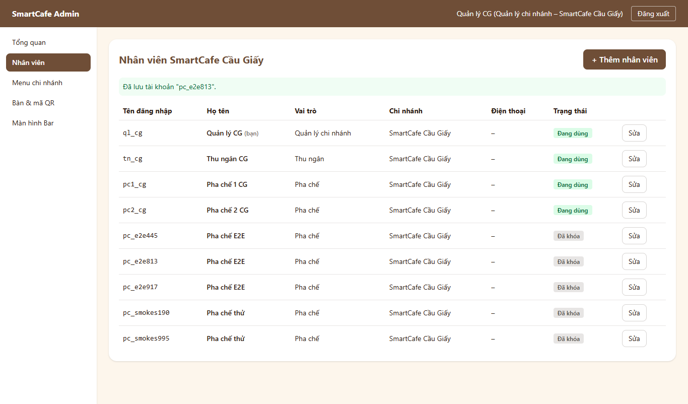 |
| A05 – Danh mục | 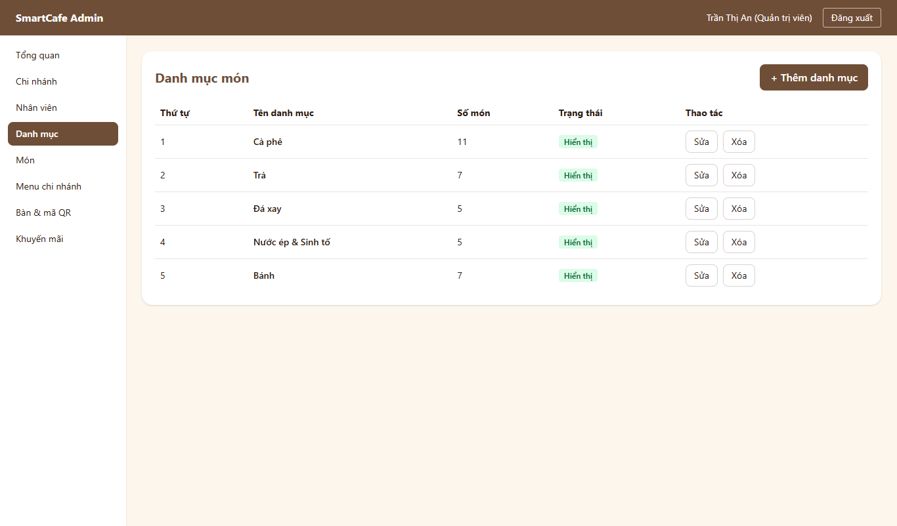 |
| W05 – Quản lý món | 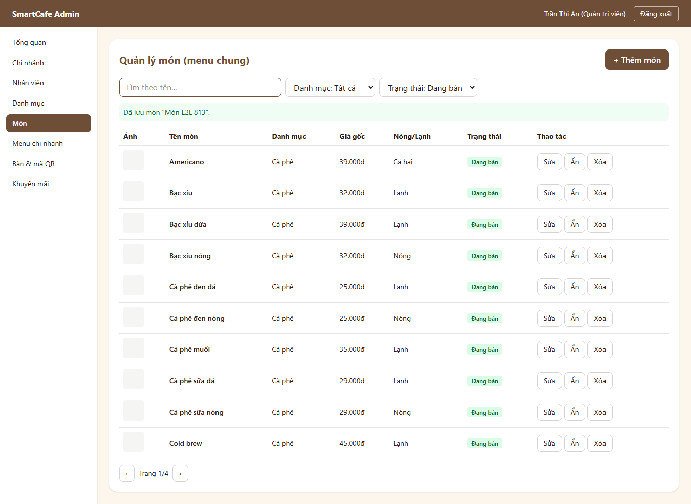 |
| W05 – Form thêm món | 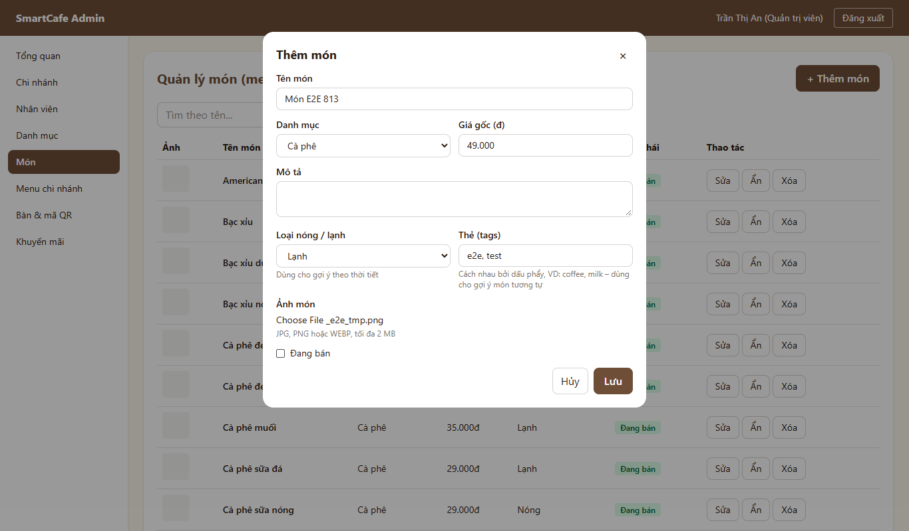 |
| W06 – Menu chi nhánh | 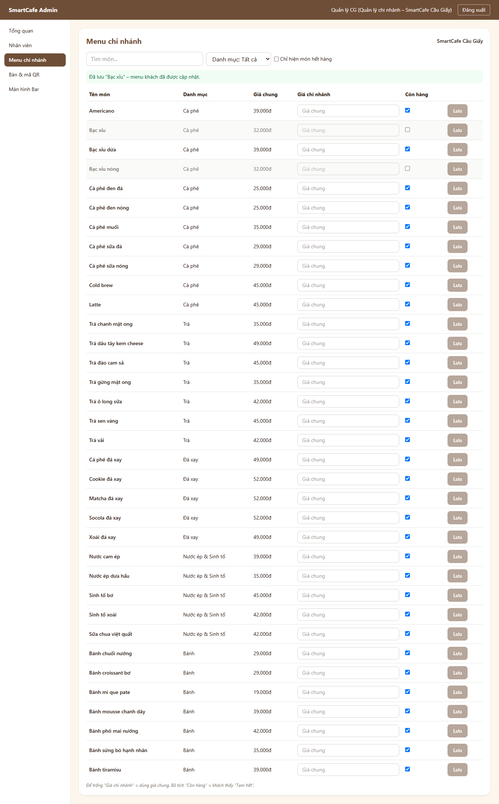 |
| W01 – khách thấy "Tạm hết" ngay | 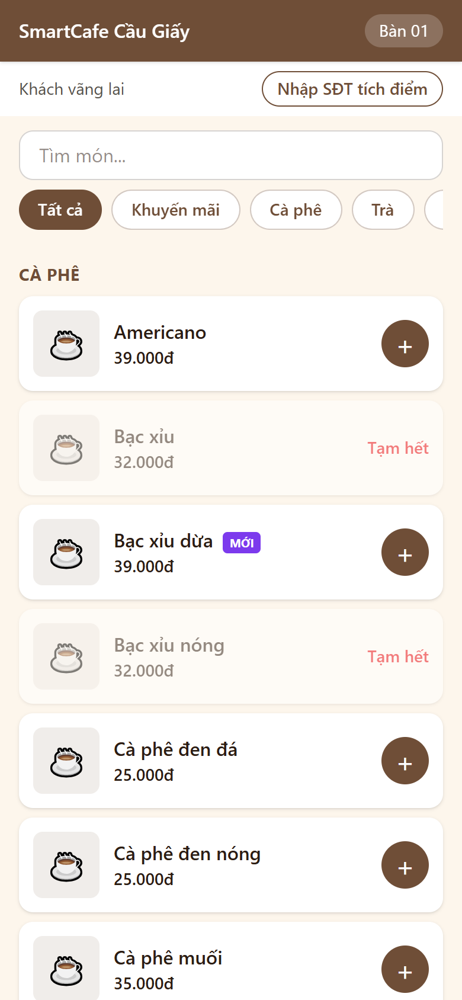 |
| W07 – Tạo khuyến mãi | 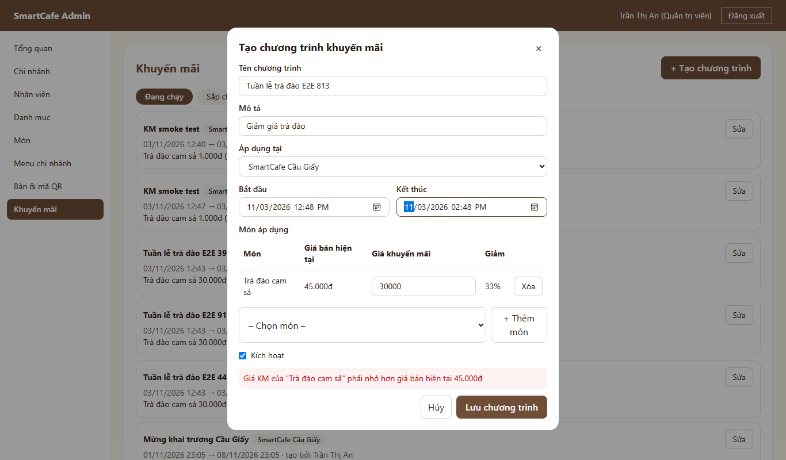 |
| W07 – Danh sách khuyến mãi | 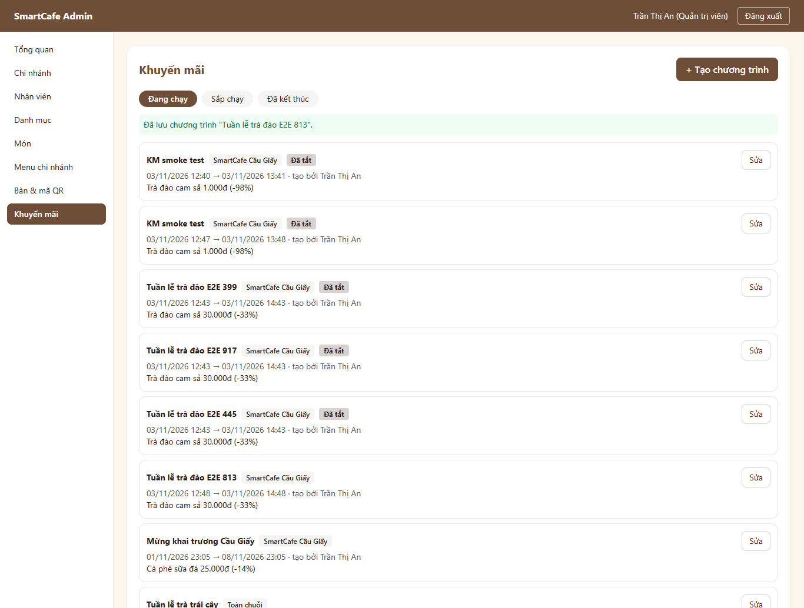 |
| W01 – khách thấy giá KM ngay | 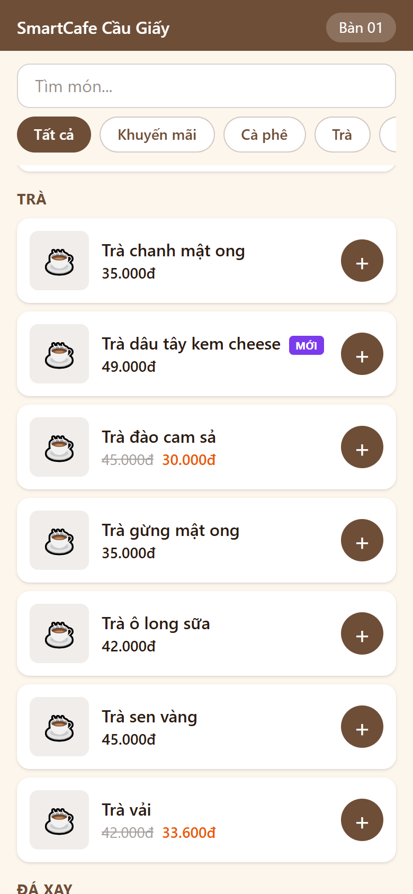 |
| A06 – Bàn & mã QR | 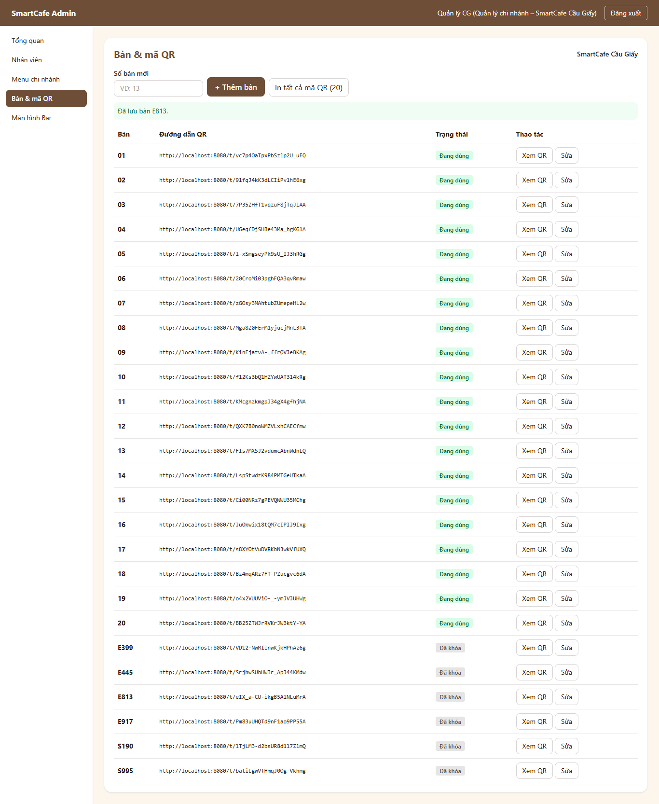 |
| A06 – Xem mã QR (sau khi sửa BUG-F6-01) | 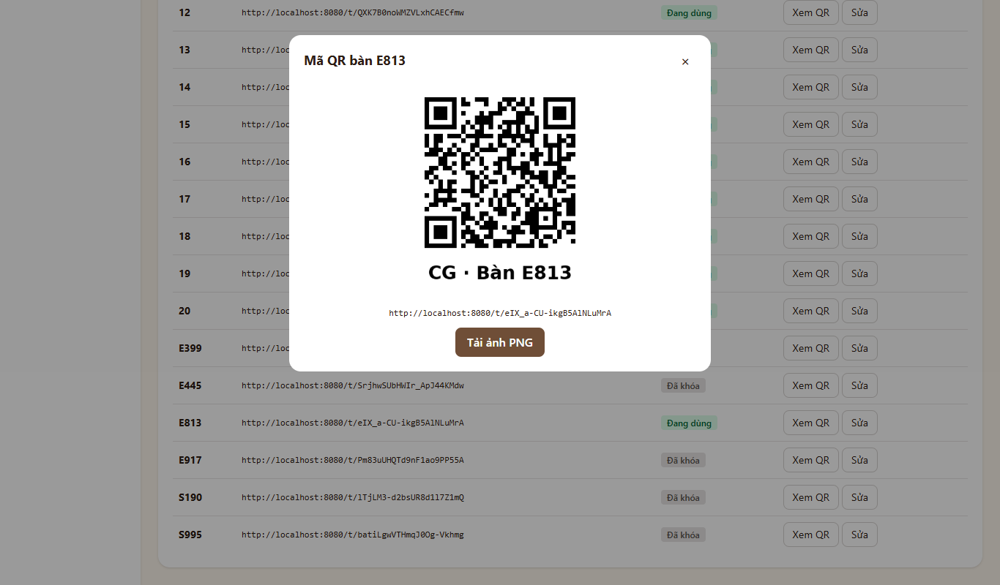 |

## 5. Tổng hợp kết quả
| Nhóm | Số ca | Đạt | Không đạt |
|:---|:---:|:---:|:---:|
| Backend (pytest, `tests/f6`, mã F6-01…62) | 188 | 188 | 0 |
| Frontend (Vitest, F6-FE-01…24) | 24 | 24 | 0 |
| Kiểm thử khói (SM-38…46) | 9 | 9 | 0 |
| Kiểm thử đầu-cuối trên trình duyệt (E2E-44…52) | 9 | 9 | 0 |
| **Tổng F6** | **230** | **230** | **0** |
| *Hồi quy F0 → F5 (backend 217, frontend 88, SM-01…37)* | *342* | *342* | *0* |

*Số ca backend lớn vì ma trận phân quyền chạy đủ từng cặp thao tác × vai trò (F6-50…52: 80 ca). E2E-01…43 của các luồng trước không chạy lại bằng trình duyệt; được hồi quy bằng test backend / frontend và SM-01…37.*

**Độ bao phủ mã** (log: [logs/F6_backend_pytest.txt](logs/F6_backend_pytest.txt), [logs/F6_hoi_quy_backend_toan_bo.txt](logs/F6_hoi_quy_backend_toan_bo.txt), [logs/F6_frontend_vitest.txt](logs/F6_frontend_vitest.txt)):
| Phần | Câu lệnh | Ghi chú |
|:---|:---:|:---|
| `app/modules/admin` (catalog, branches, staff, promotions, schemas) | **100%** | `common.py` 97%: nhánh ném lại lỗi CSDL không phải UNIQUE |
| `app/` toàn bộ | 99% | |
| Frontend toàn bộ | 98,5% (nhánh 91,6%) | Các màn hình F6 95–100% |

## 6. Lỗi phát hiện
| Mã lỗi | Mức độ | Mô tả | Phát hiện bởi | Nguyên nhân | Cách sửa | Kiểm tra lại | Trạng thái |
|:---|:---|:---|:---|:---|:---|:---|:---|
| BUG-F6-01 | Trung bình | Dòng chữ dưới ảnh QR để in hiện "CG · B□n 05" (chữ "à" thành ô vuông) – nhân viên dán QR dễ nhầm, ảnh in không chuyên nghiệp | E2E-48 (xem ảnh chụp A06) | Phông mặc định của Pillow không có chữ tiếng Việt; image `python:3.11-slim` không có phông nào | Cài `fonts-dejavu-core` vào image backend; chọn phông theo danh sách (DejaVu / Arial); máy không có phông thì bỏ dấu ("Ban") thay vì ô vuông | F6-61, F6-62; ảnh QR tải từ Docker hiện đúng "CG · Bàn 01"; E2E-48 đạt | Đã đóng |

*Ghi chú: một số lần chạy đầu bị đỏ do **chính test** (dữ liệu test thiếu danh mục trống, đếm sai số nhân viên, thiếu chi nhánh khi kiểm tra trùng tên; E2E chọn "Bạc xỉu" trùng với "Bạc xỉu dừa", "Chi nhánh" trùng với "Menu chi nhánh"; nhãn ô nhập chứa cả dòng gợi ý) – đã sửa test / tách dòng gợi ý ra ngoài nhãn, không phải lỗi nghiệp vụ.*

## 7. Tồn tại / ghi chú
Các chi tiết thiết kế chưa quy định, đã cài theo hướng an toàn cho dữ liệu (cần PM xác nhận khi review):
- **Xóa danh mục** chỉ khi chưa từng có món (kể cả món đã xóa mềm – giữ lịch sử đơn); còn món thì báo `CATEGORY_IN_USE`, đề nghị chuyển món hoặc ẩn danh mục. **Xóa món** là xóa mềm.
- **Mã chi nhánh** 2–10 chữ / số, viết hoa, **không sửa được** sau khi tạo (là tiền tố mã đơn). Chi nhánh không có nút xóa, chỉ ngừng hoạt động (IV.3 chỉ có GET/POST/PUT).
- **Nhân viên**: tên đăng nhập 3–50 ký tự `a-z 0-9 _ .`, mật khẩu ≥ 8 ký tự; không ai tự khóa / tự đổi vai trò, chi nhánh (409 `CANNOT_MODIFY_SELF`); khóa tài khoản có hiệu lực ngay ở mọi API. Kết nối WebSocket màn hình Bar đang mở của người bị khóa vẫn giữ tới khi tải lại trang (lần kết nối lại sẽ bị từ chối).
- **Khuyến mãi**: KM 1 chi nhánh so với giá chi nhánh (giá riêng nếu có), KM toàn chuỗi so với giá chung; khi lưu phải còn hiệu lực (kết thúc sau hiện tại); tối đa 50 món / chương trình. Không có xóa KM (chỉ tắt) để giữ lịch sử doanh thu KM.
- **Ảnh món**: JPG / PNG / WEBP ≤ 2 MB, kiểm tra theo nội dung file; lưu ở volume Docker `uploads`, phục vụ tại `/api/uploads/menu/...`.
- **Quyền menu chi nhánh, bàn & QR**: IV.3 cũ ghi "MANAGER", ma trận RBAC (III.1) ghi Quản trị viên cũng được – đã cài theo ma trận RBAC và sửa lại IV.3.
- **Ảnh QR** in địa chỉ `PUBLIC_BASE_URL` (mặc định `http://localhost:8080`). **Khi demo bằng điện thoại thật phải đặt `PUBLIC_BASE_URL=http://<IP Wi-Fi laptop>:8080` trong `.env`** rồi in lại QR, nếu không điện thoại quét sẽ không mở được.
- **Mã lỗi mới**: `DUPLICATE_VALUE` (409, `details.field`), `CATEGORY_IN_USE`, `CANNOT_MODIFY_SELF`, `PROMOTION_ENDED` (409), `INVALID_IMAGE` (413 / 422), `CATEGORY_NOT_FOUND`, `MENU_ITEM_NOT_FOUND`, `STAFF_NOT_FOUND`, `PROMOTION_NOT_FOUND` (404) – đã bổ sung IV.3.
- CSDL demo đang có dữ liệu thử của kiểm thử (bàn E…/S… đã khóa, tài khoản `pc_e2e…`, `pc_smoke…` đã khóa, KM "E2E", "KM smoke test" đã tắt, nhiều đơn thử). Trước buổi demo nên chạy `docker compose down -v` rồi `up -d` để nạp lại dữ liệu mẫu sạch (ảnh món đã upload cũng bị xóa theo volume).

## 8. Kết luận
**Luồng F6: ĐẠT.** 230/230 ca kiểm thử đạt, hồi quy F0 → F5 342/342 đạt; 1 lỗi (mức Trung bình) đã sửa, có test hồi quy. Đủ điều kiện chuyển sang **F7 – AI gợi ý món** khi PM duyệt.

| Vai trò | Họ tên | Ngày | Ký xác nhận |
|:---|:---|:---|:---|
| Người lập (Tester / QA) | Thành viên D | 03/11/2026 | |
| PM duyệt | Thành viên A | 03/11/2026 | |
