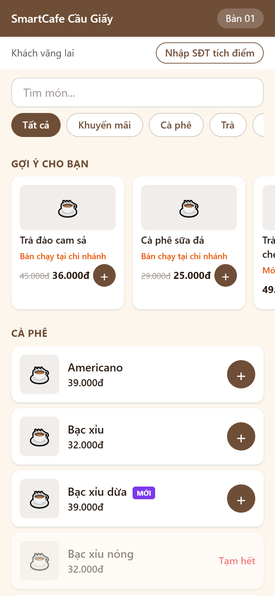
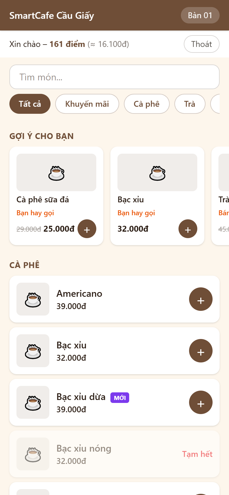
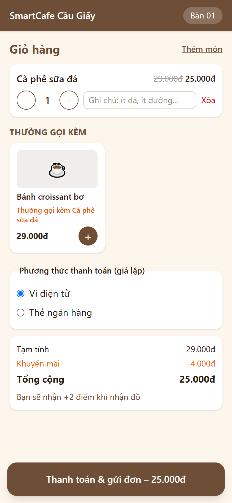

# BIÊN BẢN KIỂM THỬ – LUỒNG F7: AI GỢI Ý MÓN (2 CHẾ ĐỘ + "THƯỜNG GỌI KÈM")

## 1. Thông tin chung
| Mục | Nội dung |
|:---|:---|
| Dự án | SmartCafe – Phần mềm quản lý chuỗi quán cà phê thông minh (Nhóm 8) |
| Luồng | **F7 – AI gợi ý món**: UC03 (phần gợi ý), sơ đồ SD02; công thức chấm điểm 2 chế độ, FP-Growth "thường gọi kèm", thời tiết, đánh giá offline (II.2 Mục 2.3–2.5); khối gợi ý trên W01, W02 |
| Phiên bản | 0.7.0 – nhánh `feature/f7-ai-goi-y` (tách từ `main` sau khi gộp F6, CR-37), mã nguồn `2.San_pham/smartcafe/` |
| Ngày kiểm thử | 30/10/2026 |
| Người lập biên bản | Ngô Duy Đô (D – Tester / QA) |
| Người duyệt | Nguyễn Thanh Bình (A – PM) – đã duyệt 31/10/2026 (CR-39); review mô hình AI: Lê Minh Sơn (C) |
| Tài liệu căn cứ | [II.2 Mục 2](../Thiet_ke_he_thong/II.2_Nghien_cuu_cong_nghe.md), [III.1 UC03, SD02](../Thiet_ke_he_thong/III.1_Use_Case_Sequence.md), [III.2 NFR-P3, NFR-R1, NFR-S7, NFR-M3](../Thiet_ke_he_thong/III.2_Yeu_cau_phi_chuc_nang_Data_Model.md), [IV.1 bảng recommendation_logs, association_rules](../Thiet_ke_he_thong/IV.1_Thiet_ke_CSDL.md), [IV.2 W01, W02](../Thiet_ke_he_thong/IV.2_Thiet_ke_giao_dien.md), [IV.3](../Thiet_ke_he_thong/IV.3_Kien_truc_va_API.md); quyết định D1, D9, D13, D16, D27, **D32–D35** (CR-38) |
| Tiền đề | F0 → F6 đạt ([F6](Bien_ban_kiem_thu_F6_Quan_tri.md)) |

## 2. Phạm vi
**Trong phạm vi**
- `GET /api/public/branches/{id}/recommendations?cart=`: top 5 theo **chế độ ẩn danh** (0,45 Bán chạy + 0,25 KM + 0,20 Món mới + 0,10 Thời tiết) hoặc **thành viên** (0,40 Sở thích + 0,20 Tương tự + 0,15 Bán chạy + 0,15 KM + 0,10 Thời tiết), lý do gợi ý, tối đa 2 món "Bạn hay gọi"; "Thường gọi kèm" top 2 theo luật kết hợp; ghi `recommendation_logs`; lỗi thì trả rỗng (NFR-R1).
- Thời tiết: nhiệt độ giả lập mặc định, OpenWeatherMap khi có key (cache 30 phút, lỗi thì về giả lập) – D35.
- Học luật FP-Growth (mlxtend – D33) theo chi nhánh + toàn chuỗi, job hằng đêm 00:30 (APScheduler).
- `POST /api/public/orders` nhận `recommendation_log_id` (D34) để gắn đơn vào lần gợi ý.
- Script `seed_orders.py` (≈ 5.000 đơn / 60 ngày / 300 thành viên, tự nạp khi khởi động – D32) và `evaluate_recommender.py` (Hit Rate@5 offline).
- Giao diện: khối "Gợi ý cho bạn" (W01) và "Thường gọi kèm" (W02); món thêm từ khối gợi ý gắn `is_recommended`.

**Ngoài phạm vi**: dashboard tỉ lệ món từ gợi ý (F8 – đọc từ `order_items.is_recommended`); Collaborative Filtering (hướng phát triển, II.2).

## 3. Môi trường & cách chạy
Giống [biên bản F2 – Mục 3](Bien_ban_kiem_thu_F2_Dat_mon_Thanh_toan.md#3-môi-trường--cách-chạy). Bản `docker compose up -d --build` mới: backend thêm `mlxtend`, `pandas`, `apscheduler`; khởi động lần đầu tự chạy `seed_orders` (CSDL demo hiện tại: 4.916 đơn lịch sử, 32 luật). Nhiệt độ giả lập 31°C (`WEATHER_MOCK_TEMP_C`), không dùng key Weather API.
```powershell
cd backend;  .\.venv\Scripts\python -m pytest -v tests/f7
cd frontend; npx vitest run src/pages/qr/Recommend.test.tsx
cd backend;  .\.venv\Scripts\python -m scripts.smoke_test --qr-token <token bàn CG>
docker compose exec backend python -m scripts.evaluate_recommender
```

## 4. Danh sách test case

### 4.1. Backend – Thành phần điểm, thời tiết, xếp hạng (cấp: Đơn vị) – `tests/f7/test_unit.py`
| Mã TC | Căn cứ | Mô tả / dữ liệu | Kết quả mong đợi | KQ |
|:---|:---|:---|:---|:---:|
| F7-01a…f | II.2 – Promo | Giảm 20%, 50%, 75%, không giảm, giá KM cao hơn, giá 0 | 0,4 / 1 / 1 (tối đa) / 0 / 0 / 0 | Đạt |
| F7-02 | II.2 – Similar, chuẩn hóa | Jaccard, tập rỗng; chuẩn hóa theo giá trị lớn nhất | Đúng công thức; không chia cho 0 | Đạt |
| F7-03a…f | II.2 – Weather | 35 / 28 / 27,9 / 22,1 / 22 / 15°C | Nóng (≥ 28), trung tính, lạnh (≤ 22) đúng ngưỡng | Đạt |
| F7-04a…h | II.2 – Weather | Trời nóng / lạnh / trung tính × món COLD / HOT / BOTH / NONE | 1 hợp trời, 0 ngược, 0,5 BOTH / NONE / trung tính | Đạt |
| F7-05 | D35, NFR-R1 | Không key; có key (API giả 19,46°C); sau 29 phút; sau 31 phút; chi nhánh chưa có tọa độ; API lỗi | Giả lập 31°C; "api" 19,5°C; dùng cache; gọi lại; giả lập; giả lập (không ném lỗi) | Đạt |
| F7-06 | II.2 | 4 món, mỗi món mạnh 1 thành phần | Lý do = thành phần đóng góp nhiều nhất ("Bán chạy tại chi nhánh", "Món mới", "Đang giảm 25%", "Hợp trời nóng"); điểm đúng; tổng trọng số mỗi chế độ = 1 | Đạt |
| F7-07 | II.2 – Đa dạng | 5 món "Bạn hay gọi" điểm cao + 3 món bán chạy | Top 5: đúng 2 món "Bạn hay gọi" + 3 món khác | Đạt |
| F7-08 | Hồi quy BUG-F7-01 | Món khách đã gọi có điểm Tương tự cao | Lý do "Bạn hay gọi"; "Giống món bạn thích" chỉ cho món chưa gọi | Đạt |
| F7-09 | II.2 | Các món bằng điểm | Xếp theo bán chạy rồi mã món (ổn định) | Đạt |

### 4.2. Backend – Gợi ý trên CSDL thật, API, log – `tests/f7/test_recommend.py`
| Mã TC | Căn cứ | Mô tả / dữ liệu | Kết quả mong đợi | KQ |
|:---|:---|:---|:---|:---:|
| F7-10 | II.2 – Popular | Đơn trong 7 ngày ở CG; đơn quá 7 ngày; đơn chi nhánh HD; đơn hủy | Chỉ tính đơn đã thanh toán, không hủy, 7 ngày, đúng chi nhánh; "Trà gừng" đứng đầu, điểm 0,45 (đồ nóng ngày nóng: thời tiết 0); HD có gợi ý riêng | Đạt |
| F7-11 | II.2, D16, D27 | KM giảm 20%, món mới 3 ngày, món tạm hết, món đã trong giỏ | "Đang giảm 20%" kèm giá KM; "Món mới"; không gợi ý món tạm hết / đã có trong giỏ | Đạt |
| F7-12a…b | D13 | Chưa có đơn nào, trời 33°C / 18°C; rồi có 1 đơn | Món hợp trời đứng đầu ("Hợp trời nóng / lạnh"); có bán chạy thì bán chạy (45%) thắng thời tiết (10%) | Đạt |
| F7-13 | II.2 – Thành viên | Thành viên hay gọi Cà phê sữa đá + Croissant (ở chi nhánh khác), Trà gừng; khách khác mua nhiều Trà đào | Chế độ MEMBER; đúng 2 "Bạn hay gọi"; Bạc xỉu, Cà phê sữa nóng "Giống món bạn thích" (cùng tags); món ruột thứ 3 nhường chỗ; khách ẩn danh nhận gợi ý khác | Đạt |
| F7-14 | II.2 – Personal | 3 ly cách đây 90 ngày vs 1 ly hôm qua | Đơn gần đây nặng hơn (chu kỳ bán rã 30 ngày) | Đạt |
| F7-15 | II.2 | Thành viên chưa có đơn (chỉ có đơn hủy) | Công thức ẩn danh, `member_fallback`; log ghi `customer_id`, mode ANONYMOUS, `context.member_fallback` | Đạt |
| F7-16 | NFR-R1 | Token sai; token nhân viên | Vẫn 200, gợi ý ẩn danh (không chặn menu) | Đạt |
| F7-17 | IV.1 | Gọi kèm giỏ có món trùng | Log: chi nhánh, khách, `context {temp_c, weather, weather_source, hour, cart (bỏ trùng), member_fallback}`, `items [{menu_item_id, score, reason}]` đúng thứ tự trả về | Đạt |
| F7-18a…c | NFR-S5 | `cart=1,a`; 31 món; chuỗi 301 ký tự | 422 `VALIDATION_ERROR` | Đạt |
| F7-19 | UC03 | Chi nhánh không tồn tại / ngừng hoạt động | 404 `BRANCH_NOT_FOUND` | Đạt |
| F7-20 | NFR-R1 | Service gợi ý ném lỗi | 200, `degraded: true`, danh sách rỗng, không log; menu vẫn 200 | Đạt |
| F7-21 | NFR-P3 | 20 lần gọi (thành viên + giỏ) với 29 đơn lịch sử | p95 < 500 ms | Đạt |
| F7-22 | II.2 – 2.5 | Gợi ý tại thời điểm quá khứ | Chỉ dùng đơn trước thời điểm đó (không rò dữ liệu tương lai khi đánh giá offline) | Đạt |

### 4.3. Backend – Luật kết hợp, job, gắn đơn, dữ liệu mẫu, đánh giá – `tests/f7/test_training.py`
| Mã TC | Căn cứ | Mô tả / dữ liệu | Kết quả mong đợi | KQ |
|:---|:---|:---|:---|:---:|
| F7-23 | II.2 – 2.4 | 200 giỏ có quy luật 1 → 2 (70%) | Tìm ra luật 1 → 2, confidence ≥ 0,6, lift > 1; mọi luật đạt support ≥ 0,01, confidence ≥ 0,2, lift > 1 | Đạt |
| F7-24 | II.2 | < 20 giỏ; mỗi giỏ 1 món; 2 món luôn đi cùng | Không sinh luật (lift = 1 bị loại) | Đạt |
| F7-25 | II.2 | Đơn hợp lệ CG; đơn hủy và đơn quá 60 ngày chứa cặp món khác; 1 luật cũ | Luật Cà phê sữa đá → Croissant ở CG và toàn chuỗi; không có luật từ đơn hủy / quá hạn; luật cũ bị thay; số đếm đúng | Đạt |
| F7-26 | SD02 | 6 luật: toàn chuỗi, của CG, món tạm hết, thứ 4, món đã trong giỏ, của HD | "Thường gọi kèm" = [Trà đào (luật CG ưu tiên), Croissant], lý do "Thường gọi kèm Cà phê sữa đá"; giỏ trống → rỗng | Đạt |
| F7-27 | II.2 | Scheduler tắt / bật; job lỗi | Tắt trong test; bật: cron 00:30 Asia/Ho_Chi_Minh; job lỗi không làm sập backend | Đạt |
| F7-28 | D34 | Đặt đơn kèm `recommendation_log_id`; dùng lại log đó | Log gắn `order_id`; món `is_recommended` lưu đúng; lần 2 vẫn 201, log giữ đơn đầu | Đạt |
| F7-29a…d | D34, NFR-R1 | Log của chi nhánh khác / của khách khác / không tồn tại / quá 2 giờ; `recommendation_log_id = 0` | Đơn vẫn 201, log không bị gắn; 0 → 422 | Đạt |
| F7-30 | D32 | `seed_orders` (14 ngày, 30 thành viên) | Có đơn COMPLETED / CANCELLED (< 10%); mã đơn không trùng trong ngày; điểm khách = tổng giao dịch EARN; khách demo có ≥ 3 đơn; **không có đơn chứa món tạo sau ngày đơn**; học lại được luật "Cà phê sữa đá → Bánh croissant bơ" | Đạt |
| F7-31 | II.2 – 2.5 | `evaluate_recommender` trên dữ liệu đó | Hit Rate@5 công thức thành viên > baseline Bán chạy trên đơn thành viên | Đạt |

### 4.4. Frontend – W01, W02 (cấp: Giao diện, API giả lập) – `src/pages/qr/Recommend.test.tsx`
| Mã TC | Màn hình | Mô tả | Kết quả mong đợi | KQ |
|:---|:---|:---|:---|:---:|
| F7-FE-01 | W01 | Khách ẩn danh mở menu | Khối "Gợi ý cho bạn" với lý do, giá KM gạch giá gốc; không gửi token; bỏ món đang tạm hết trên menu; nhớ `log_id` trong sessionStorage | Đạt |
| F7-FE-02 | W01 | Khách thành viên | Gửi `Bearer` customer token; hiện "Bạn hay gọi" | Đạt |
| F7-FE-03 | W01 → W02 | Thêm từ khối gợi ý + 1 món từ menu thường, đặt đơn | Body đơn: `recommendation_log_id` của lần gợi ý gần nhất; món gợi ý `is_recommended: true`, món thường `false` | Đạt |
| F7-FE-04 | W01, NFR-R1 | API gợi ý lỗi | Không hiện khối; menu vẫn dùng được | Đạt |
| F7-FE-05 | W01 | Lọc danh mục / tìm món; nhận `MENU_UPDATED` | Ẩn khối khi lọc / tìm; tải lại gợi ý khi menu đổi | Đạt |
| F7-FE-06 | W02 | Giỏ có Cà phê sữa đá | Gọi `?cart=11`; khối "Thường gọi kèm" có Croissant + lý do; thêm vào giỏ là món gợi ý; gọi lại với `?cart=11,31` | Đạt |
| F7-FE-07 | W02 | Không có luật phù hợp | Không hiện khối | Đạt |

*Sửa test cũ: F0-FE-01 (đăng nhập → màn hình mặc định) **chập chờn** khi chạy cả bộ (khoảng 1/3 lần đỏ): test kiểm tra URL ngay sau khi bấm đăng nhập trong khi chuyển trang là bất đồng bộ. Đã đổi sang chờ URL đổi (`waitFor`); chạy cả bộ 5 lần liên tiếp đều xanh. Không phải lỗi sản phẩm.*

### 4.5. Kiểm thử khói trên hệ thống chạy thật (qua Nginx, dữ liệu lịch sử thật của `seed_orders`)
| Mã TC | Mô tả | Kết quả thực tế | KQ |
|:---|:---|:---|:---:|
| SM-47 | Gợi ý ẩn danh: 5 món có lý do; p95 ≤ 500 ms | **p95 25 ms**; Trà đào cam sả, Cà phê sữa đá (Bán chạy tại chi nhánh), Trà dâu tây kem cheese (Món mới)… | Đạt |
| SM-48 | Khách demo 0901000001 đăng nhập OTP → chế độ thành viên, 1–2 "Bạn hay gọi", khác ẩn danh | Cà phê sữa đá, Bạc xỉu (Bạn hay gọi), Trà đào (Bán chạy), Trà vải, Sinh tố xoài (Hợp trời nóng) | Đạt |
| SM-49 | Giỏ có Cà phê sữa đá → "Thường gọi kèm" Bánh croissant bơ (luật học từ dữ liệu) | Đúng | Đạt |
| SM-50 | Đặt món từ gợi ý kèm `recommendation_log_id` | 201, có điểm dự kiến; CSDL: log gắn đúng đơn | Đạt |
| SM-51 | `cart` sai → 422 | 422 | Đạt |

Log: [logs/F7_smoke_test.txt](logs/F7_smoke_test.txt) (chạy cả SM-01…51, **51/51 đạt**).

### 4.6. Kiểm thử đầu-cuối trên trình duyệt (Playwright + Edge, 2 điện thoại cùng bàn CG 01)
| Mã TC | Mô tả | Kết quả thực tế | KQ |
|:---|:---|:---|:---:|
| E2E-53 | Khách ẩn danh: khối "Gợi ý cho bạn" 5 thẻ có lý do | Trà đào cam sả, Cà phê sữa đá, Trà dâu tây kem cheese, Bạc xỉu dừa, Xoài đá xay | Đạt |
| E2E-54 | Khối cuộn ngang, trang không tràn ngang ở 390px | Đúng | Đạt |
| E2E-55 | Khách demo nhập SĐT + OTP → gợi ý theo sở thích, khác ẩn danh | Cà phê sữa đá, Bạc xỉu (Bạn hay gọi), Trà đào (Bán chạy), Trà vải, Sinh tố xoài (Hợp trời nóng) | Đạt |
| E2E-56 | Thêm Cà phê sữa đá từ gợi ý → giỏ hàng có "Thường gọi kèm: Bánh croissant bơ" | Đúng | Đạt |
| E2E-57 | Thêm Croissant từ "Thường gọi kèm", thanh toán | CG-0027 thanh toán xong; CSDL: cả 2 món `is_recommended = true`, log MEMBER gắn đơn ([log](logs/F7_kiem_tra_csdl_don_goi_y.txt)) | Đạt |

Log: [logs/F7_e2e_trinh_duyet.txt](logs/F7_e2e_trinh_duyet.txt). Ảnh chụp:

| Màn hình | Ảnh |
|:---|:---|
| W01 – gợi ý khách ẩn danh |  |
| W01 – gợi ý khách thành viên |  |
| W02 – Thường gọi kèm |  |

### 4.7. Đánh giá offline mô hình (II.2 Mục 2.5) – CSDL demo
Chia 4.767 đơn hoàn tất theo thời gian: 80% đầu (3.813 đơn) để học, 954 đơn sau để kiểm tra; mỗi đơn ẩn 1 món, gợi ý tại đúng thời điểm thanh toán. Log: [logs/F7_danh_gia_offline_hit_rate.txt](logs/F7_danh_gia_offline_hit_rate.txt).

| Cấu hình | Số đơn | Trúng | Hit Rate@5 |
|:---|:---:|:---:|:---:|
| Chỉ Bán chạy – baseline (tất cả đơn) | 954 | 199 | 20,9% |
| Công thức ẩn danh (tất cả đơn) | 954 | 189 | 19,8% |
| Chỉ Bán chạy (đơn thành viên) | 378 | 77 | 20,4% |
| Công thức ẩn danh (đơn thành viên) | 378 | 78 | 20,6% |
| **Công thức thành viên (đơn thành viên)** | 378 | 185 | **48,9%** |
| "Thường gọi kèm" Hit Rate@2 (đơn ≥ 2 món) | 324 | 49 | 15,1% |

**Nhận xét:** cá nhân hóa tăng tỉ lệ đoán trúng từ ~20% lên ~49% (gấp 2,4 lần). Công thức ẩn danh **không hơn** baseline vì dữ liệu mô phỏng không có hành vi "mua vì khuyến mãi / vì món mới" (KM và nhãn "Mới" lấy theo hiện tại), nên 45% còn lại của công thức chỉ làm nhiễu thứ tự bán chạy – đây là kết quả trung thực để đưa vào báo cáo; trọng số sẽ được nhóm AI (C) tinh chỉnh như II.2 đã nêu. Đây là dữ liệu mô phỏng (II.2 Mục 5 – rủi ro "dữ liệu quá đẹp").

## 5. Tổng hợp kết quả
| Nhóm | Số ca | Đạt | Không đạt |
|:---|:---:|:---:|:---:|
| Backend (pytest, `tests/f7`, F7-01…31) | 54 | 54 | 0 |
| Frontend (Vitest, F7-FE-01…07) | 7 | 7 | 0 |
| Kiểm thử khói (SM-47…51) | 5 | 5 | 0 |
| Kiểm thử đầu-cuối trên trình duyệt (E2E-53…57) | 5 | 5 | 0 |
| **Tổng F7** | **71** | **71** | **0** |
| *Hồi quy F0 → F6 (backend 405, frontend 112, SM-01…46)* | *563* | *563* | *0* |

**Độ bao phủ mã** (log: [logs/F7_backend_pytest.txt](logs/F7_backend_pytest.txt), [logs/F7_hoi_quy_backend_toan_bo.txt](logs/F7_hoi_quy_backend_toan_bo.txt), [logs/F7_frontend_vitest.txt](logs/F7_frontend_vitest.txt)):
| Phần | Câu lệnh | Ghi chú |
|:---|:---:|:---|
| `app/modules/recommend` (service, training, router, logs, weather, scheduler) | 94–100% | Đạt NFR-M3 (≥ 60%). Chưa phủ: gọi HTTP thật tới OpenWeatherMap, `sched.start()` của tiến trình thật |
| `app/` toàn bộ | 99% | |
| Frontend toàn bộ | 98,5% (nhánh 91,8%) | `api/recommend.ts` 88% (nhánh trình duyệt chặn sessionStorage) |

## 6. Lỗi phát hiện
| Mã lỗi | Mức độ | Mô tả | Phát hiện bởi | Nguyên nhân | Cách sửa | Kiểm tra lại | Trạng thái |
|:---|:---|:---|:---|:---|:---|:---|:---|
| BUG-F7-01 | Trung bình | Khách demo hay gọi Bạc xỉu nhưng thẻ gợi ý ghi "Giống món bạn thích" thay vì "Bạn hay gọi" – lý do gây hiểu nhầm | Chạy thử API trên CSDL nháp | Điểm Tương tự so món với **chính nó** trong 3 món yêu thích (Jaccard = 1) nên lấn át Sở thích | Không so món với chính nó; món khách đã gọi luôn ghi "Bạn hay gọi" | F7-08, F7-13; SM-48, E2E-55 | Đã đóng |
| BUG-F7-02 | Trung bình | Dữ liệu mẫu có đơn 60 ngày trước chứa "món mới" (mới tạo 5 ngày) → món mới thành "bán chạy", sai thực tế, làm lệch gợi ý và dashboard F8 | Chạy thử API (Bạc xỉu dừa đứng đầu "Bán chạy") | `seed_orders` chọn món không xét ngày tạo món | Chỉ sinh đơn với món đã tồn tại vào ngày đó (cả món kèm theo luật) | F7-30 (đếm đơn chứa món tạo sau ngày đơn = 0) | Đã đóng |
| BUG-F7-03 | Trung bình | Lần khởi động đầu, `seed_orders` mất **4 phút 18 giây** (backend chưa nhận request) | Đo thời gian chạy | Ghi 35.000 dòng từng dòng một (mỗi lượt gọi tới Postgres trong Docker vài ms) | Ghi theo lô 1.000 dòng / câu lệnh; lấy id theo cột duy nhất thay vì dựa vào thứ tự RETURNING | Còn **14 giây**; F7-30 | Đã đóng |
| BUG-F7-04 | Thấp | Menu khách bị lỗi trắng trang nếu API gợi ý trả dữ liệu sai dạng (thiếu `items`) | F1-FE-15 (backend giả trả menu cho mọi URL) | Frontend tin phản hồi luôn đúng dạng | Chỉ dùng khi `items` / `also_bought` là mảng, ngược lại ẩn khối | F1-FE-15, F7-FE-04 | Đã đóng |

*Ghi chú: lần chạy đầu F7-20 đỏ vì nhánh xử lý lỗi gọi `db.rollback()` (trong test làm mất dữ liệu của test; ở hệ thống thật không có tác hại vì chưa ghi gì) – đã bỏ lệnh thừa. Các ca F7-10, 11, 26 lần đầu đỏ do **dữ liệu / kỳ vọng của test** (số lượng > 20 ly vi phạm ràng buộc CSDL, tính nhầm điểm) – đã sửa test.*

## 7. Tồn tại / ghi chú
Diễn giải chi tiết mà II.2 chưa quy định (cần C – AI review):
- **Bán chạy** = tổng số lượng của đơn đã thanh toán, không hủy, 7 ngày, tại chi nhánh; chuẩn hóa theo món bán nhiều nhất. **Sở thích** tính trên đơn của khách ở **mọi chi nhánh**, chu kỳ bán rã 30 ngày (`REC_PERSONAL_HALF_LIFE_DAYS`).
- **Tương tự** không so món với chính nó; nhãn "Giống món bạn thích" chỉ cho món khách chưa từng gọi (BUG-F7-01).
- Không gợi ý món đã có trong giỏ, món tạm hết / ngừng bán. Thành viên chưa có đơn: công thức ẩn danh, log ghi mode ANONYMOUS + `member_fallback`.
- Token khách sai / hết hạn ở API gợi ý → gợi ý ẩn danh (không chặn menu); việc báo hết phiên vẫn do API đặt đơn đảm nhiệm như F4.
- Luật kết hợp: 1 món → 1 món, học riêng từng chi nhánh + toàn chuỗi; luật của chi nhánh được ưu tiên; job 00:30 (sau job báo cáo 00:05 của F8); cần ≥ 20 đơn mới học.
- **Image backend tăng lên ~984 MB** do mlxtend kéo theo pandas, scipy, scikit-learn (đã báo trước khi chốt D33); lần build đầu cần mạng ổn định.
- Khách demo **0901000001** (chi nhánh Cầu Giấy, ~32 đơn lịch sử). OTP vẫn giới hạn 60 giây / lần gửi, 5 mã / giờ (NFR-S4) – khi demo nhiều lần nên dùng thêm số 0901000002…0901000300 (cũng có lịch sử).
- Đánh giá offline: công thức ẩn danh chưa hơn baseline (Mục 4.7) – đề nghị C tinh chỉnh trọng số trước buổi nghiệm thu, hoặc trình bày đúng như kết quả hiện tại.
- CSDL demo đang có thêm dữ liệu thử của các lần kiểm thử; trước buổi demo nên `docker compose down -v` rồi `up -d` (tự nạp lại dữ liệu mẫu + lịch sử, khoảng 20–30 giây).
- API bổ sung so với IV.3: dữ liệu trả về của gợi ý, `recommendation_log_id`, biến môi trường thời tiết – đã cập nhật [IV.3](../Thiet_ke_he_thong/IV.3_Kien_truc_va_API.md), [II.2](../Thiet_ke_he_thong/II.2_Nghien_cuu_cong_nghe.md).

## 8. Kết luận
**Luồng F7: ĐẠT.** 71/71 ca kiểm thử đạt, hồi quy F0 → F6 563/563 đạt; 4 lỗi (3 Trung bình, 1 Thấp) đã sửa, có test hồi quy. Đủ điều kiện chuyển sang **F8 – Báo cáo ngày & dashboard** khi PM duyệt.

| Vai trò | Họ tên | Ngày | Ký xác nhận |
|:---|:---|:---|:---|
| Người lập (Tester / QA) | Ngô Duy Đô (D) | 30/10/2026 | |
| PM duyệt | Nguyễn Thanh Bình (A) | 31/10/2026 | |
| Review mô hình AI | Lê Minh Sơn (C) | | |
