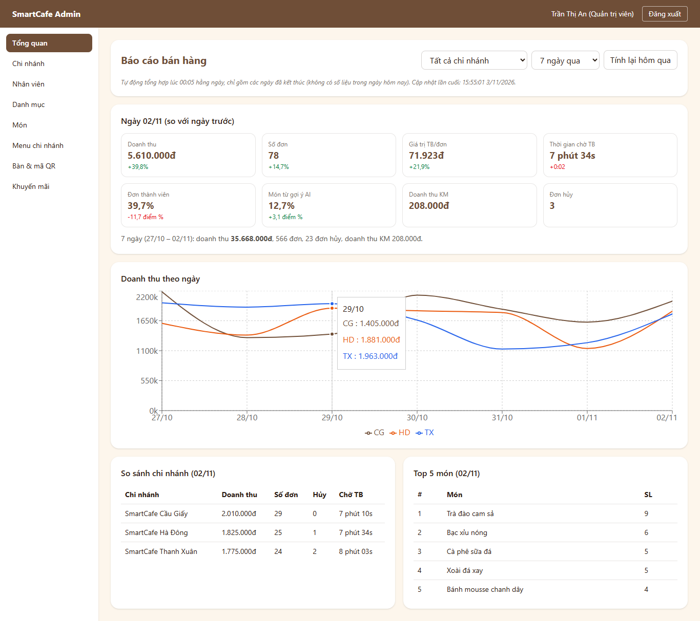
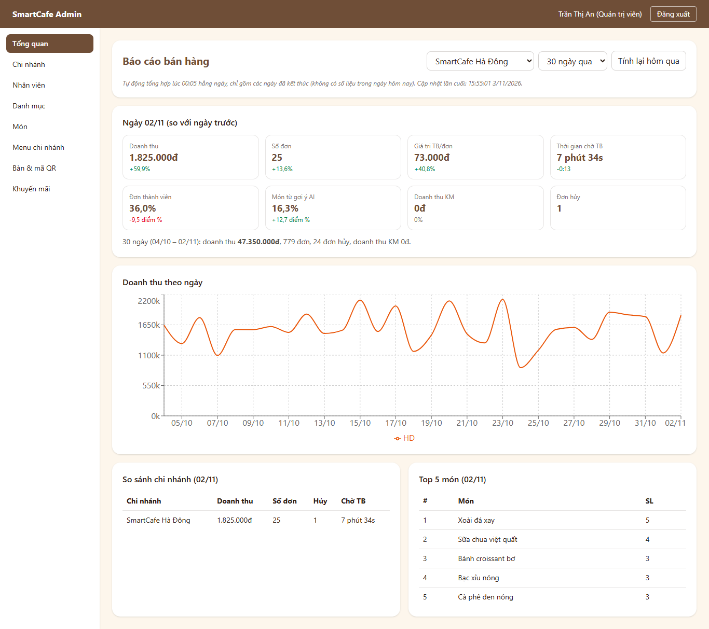
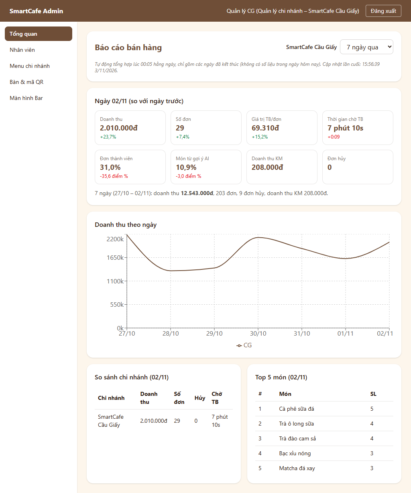

# BIÊN BẢN KIỂM THỬ – LUỒNG F8: BÁO CÁO NGÀY (JOB 00:05) & DASHBOARD BÁN HÀNG

## 1. Thông tin chung
| Mục | Nội dung |
|:---|:---|
| Dự án | SmartCafe – Phần mềm quản lý chuỗi quán cà phê thông minh (Nhóm 8) |
| Luồng | **F8 – Báo cáo & dashboard**: UC16, màn hình W08, bảng `daily_sales_reports`, job `build_daily_report` 00:05 |
| Phiên bản | 0.8.0 – nhánh `feature/f8-bao-cao` (tách từ `main` sau khi gộp F7, CR-39), mã nguồn `2.San_pham/smartcafe/` |
| Ngày kiểm thử | 03/11/2026 |
| Người lập biên bản | Thành viên D (Tester / QA) |
| Người duyệt | Thành viên A (PM) – đã duyệt 03/11/2026 (CR-40) |
| Tài liệu căn cứ | [III.1 UC16, ma trận RBAC](../Thiet_ke_he_thong/III.1_Use_Case_Sequence.md), [III.2 NFR-P6](../Thiet_ke_he_thong/III.2_Yeu_cau_phi_chuc_nang_Data_Model.md), [IV.1 Mục 4.8, 6, 7](../Thiet_ke_he_thong/IV.1_Thiet_ke_CSDL.md), [IV.2 W08](../Thiet_ke_he_thong/IV.2_Thiet_ke_giao_dien.md), [IV.3](../Thiet_ke_he_thong/IV.3_Kien_truc_va_API.md); quyết định D21 |
| Tiền đề | F0 → F7 đạt ([F7](Bien_ban_kiem_thu_F7_AI_goi_y.md)) |

## 2. Phạm vi
**Trong phạm vi**
- Job tổng hợp 1 ngày / 1 chi nhánh theo câu SQL ở IV.1 Mục 6 (UPSERT, chạy lại được): số đơn, đơn hủy, doanh thu, giá trị TB/đơn, thời gian chờ TB, tỉ lệ đơn thành viên, doanh thu KM, tỉ lệ món từ gợi ý AI, top 5 món; ngày theo **giờ Việt Nam**.
- Lịch chạy: 00:05 hằng ngày (ngày hôm qua, mọi chi nhánh) + **bù các ngày còn thiếu khi backend khởi động** (60 ngày) + `seed_orders` tạo sẵn báo cáo cho các ngày lịch sử (IV.1 Mục 7).
- `GET /api/staff/reports/daily?branch_id=&from=&to=` (ADMIN mọi chi nhánh / tất cả; MANAGER chi nhánh mình) và `POST /api/staff/reports/daily/rebuild` (ADMIN).
- Giao diện W08 "Tổng quan": bộ lọc chi nhánh + 7 / 30 ngày, thẻ chỉ số ngày gần nhất + thay đổi so với ngày trước, biểu đồ đường doanh thu theo chi nhánh (Recharts), bảng so sánh chi nhánh, top 5 món; nút "Tính lại hôm qua" (quản trị viên).

**Ngoài phạm vi**: số liệu realtime trong ngày (UC16 – chỉ các ngày đã kết thúc); xuất báo cáo ra file.

## 3. Môi trường & cách chạy
Giống [biên bản F2 – Mục 3](Bien_ban_kiem_thu_F2_Dat_mon_Thanh_toan.md#3-môi-trường--cách-chạy). Frontend thêm thư viện `recharts`. Khi khởi động lại Docker, backend tự bù **180 báo cáo** (60 ngày × 3 chi nhánh) trong khoảng 1 giây (log `Đã bù 180 báo cáo ngày còn thiếu`).
```powershell
cd backend;  .\.venv\Scripts\python -m pytest -v tests/f8
cd frontend; npx vitest run src/pages/admin/DashboardPage.test.tsx
cd backend;  .\.venv\Scripts\python -m scripts.smoke_test --qr-token <token bàn CG>
```

## 4. Danh sách test case

### 4.1. Backend – Job tổng hợp (cấp: Tích hợp, PostgreSQL thật) – `tests/f8/test_build.py`
| Mã TC | Căn cứ | Mô tả / dữ liệu | Kết quả mong đợi | KQ |
|:---|:---|:---|:---|:---:|
| F8-01 | IV.1 4.8 | 2 đơn hoàn tất (1 thành viên, 1 món KM + gợi ý, chờ 4 và 8 phút) + 1 đơn hủy | 2 đơn, 1 hủy, doanh thu 110.000, TB 55.000, chờ TB 360 giây, thành viên 0,5, doanh thu KM 30.000, món từ gợi ý 1/3, top món đúng thứ tự (SL giảm dần, rồi tên) | Đạt |
| F8-02 | UC16 – giờ VN | Đơn 23:50 và 00:10 (giờ VN) của hôm qua, đơn 23:59 hôm kia | Đếm đúng 2 đơn theo ngày giờ Việt Nam (không theo UTC) | Đạt |
| F8-03 | IV.1 Mục 6 | Đơn chưa thanh toán, đơn tự hủy khi chưa trả tiền, đơn của chi nhánh khác; ngày không có đơn | Không tính đơn `paid_at` NULL; tách đúng chi nhánh; ngày trống vẫn có 1 dòng toàn 0, chờ TB rỗng, top món `[]` | Đạt |
| F8-04 | UC16 – chạy lại | Tổng hợp, thêm đơn, tổng hợp lại | UPSERT: vẫn 1 dòng, số liệu mới, `generated_at` cập nhật | Đạt |
| F8-05 | IV.1 4.8 | 6 món, có đơn hủy số lượng lớn | Top 5 theo số lượng, bằng nhau thì theo tên; không tính đơn hủy | Đạt |
| F8-06 | Bù ngày thiếu | 5 ngày, đã có sẵn 1 ngày (giá trị khác) | Tính 9 dòng còn thiếu (2 chi nhánh × 5 − 1), **không tính lại** ngày đã có, không tính hôm nay; chạy lần 2 → 0 | Đạt |
| F8-07 | W08 – gộp | Gộp 3 dòng (1 ngày trống) | Cộng tổng; tỉ lệ / chờ TB trung bình có trọng số theo số đơn; gộp top món nhiều chi nhánh | Đạt |
| F8-08 | D21 | Scheduler | Job 00:05 (Asia/Ho_Chi_Minh) + 00:30 (F7); job bù chạy 1 lần ngay khi khởi động; job 00:05 tính đúng **ngày hôm qua**; job lỗi không làm sập backend | Đạt |
| F8-09 | NFR-P6, IV.1 Mục 7 | `seed_orders` 20 ngày; xóa báo cáo rồi bù 60 ngày | `seed_orders` tạo 60 báo cáo (20 × 3); bù 180 dòng < 1 phút; **tổng doanh thu báo cáo = tổng tiền các đơn không hủy** | Đạt |

### 4.2. Backend – API dashboard – `tests/f8/test_api.py`
| Mã TC | Căn cứ | Mô tả / dữ liệu | Kết quả mong đợi | KQ |
|:---|:---|:---|:---|:---:|
| F8-10 | UC16, W08 | Quản trị viên, mặc định | 7 ngày đến **hôm qua**; ngày gần nhất gộp 2 chi nhánh (200.000đ, 3 đơn, 1 hủy, TB 66.667, chờ 400 giây…); ngày trước; cộng dồn kỳ (không lấy ngày ngoài khoảng); so sánh CG / HD; chuỗi doanh thu từng chi nhánh (ngày 0 vẫn có điểm); top món gộp; `generated_at` | Đạt |
| F8-11 | W08 | Lọc Hà Đông, 30 ngày | Chỉ số liệu HD | Đạt |
| F8-12 | RBAC | Quản lý CG; quản lý xem HD; thu ngân; pha chế; chưa đăng nhập | Mặc định CG; 403; 403; 403; 401 | Đạt |
| F8-13a…b | NFR-S5 | from > to; > 92 ngày | 422 (`field = from`) | Đạt |
| F8-14 | UC16 | `to` là tương lai; chi nhánh không tồn tại; khoảng không có báo cáo | Cắt về hôm qua; 404; `latest` rỗng, kỳ = 0 | Đạt |
| F8-15 | UC16 | Thêm đơn sau khi đã tổng hợp → quản trị viên chạy lại cho CG, rồi cho mọi chi nhánh | Dashboard cập nhật (200.000 → 300.000đ); trả số chi nhánh đã tính | Đạt |
| F8-16a…e | UC16, RBAC | Chạy lại cho hôm nay / tương lai / sai định dạng ngày / chi nhánh không tồn tại; quản lý gọi | 422 / 422 / 422 / 404 / 403 | Đạt |
| F8-17 | NFR-P6 | 30 ngày × 3 chi nhánh | Phản hồi < 2 giây, đủ 90 điểm | Đạt |

### 4.3. Frontend – W08 (cấp: Giao diện, API giả lập) – `src/pages/admin/DashboardPage.test.tsx`
| Mã TC | Mô tả | Kết quả mong đợi | KQ |
|:---|:---|:---|:---:|
| F8-FE-01 | Thẻ chỉ số ngày gần nhất | Doanh thu "18.450.000đ +6,2%", số đơn "+3,5%", chờ TB "6 phút 20s −0:40", thành viên "41,0% +2,0 điểm %", món từ gợi ý "18,0% +1,0 điểm %", đơn hủy; dòng cộng dồn kỳ; ghi chú "tự động tổng hợp lúc 00:05" + giờ cập nhật | Đạt |
| F8-FE-02 | Bảng so sánh, top 5, biểu đồ | Đúng từng dòng; có khung biểu đồ | Đạt |
| F8-FE-03 | Quản trị viên đổi chi nhánh, 30 ngày | Gọi API `from` / `to` (đến hôm qua, giờ VN) + `branch_id` | Đạt |
| F8-FE-04 | Quản lý | Không có ô chọn chi nhánh, không có nút tính lại; gọi kèm chi nhánh mình | Đạt |
| F8-FE-05 | "Tính lại hôm qua" | Gửi `{date: hôm qua}`, báo kết quả, tải lại dashboard | Đạt |
| F8-FE-06 | Chưa có báo cáo | "Chưa có báo cáo trong khoảng này." | Đạt |
| F8-FE-07 | API lỗi | Hiện thông báo lỗi | Đạt |
| F8-FE-08 | Hàm tiện ích | % thay đổi (kể cả ngày trước = 0), điểm %, chênh thời gian chờ, dữ liệu biểu đồ theo ngày × chi nhánh, ngày giờ VN lúc 01:00 sáng | Đạt |
| F8-FE-09 | Hồi quy BUG-F8-01 | Màu xu hướng | Thời gian chờ giảm → xanh, tăng → đỏ; doanh thu ngược lại; 0 → xám; kiểm cả trên thẻ thật | Đạt |

*Màn hình giữ chỗ `ComingSoonPage` (F0) đã bỏ vì không còn màn hình nào chưa làm.*

### 4.4. Kiểm thử khói trên hệ thống chạy thật (qua Nginx, dữ liệu lịch sử `seed_orders`)
| Mã TC | Mô tả | Kết quả thực tế | KQ |
|:---|:---|:---|:---:|
| SM-52 | Dashboard 30 ngày × 3 chi nhánh đủ số liệu, ≤ 2 giây | **21 ms**; hôm qua 5.610.000đ / 78 đơn | Đạt |
| SM-53 | Quản lý chỉ thấy chi nhánh mình; xem chi nhánh khác → 403 | Đúng | Đạt |
| SM-54 | Quản trị viên tính lại báo cáo hôm qua | 3 chi nhánh, 70 ms | Đạt |
| SM-55 | Tính báo cáo cho hôm nay → 422 | 422 | Đạt |

Log: [logs/F8_smoke_test.txt](logs/F8_smoke_test.txt) (chạy cả SM-01…55, **55/55 đạt**).

### 4.5. Kiểm thử đầu-cuối trên trình duyệt (Playwright + Edge)
| Mã TC | Mô tả | Kết quả thực tế | KQ |
|:---|:---|:---|:---:|
| E2E-58 | Quản trị viên đăng nhập → mặc định W08; thẻ doanh thu khớp số liệu API | 5.610.000đ +39,8% | Đạt |
| E2E-59 | Biểu đồ 3 đường, bảng so sánh 3 chi nhánh, top 5 món | Đúng | Đạt |
| E2E-60 | Không tràn ngang ở 1366px | Đúng | Đạt |
| E2E-61 | Chọn Hà Đông + 30 ngày → 1 đường, 1 chi nhánh, dòng kỳ "30 ngày" | Đúng | Đạt |
| E2E-62 | Bấm "Tính lại hôm qua" → báo đã tính lại 3 chi nhánh | Đúng | Đạt |
| E2E-63 | Quản lý Cầu Giấy trên tablet 1024px: chỉ chi nhánh mình, không có ô chọn / nút tính lại, không tràn ngang | Đúng | Đạt |

Log: [logs/F8_e2e_trinh_duyet.txt](logs/F8_e2e_trinh_duyet.txt). Ảnh chụp:

| Màn hình | Ảnh |
|:---|:---|
| W08 – tất cả chi nhánh, 7 ngày |  |
| W08 – Hà Đông, 30 ngày |  |
| W08 – quản lý chi nhánh (tablet) |  |

## 5. Tổng hợp kết quả
| Nhóm | Số ca | Đạt | Không đạt |
|:---|:---:|:---:|:---:|
| Backend (pytest, `tests/f8`, F8-01…17) | 22 | 22 | 0 |
| Frontend (Vitest, F8-FE-01…09) | 9 | 9 | 0 |
| Kiểm thử khói (SM-52…55) | 4 | 4 | 0 |
| Kiểm thử đầu-cuối trên trình duyệt (E2E-58…63) | 6 | 6 | 0 |
| **Tổng F8** | **41** | **41** | **0** |
| *Hồi quy F0 → F7 (backend 459, frontend 119, SM-01…51)* | *629* | *629* | *0* |

**Độ bao phủ mã** (log: [logs/F8_backend_pytest.txt](logs/F8_backend_pytest.txt), [logs/F8_hoi_quy_backend_toan_bo.txt](logs/F8_hoi_quy_backend_toan_bo.txt), [logs/F8_frontend_vitest.txt](logs/F8_frontend_vitest.txt)):
| Phần | Câu lệnh | Ghi chú |
|:---|:---:|:---|
| `app/modules/report` (service, router) | **100%** | |
| `app/` toàn bộ | 99% | |
| Frontend toàn bộ | 98,5% (nhánh 92,2%) | `api/report.ts` 100% |

## 6. Lỗi phát hiện
| Mã lỗi | Mức độ | Mô tả | Phát hiện bởi | Nguyên nhân | Cách sửa | Kiểm tra lại | Trạng thái |
|:---|:---|:---|:---|:---|:---|:---|:---|
| BUG-F8-01 | Thấp | Thẻ "Thời gian chờ TB": chờ **giảm** (tốt hơn) tô đỏ, **tăng** tô xanh – quản lý dễ đọc nhầm | E2E-61 (xem ảnh chụp) | Mọi thẻ tô màu theo dấu +/−, không xét chỉ số "càng thấp càng tốt" | Hàm `trendClass` có cờ "càng thấp càng tốt" cho thời gian chờ; thay đổi 0 tô xám | F8-FE-09 | Đã đóng |

*Ghi chú:*
- *Ảnh chụp lần đầu cho thấy các đường biểu đồ dừng trước ngày cuối – do hiệu ứng vẽ 1,5 giây của Recharts chưa chạy xong lúc chụp, không phải sai số liệu. Đã tắt hiệu ứng (dashboard hiện số liệu ngay); ảnh chụp lại hiển thị đủ đến 02/11.*
- *Màu mỗi chi nhánh cố định (CG nâu, HD cam, TX xanh) khi lọc 1 chi nhánh, để người xem không nhầm.*
- *F8-08 lần đầu đỏ do chính test: job "bù khi khởi động" chạy ngay rồi tự xóa khỏi danh sách job (và có thể chạm CSDL test thật) – đã sửa test để thay job này bằng hàm giả và kiểm tra nó đã được gọi.*

## 7. Tồn tại / ghi chú
- **Đề xuất đã được PM chốt giữ nguyên như đã cài (CR-40):**
  - **P21 – Bù báo cáo khi khởi động:** thiết kế chỉ có job 00:05, nhưng laptop demo thường tắt lúc đó nên dashboard sẽ trống. Đã cài: khi backend khởi động, tự tính các ngày đã kết thúc còn thiếu trong 60 ngày (không tính lại ngày đã có). Phương án khác: chỉ job 00:05 + quản trị viên bấm "Tính lại". → **Đã chốt D36.**
  - **P22 – Số liệu "Tất cả chi nhánh":** bảng chỉ lưu theo từng chi nhánh, nên khi gộp, *tỉ lệ món từ gợi ý* lấy trung bình theo số đơn (gần đúng) và *top 5 món* gộp từ top 5 của từng chi nhánh (có thể sót món đứng thứ 6 ở cả 3 chi nhánh). Phương án khác: tính top món toàn chuỗi trực tiếp từ `order_items` (dashboard không còn "chỉ đọc bảng báo cáo"). → **Đã chốt D37** (giữ cách gộp).
- Thời gian chờ TB tính trên đơn không hủy (IV.1 tính trên mọi đơn có `ready_at`; đơn hủy không có `ready_at` nên kết quả như nhau).
- Quản trị viên có nút "Tính lại hôm qua" (gọi API rebuild) – tiện khi demo; chọn ngày khác thì dùng API.
- Số liệu "Doanh thu KM" của các ngày lịch sử bằng 0 vì `seed_orders` sinh đơn giá thường (D32); chỉ các đơn thật đặt khi KM đang chạy mới có doanh thu KM.
- CSDL demo có thêm đơn thử của các lần kiểm thử ở ngày 02–03/11; trước buổi demo nên `docker compose down -v` rồi `up -d`.
- API bổ sung so với IV.3: dữ liệu trả về của dashboard, ràng buộc khoảng ngày – đã cập nhật [IV.3](../Thiet_ke_he_thong/IV.3_Kien_truc_va_API.md).

## 8. Kết luận
**Luồng F8: ĐẠT.** 41/41 ca kiểm thử đạt, hồi quy F0 → F7 629/629 đạt; 1 lỗi (mức Thấp) đã sửa, có test hồi quy. **Hoàn tất toàn bộ 9 luồng F0 → F8** theo D26; PM đã duyệt và chốt P21 → D36, P22 → D37 (CR-40); F8 gộp vào `main`.

| Vai trò | Họ tên | Ngày | Ký xác nhận |
|:---|:---|:---|:---|
| Người lập (Tester / QA) | Thành viên D | 03/11/2026 | |
| PM duyệt | Thành viên A | 03/11/2026 | |
