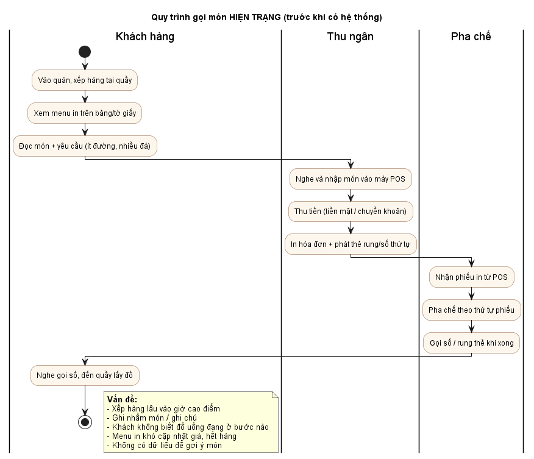
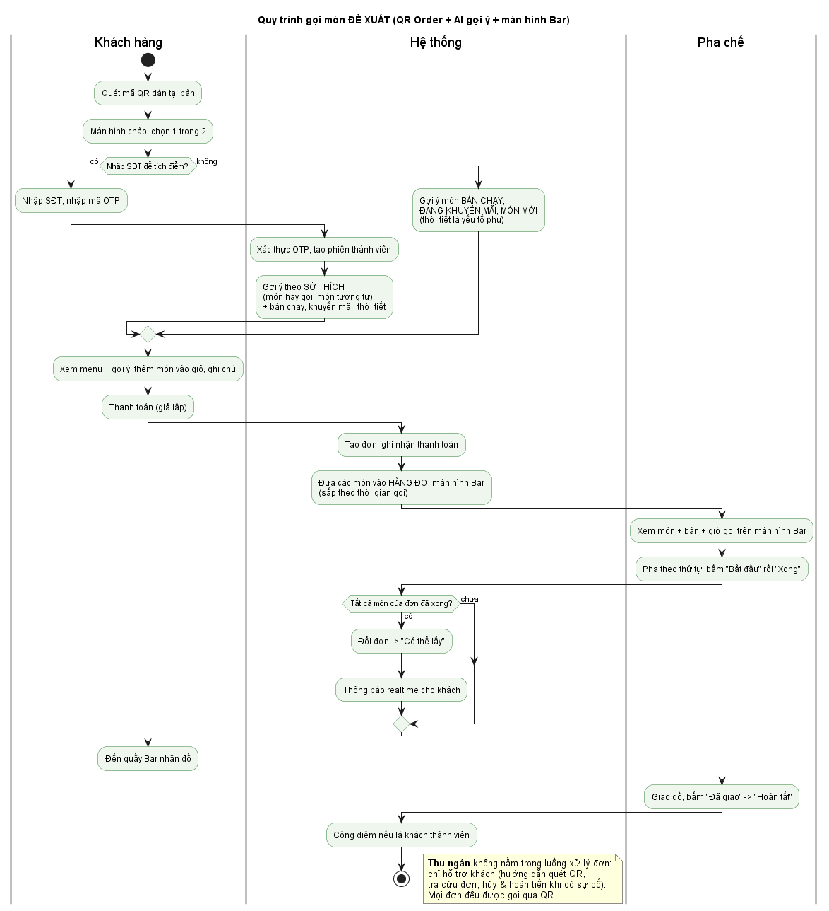

# II.1. KHẢO SÁT QUY TRÌNH QUẢN LÝ MENU VÀ ĐẶT HÀNG

| Thông tin | Nội dung |
|:---|:---|
| Người thực hiện | Ngô Duy Đô (D) |
| Người review | Nguyễn Thanh Bình (A – PM) |
| Thời gian | 25/09/2026 – 29/09/2026 (review 30/09/2026) |
| Cập nhật | 04/11/2026 – rà soát, đồng bộ với mã nguồn và kế hoạch D41 (CR-46) |
| Hình thức | Khảo sát giả định dựa trên mô hình chuỗi cà phê điển hình tại Việt Nam (3–10 chi nhánh, bán mang đi + ngồi tại chỗ), kèm bộ câu hỏi để nhóm đối chiếu với quán thực tế |

> **Lưu ý:** Số liệu trong tài liệu này là giả định mang tính điển hình, phục vụ phân tích. Nếu nhóm đi khảo sát được một quán thật, cập nhật Mục 5 và ghi nguồn ở Mục 6.

---

## 1. Đối tượng khảo sát

| Vai trò | Công việc chính liên quan đến hệ thống |
|:---|:---|
| Chủ chuỗi / Quản trị trụ sở | Ban hành menu chung, giá chuẩn; mở chi nhánh; xem doanh thu toàn chuỗi |
| Quản lý chi nhánh | Báo hết nguyên liệu, điều chỉnh giá khuyến mãi tại chi nhánh, quản lý ca nhân viên, bàn ghế |
| Thu ngân | Nhận order, thu tiền, xử lý hủy/đổi món, trả đồ cho khách |
| Pha chế (Barista) | Nhận phiếu, pha theo thứ tự, báo khách lấy đồ |
| Khách hàng | Xem menu, gọi món, chờ và nhận đồ uống |

## 2. Quy trình hiện trạng

### 2.1. Quản lý menu
1. Trụ sở chốt menu và giá trên file Excel, gửi xuống các chi nhánh qua nhóm chat.
2. Chi nhánh tự cập nhật menu trên phần mềm POS và in lại menu giấy hoặc bảng menu.
3. Khi hết nguyên liệu, thu ngân nhớ và báo miệng cho khách. Menu không tự cập nhật.
4. Khuyến mãi riêng ở từng chi nhánh được nhập tay vào POS, trụ sở khó kiểm soát.

### 2.2. Đặt hàng tại quầy
1. Khách xếp hàng, đọc món và yêu cầu riêng (ít đường, nhiều đá…).
2. Thu ngân nhập món vào POS, thu tiền, in hóa đơn và đưa thẻ rung hoặc số thứ tự.
3. Phiếu pha chế được in ra ở quầy Bar. Pha chế làm theo thứ tự phiếu.
4. Pha xong, pha chế gọi số hoặc rung thẻ. Khách đến quầy nhận đồ.

## 3. Vấn đề phát hiện (Pain points)

| # | Vấn đề | Ảnh hưởng | Hướng giải quyết trong dự án |
|:---|:---|:---|:---|
| P1 | Xếp hàng lâu giờ cao điểm (7h–9h, 12h–14h) | Khách bỏ về, mất doanh thu | Khách tự gọi món qua **QR tại bàn** |
| P2 | Nghe nhầm món hoặc ghi chú | Làm lại đồ uống, lãng phí nguyên liệu | Khách tự chọn món và tự nhập ghi chú, đơn được gửi thẳng xuống Bar |
| P3 | Khách không biết đồ uống đang ở bước nào | Hỏi lại nhiều lần, quầy bị quá tải | **Màn hình theo dõi trạng thái** realtime |
| P4 | Menu giấy chậm cập nhật hết hàng hoặc đổi giá | Khách gọi món đã hết | **Menu điện tử**: bật/tắt "Tạm hết" và đặt giá riêng theo chi nhánh |
| P5 | Trụ sở và chi nhánh quản lý menu rời rạc | Sai giá, khó kiểm soát | **Menu chung** ở trụ sở, chi nhánh chỉ được tùy biến trong phạm vi cho phép |
| P6 | Không có dữ liệu thói quen khách, khuyến mãi khó truyền tải tới khách | Không bán chéo hoặc gợi ý được | **AI gợi ý món** (món bán chạy, khuyến mãi, món mới; theo sở thích nếu khách là thành viên) + **tích điểm** để khách có lý do để lại SĐT |
| P7 | Phiếu in rời rạc, giờ cao điểm pha chế dễ làm sai thứ tự hoặc sót món | Khách đến trước nhận đồ sau, phải làm lại | **Màn hình hàng đợi pha chế**: hiển thị món, bàn, giờ gọi, ghi chú, **sắp theo thời gian gọi**; pha chế bấm Bắt đầu / Xong |

## 4. Quy trình đề xuất

Điểm thay đổi chính:
- Khách **trả trước** trên điện thoại (thanh toán giả lập) nên đơn xuống Bar là đơn đã thanh toán. **Mọi đơn đều gọi qua QR**; thu ngân không nhận order tại quầy (vì sẽ không biết khách ngồi bàn nào để lên đơn) và **không nằm trong luồng xử lý đơn**, chỉ hỗ trợ khách hàng (hướng dẫn quét QR, tra cứu đơn, hủy và hoàn tiền khi có sự cố). Pha chế là người giao đồ và xác nhận "Đã giao".
- Khách không cần cài app hay đăng ký tài khoản. Ngay sau khi quét QR, khách chọn **gọi món ngay** (ẩn danh) hoặc **nhập SĐT + OTP** để tích điểm và nhận gợi ý theo sở thích. Hệ thống không lưu thông tin nhận diện thiết bị, nên khách đổi điện thoại vẫn dùng được điểm của mình.
- Ban đầu nhóm cân nhắc dùng máy pha chế IoT để tự báo hoàn thành. Phương án này đã bị loại vì phần lớn đồ uống được pha tay, còn máy pha có kết nối thì ít mẫu và khó cập nhật công thức mới cho toàn chuỗi (xem II.2 Mục 3).

## 5. Kết quả khảo sát giả định (dùng làm giả thiết thiết kế)

| Chỉ số | Giá trị giả định | Dùng cho |
|:---|:---|:---|
| Số chi nhánh demo | 3 | Dữ liệu mẫu, phân quyền chi nhánh |
| Số bàn / chi nhánh | 15–25 | Sinh mã QR |
| Số món trong menu | 30–40 món, 5 danh mục | Dữ liệu mẫu, thuật toán gợi ý |
| Đơn giờ cao điểm / chi nhánh | ~60 đơn/giờ | Yêu cầu hiệu năng (III.2) |
| Số món trung bình / đơn | 1,8 | Sinh dữ liệu đơn hàng giả lập cho AI |
| Thời gian pha 1 ly | 1–4 phút | Ngưỡng cảnh báo món chờ lâu trên màn hình Bar (10 phút) |
| Tỉ lệ khách sẵn sàng để lại SĐT (để tích điểm) | ~40% | Tỉ lệ khách thành viên trong dữ liệu mẫu |
| Số chương trình khuyến mãi / tháng | 2–4 | Dữ liệu mẫu khuyến mãi |

## 6. Bộ câu hỏi phỏng vấn (để đối chiếu với quán thực tế)

**Quản lý / chủ quán**
1. Menu được thống nhất toàn chuỗi hay mỗi chi nhánh tự quyết? Giá có khác nhau giữa các chi nhánh không?
2. Khi hết nguyên liệu, quy trình báo hết món hiện nay như thế nào?
3. Anh/chị muốn xem những số liệu gì hằng ngày (doanh thu, món bán chạy, giờ cao điểm…)? Chương trình khuyến mãi hiện nay do ai quyết định, áp dụng theo chi nhánh hay toàn chuỗi? Báo cáo cuối ngày cần những chỉ số nào?
4. Quán phân quyền nhân viên ra sao? Ai được hủy đơn và hoàn tiền?

**Thu ngân / pha chế**

5. Giờ cao điểm mỗi giờ có khoảng bao nhiêu đơn? Lỗi nào hay gặp nhất?
6. Pha chế nhận phiếu theo cách nào? Có ưu tiên đơn nào trước không?
7. Có ghi chú đặc biệt nào hay gặp (đường, đá, size, topping)?

**Khách hàng**

8. Anh/chị có sẵn sàng quét QR để tự gọi món và thanh toán trên điện thoại không?
9. Anh/chị có muốn được gợi ý món (theo thời tiết hoặc món hay gọi) không? Anh/chị có sẵn sàng để lại số điện thoại để tích điểm không?

## 7. Kết luận

Kết quả khảo sát xác nhận phạm vi đã chốt ở [Pham_Vi_Du_An.md](../Pham_Vi_Du_An.md) là hợp lý. Ba phân hệ (Quản trị, QR Order, AI gợi ý món) giải quyết các vấn đề P1–P7. Đầu vào cho bước Phân tích (III):
- Danh sách tác nhân: Khách hàng, Khách thành viên, Quản trị viên, Quản lý chi nhánh, Thu ngân, Pha chế, Dịch vụ thời tiết.
- Quy tắc nghiệp vụ đã chốt: menu chung kèm tùy biến theo chi nhánh; khách chọn gọi món ẩn danh hoặc xác thực SĐT bằng OTP (giả lập) để tích điểm; trả trước bằng thanh toán giả lập; khuyến mãi đơn giản theo món.
