# III.1. BIỂU ĐỒ USE CASE VÀ SEQUENCE DIAGRAM CHO CÁC LUỒNG CHÍNH

| Thông tin | Nội dung |
|:---|:---|
| Người thực hiện | Nguyễn Thanh Bình (A – PM) |
| Người review | Nguyễn Trường Thiên (B) |
| Thời gian | 02/10/2026 – 06/10/2026 (review 07/10/2026) |
| Cập nhật | 09/10/2026 – bỏ IoT; thêm màn hình chào, OTP, tích điểm, khuyến mãi; màn hình Bar dạng hàng đợi (CR-09 → CR-14); chỉ Admin tạo KM, phiên 1 giờ (CR-15 → CR-19); thu ngân chỉ hỗ trợ khách, pha chế giao đồ, dashboard báo cáo ngày (CR-21 → CR-25); 06/11/2026 – rà soát, đồng bộ với mã nguồn và kế hoạch D41 (CR-46) |
| Mã nguồn sơ đồ | [diagrams/src/](diagrams/src/) (PlantUML), ảnh PNG trong [diagrams/png/](diagrams/png/) |

## 1. Tác nhân (Actors)

| Tác nhân | Loại | Mô tả |
|:---|:---|:---|
| Khách hàng | Người | Khách ngồi tại bàn, quét QR để gọi món. Không cần tài khoản |
| Khách thành viên | Người | Khách đã xác thực SĐT bằng OTP trong phiên hiện tại. Kế thừa Khách hàng, thêm tích điểm và gợi ý theo sở thích |
| Nhân viên | Người (trừu tượng) | Tác nhân cha của 4 vai trò bên dưới, dùng chung chức năng đăng nhập |
| Quản trị viên | Người | Thuộc trụ sở (`branch_id = NULL`), quản lý dữ liệu toàn chuỗi |
| Quản lý chi nhánh | Người | Quản lý 1 chi nhánh: menu chi nhánh, bàn, nhân viên chi nhánh. **Không** tạo khuyến mãi |
| Thu ngân | Người | **Không nằm trong luồng xử lý đơn.** Chỉ hỗ trợ khách hàng: hướng dẫn quét QR/OTP, tra cứu đơn, hủy đơn và hoàn tiền khi có sự cố. Không tạo đơn tại quầy (mọi đơn đều gọi qua QR) |
| Pha chế | Người | Làm theo hàng đợi trên màn hình Bar, bấm Bắt đầu / Xong, giao đồ cho khách và bấm "Đã giao" |
| Dịch vụ thời tiết | Hệ thống ngoài | OpenWeatherMap, cung cấp nhiệt độ cho AI gợi ý (yếu tố phụ) |

## 2. Biểu đồ Use Case

### 2.1. Tổng quát
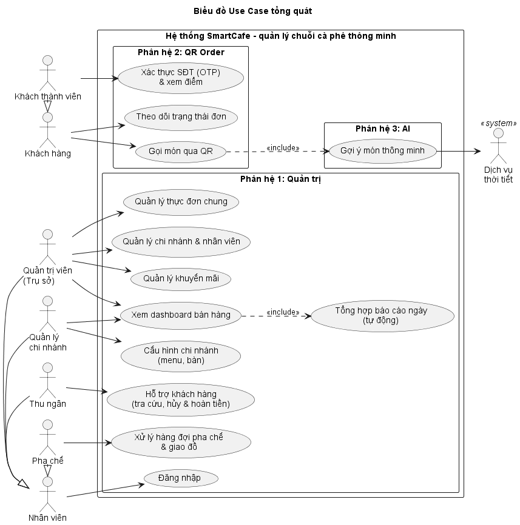

### 2.2. Phân hệ QR Order (Khách hàng)
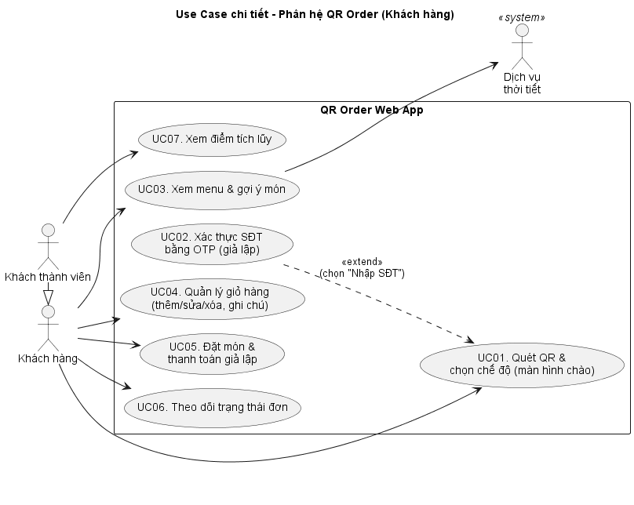

### 2.3. Phân hệ Quản trị
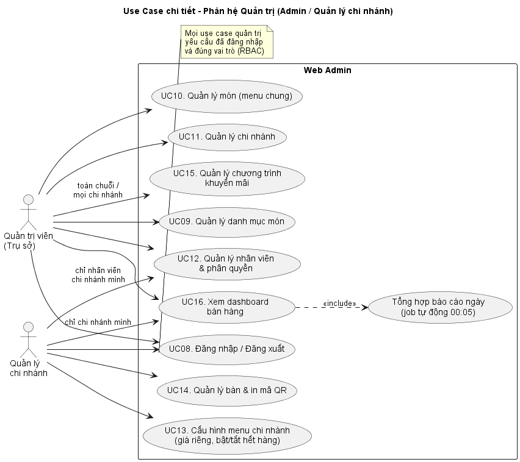

### 2.4. Vận hành quầy
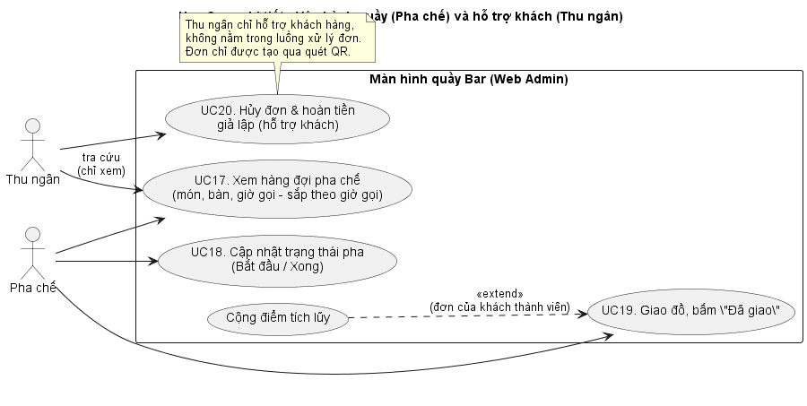

## 3. Danh sách Use Case

Độ ưu tiên: **M** = Must (bắt buộc cho demo), **S** = Should (nên có), **C** = Could (làm nếu còn thời gian).

| Mã | Tên Use Case | Tác nhân | Phân hệ | Ưu tiên | Luồng code (D26) |
|:---|:---|:---|:---|:---:|:---|
| UC01 | Quét QR & chọn chế độ (màn hình chào) | Khách hàng | QR Order | M | F1 |
| UC02 | Xác thực SĐT bằng OTP (giả lập) | Khách hàng | QR Order | M | F4 |
| UC03 | Xem menu & gợi ý món | Khách hàng, Dịch vụ thời tiết | QR Order + AI | M | F1, F7 |
| UC04 | Quản lý giỏ hàng | Khách hàng | QR Order | M | F2 |
| UC05 | Đặt món & thanh toán giả lập | Khách hàng | QR Order | M | F2 |
| UC06 | Theo dõi trạng thái đơn | Khách hàng | QR Order | M | F2 |
| UC07 | Xem điểm tích lũy | Khách thành viên | QR Order | S | F4 |
| UC08 | Đăng nhập / Đăng xuất | Nhân viên | Quản trị | M | F0 |
| UC09 | Quản lý danh mục món | Quản trị viên | Quản trị | M | F6 |
| UC10 | Quản lý món (menu chung) | Quản trị viên | Quản trị | M | F6 |
| UC11 | Quản lý chi nhánh | Quản trị viên | Quản trị | M | F6 |
| UC12 | Quản lý nhân viên & phân quyền | Quản trị viên, Quản lý CN | Quản trị | M | F6 |
| UC13 | Cấu hình menu chi nhánh | Quản lý CN | Quản trị | M | F6 |
| UC14 | Quản lý bàn & in mã QR | Quản lý CN | Quản trị | M | F6 |
| UC15 | Quản lý chương trình khuyến mãi | Quản trị viên | Quản trị | M | F6 |
| UC16 | Xem dashboard bán hàng (báo cáo tự tổng hợp hằng ngày) | Quản trị viên, Quản lý CN | Quản trị | M | F8 |
| UC17 | Xem hàng đợi pha chế (màn hình Bar) | Pha chế (Thu ngân chỉ tra cứu) | Vận hành | M | F3 |
| UC18 | Cập nhật trạng thái pha (Bắt đầu / Xong) | Pha chế | Vận hành | M | F3 |
| UC19 | Giao đồ, bấm "Đã giao" (cộng điểm) | Pha chế | Vận hành | M | F3 |
| UC20 | Hủy đơn & hoàn tiền giả lập (hỗ trợ khách) | Thu ngân | Hỗ trợ | S | F5 |

**Ma trận phân quyền (RBAC):**

| Chức năng | ADMIN | MANAGER | CASHIER | BARISTA |
|:---|:---:|:---:|:---:|:---:|
| Danh mục, món (menu chung), chi nhánh | ✔ | Chỉ xem | – | – |
| Nhân viên | ✔ (tất cả) | ✔ (chi nhánh mình, không tạo ADMIN/MANAGER) | – | – |
| Menu chi nhánh, bàn & QR | ✔ | ✔ (chi nhánh mình) | – | – |
| Khuyến mãi | ✔ (toàn chuỗi / mọi chi nhánh) | – | – | – |
| Màn hình Bar: xem hàng đợi | – (không thuộc chi nhánh) | ✔ | ✔ (chỉ tra cứu) | ✔ |
| Bắt đầu / Xong món | – | ✔ | – | ✔ |
| Hủy đơn & hoàn tiền (hỗ trợ khách) | – | ✔ | ✔ | – |
| Giao đồ ("Đã giao") | – | ✔ | – | ✔ |
| Dashboard bán hàng | ✔ (toàn chuỗi) | ✔ (chi nhánh mình) | – | – |

## 4. Đặc tả Use Case chính

### UC01 – Quét QR & chọn chế độ
| Mục | Nội dung |
|:---|:---|
| Tác nhân | Khách hàng |
| Tiền điều kiện | Bàn có mã QR hợp lệ (`dining_tables.is_active = true`), chi nhánh đang hoạt động |
| Hậu điều kiện | Khách vào menu ở chế độ **ẩn danh** hoặc **thành viên** |
| Luồng chính | 1. Khách quét QR, trình duyệt mở `/t/{qr_token}`. 2. Hệ thống xác định chi nhánh và bàn. 3. Hệ thống hiển thị **màn hình chào** (W00) với 2 lựa chọn: "Nhập số điện thoại" (tích điểm, gợi ý theo sở thích) và "Xem menu ngay". 4a. Khách chọn "Xem menu ngay": chuyển sang UC03 ở chế độ ẩn danh. 4b. Khách chọn "Nhập số điện thoại": thực hiện UC02. |
| Luồng ngoại lệ | 2a. Mã QR sai hoặc bàn bị khóa: hiện "Mã QR không hợp lệ, vui lòng gọi nhân viên". |
| Quy tắc | Khách ẩn danh có thể chuyển sang thành viên bất cứ lúc nào bằng nút "Nhập SĐT tích điểm" trên menu, kể cả khi giỏ hàng đã có món. Hệ thống **không lưu định danh thiết bị**: lần quét sau, khách lại chọn chế độ. |

### UC02 – Xác thực SĐT bằng OTP (giả lập)
| Mục | Nội dung |
|:---|:---|
| Tác nhân | Khách hàng |
| Hậu điều kiện | Khách trở thành **Khách thành viên** trong phiên hiện tại (customer token **1 giờ**, lưu trong sessionStorage của tab) |
| Luồng chính | 1. Khách nhập SĐT. 2. Hệ thống kiểm tra định dạng SĐT Việt Nam và giới hạn gửi, sinh mã 6 số, lưu mã đã băm (hết hạn 5 phút), gửi qua Mock SMS. 3. Khách nhập mã. 4. Hệ thống kiểm tra mã, tạo bản ghi `customers` nếu SĐT mới, trả customer token cùng số điểm hiện có. 5. Menu hiện "Xin chào – X điểm (≈ Yđ)". Hệ thống chỉ lưu SĐT, không thu thập tên (D31). |
| Ngoại lệ | 2a. Gửi lại khi chưa đủ 60 giây hoặc đã quá 5 mã/giờ: báo thời gian chờ. 4a. Sai mã: báo lỗi, tăng số lần thử; sai 5 lần thì mã bị hủy, phải yêu cầu mã mới. 4b. Mã hết hạn: yêu cầu gửi lại. |
| Ghi chú | Chế độ demo hiện mã trên màn hình (khung "[DEMO]"); không gửi SMS thật. |

### UC03 – Xem menu & gợi ý món
| Mục | Nội dung |
|:---|:---|
| Tác nhân | Khách hàng; Dịch vụ thời tiết |
| Luồng chính | 1. Hệ thống hiển thị menu theo danh mục với **giá bán = giá khuyến mãi (nếu có) / giá chi nhánh / giá chung**. Món đang KM hiện giá gốc gạch ngang, món mới có nhãn "MỚI", món hết hàng hiện "Tạm hết". 2. Hệ thống hiển thị khối "Gợi ý cho bạn" (top 5 kèm lý do): **ẩn danh** thì theo bán chạy, khuyến mãi, món mới, thời tiết; **thành viên** thì theo sở thích, món tương tự, bán chạy, khuyến mãi, thời tiết (công thức ở II.2 Mục 2.3). 3. Ghi `recommendation_logs`. |
| Ngoại lệ | 2a. Dịch vụ gợi ý lỗi: ẩn khối gợi ý, menu vẫn hoạt động. 2b. Thành viên chưa có đơn nào: dùng gợi ý như khách ẩn danh. |
| Quy tắc | Menu tự tải lại khi có sự kiện `MENU_UPDATED` (đổi tình trạng món, khuyến mãi mới). Chỉ hiện nhãn KM khi giá KM **thấp hơn** giá đang bán của chi nhánh; nếu không thì hiển thị như món thường (D27) |

### UC05 – Đặt món & thanh toán giả lập
| Mục | Nội dung |
|:---|:---|
| Tác nhân | Khách hàng |
| Tiền điều kiện | Giỏ hàng có ít nhất 1 món |
| Hậu điều kiện | Đơn ở trạng thái PAID, các món xuất hiện ở **cuối hàng đợi** màn hình Bar |
| Luồng chính | 1. Khách xem giỏ: tạm tính, giảm giá KM, tổng cộng, và **số điểm sẽ nhận** nếu là thành viên. 2. Bấm "Thanh toán & gửi đơn". 3. Hệ thống kiểm tra lại tình trạng còn hàng và **tính lại giá ở server**, tạo đơn PENDING_PAYMENT, chốt `original_price`, `unit_price`, `promotion_id`; gắn `customer_id` nếu có customer token. 4. Khách chọn phương thức (giả lập) và xác nhận. 5. Hệ thống ghi `payments`, chuyển đơn sang PAID, đẩy sự kiện xuống Bar. 6. Chuyển sang UC06. |
| Ngoại lệ | 3a. Có món vừa hết: báo tên món, yêu cầu bỏ món đó. 3b. Khuyến mãi vừa hết hạn: hiện giá mới và yêu cầu khách xác nhận lại. 5a. Thanh toán thất bại: đơn giữ PENDING_PAYMENT, khách thử lại. 5b. **Không nhận được thanh toán sau 15 phút thì hệ thống tự hủy đơn** (source = SYSTEM). Vì thanh toán là giả lập và trả kết quả ngay, quy tắc này chỉ được **mô tả** trong tài liệu, **chưa cài đặt job** (D22). |
| Quy tắc | Mỗi món tối đa 20 ly/đơn; ghi chú tối đa 255 ký tự; mã đơn = `{mã chi nhánh}-{số thứ tự trong ngày, 4 chữ số}` |

### UC06 – Theo dõi trạng thái đơn
| Mục | Nội dung |
|:---|:---|
| Luồng chính | 1. Trang theo dõi mở WebSocket `/ws/order/{order_id}?token=`. 2. Hiển thị 3 bước **Đang chờ** (PAID) → **Đang pha chế** (PREPARING) → **Có thể lấy** (READY), trạng thái từng món, và **vị trí trong hàng đợi**. 3. Khi đơn READY: hiện thông báo và rung điện thoại. 4. Khi đơn COMPLETED: thành viên thấy "+X điểm". |
| Phiên thành viên | Hết hạn sau **1 giờ** hoặc khi đóng tab. Hết phiên thì menu trở về chế độ ẩn danh; trang theo dõi đơn vẫn xem được (dùng `access_token` của đơn), và đơn đã đặt khi còn phiên vẫn được cộng điểm |
| Ngoại lệ | Mất kết nối WebSocket: tự kết nối lại, đồng bộ qua REST. Đơn bị hủy: hiện "Đơn đã hủy – đã hoàn tiền" và lý do. |
| Bảo mật | `orders.access_token` ngẫu nhiên được trả về khi tạo đơn, để người khác không xem được đơn bằng cách đoán ID |

### UC15 – Quản lý chương trình khuyến mãi
| Mục | Nội dung |
|:---|:---|
| Tác nhân | Quản trị viên (chọn phạm vi toàn chuỗi hoặc 1 chi nhánh). Quản lý chi nhánh **không** tạo/sửa khuyến mãi, để đơn giản hóa luồng vận hành |
| Luồng chính | 1. Tạo chương trình: tên, mô tả, phạm vi, thời gian bắt đầu/kết thúc. 2. Thêm món và giá khuyến mãi. 3. Lưu; chương trình **tự có hiệu lực** trong khoảng thời gian đã đặt. 4. Có thể sửa, tắt (`is_active = false`) hoặc xem danh sách chương trình đang chạy, sắp chạy, đã kết thúc. |
| Quy tắc | `end_at > start_at`; giá KM nhỏ hơn giá bán hiện tại; một món thuộc nhiều KM cùng lúc thì lấy **giá thấp nhất**; không làm voucher, combo, mua 1 tặng 1; không sửa được chương trình đã kết thúc (giữ đúng lịch sử). |

### UC16 – Xem dashboard bán hàng
| Mục | Nội dung |
|:---|:---|
| Tác nhân | Quản trị viên (mọi chi nhánh), Quản lý chi nhánh (chi nhánh mình) |
| Luồng chính | 1. Lúc **00:05 mỗi ngày**, job hệ thống tổng hợp số liệu ngày hôm trước cho từng chi nhánh và lưu vào `daily_sales_reports`. 2. Người dùng mở "Tổng quan" (W08), chọn chi nhánh và khoảng thời gian (7 / 30 ngày). 3. Hệ thống hiển thị: thẻ chỉ số của ngày gần nhất so với ngày trước, **biểu đồ doanh thu theo ngày của từng chi nhánh**, bảng so sánh chi nhánh, top 5 món. |
| Chỉ số | Doanh thu; số đơn; số đơn hủy; giá trị trung bình/đơn; thời gian chờ trung bình (thanh toán → có thể lấy); tỉ lệ đơn thành viên; doanh thu từ món khuyến mãi; tỉ lệ món thêm từ gợi ý AI; top 5 món |
| Quy tắc | Báo cáo tính theo ngày (giờ Việt Nam), chỉ gồm các ngày đã kết thúc; không có số liệu realtime trong ngày. Doanh thu = tổng tiền các đơn đã thanh toán trong ngày, không tính đơn hủy. Job chạy lại được cho một ngày bất kỳ (UPSERT) nếu cần tính lại. |

### UC17 + UC18 – Hàng đợi pha chế trên màn hình Bar
| Mục | Nội dung |
|:---|:---|
| Tác nhân | Pha chế (thu ngân chỉ tra cứu, không thao tác) |
| Luồng chính | 1. Màn hình Bar hiển thị **từng món** chưa xong (WAITING, PREPARING) gồm: số thứ tự, **giờ gọi**, số phút đã chờ, **bàn**, mã đơn, tên món, số lượng, **ghi chú**. **Sắp theo giờ gọi tăng dần** (giờ thanh toán của đơn); các món cùng đơn đứng liền nhau. 2. Pha chế bấm "Bắt đầu": món chuyển PREPARING; nếu đơn đang PAID thì đơn chuyển PREPARING. 3. Pha xong, bấm "Xong": món chuyển DONE và rời hàng đợi. 4. Khi tất cả món của đơn DONE, đơn chuyển READY và hiện ở cột "Có thể lấy"; khách nhận thông báo. |
| Ngoại lệ | 3a. Bấm nhầm "Xong": có nút "Hoàn tác" trong 10 giây; món quay lại PREPARING. Nếu đó là món cuối làm đơn đã chuyển READY thì **đơn quay lại PREPARING** (ghi lịch sử, khách thấy lại "Đang pha") – D30. Đơn đã COMPLETED thì không hoàn tác. |
| Quy tắc | Món chờ quá 10 phút hiển thị màu đỏ; có âm báo khi có món mới; dữ liệu cập nhật qua WebSocket, không cần tải lại trang. |

### UC19 – Giao đồ, bấm "Đã giao" (cộng điểm)
| Mục | Nội dung |
|:---|:---|
| Tác nhân | Pha chế |
| Luồng chính | 1. Khách đến quầy Bar nhận đồ; pha chế đưa đồ và bấm "Đã giao" trên đơn ở cột "Có thể lấy". 2. Đơn chuyển COMPLETED. 3. Nếu đơn có `customer_id`: cộng `floor(total_amount / 10.000)` điểm, ghi `loyalty_transactions` (mỗi đơn chỉ cộng 1 lần). |
| Quy tắc | Điểm tính trên số tiền thực trả (sau KM). Cộng điểm khi hoàn tất, không cộng lúc thanh toán, nên đơn bị hủy không bao giờ phát sinh điểm. **1 điểm có giá trị 100đ** (tỉ lệ hoàn lại 1%). Giá trị này dùng để hiển thị và làm cơ sở cho tính năng đổi điểm sau này (hiện chưa làm đổi điểm). |

### UC20 – Hủy đơn & hoàn tiền giả lập (hỗ trợ khách)
| Mục | Nội dung |
|:---|:---|
| Tác nhân | Thu ngân (Quản lý chi nhánh cũng làm được) |
| Tiền điều kiện | Đơn ở trạng thái PAID hoặc PREPARING (đơn PENDING_PAYMENT chưa vào hàng đợi; quy tắc tự hủy sau 15 phút chỉ mô tả – D22) |
| Luồng chính | Khi khách cần hỗ trợ (gọi nhầm món, đổi ý, sự cố), thu ngân tra cứu đơn theo mã đơn hoặc bàn, nhập lý do; hệ thống hoàn tiền giả lập, chuyển đơn và các món sang CANCELLED, xóa các món khỏi hàng đợi Bar, thông báo cho khách |
| Ngoại lệ | Đơn đã READY/COMPLETED: không cho hủy (409) |

## 5. Biểu đồ trạng thái Đơn hàng
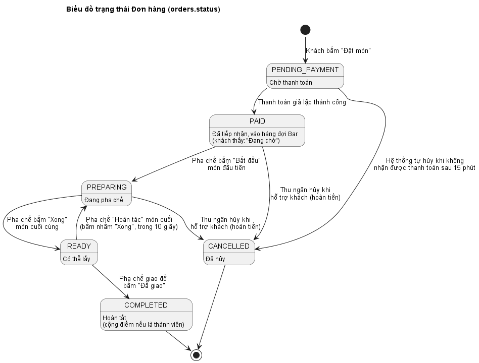

Trạng thái từng món (`order_items.status`): `WAITING → PREPARING → DONE`, hoặc `CANCELLED` khi đơn bị hủy.

## 6. Sequence Diagram các luồng chính

### SD01 – Quét QR, chọn chế độ và xác thực OTP
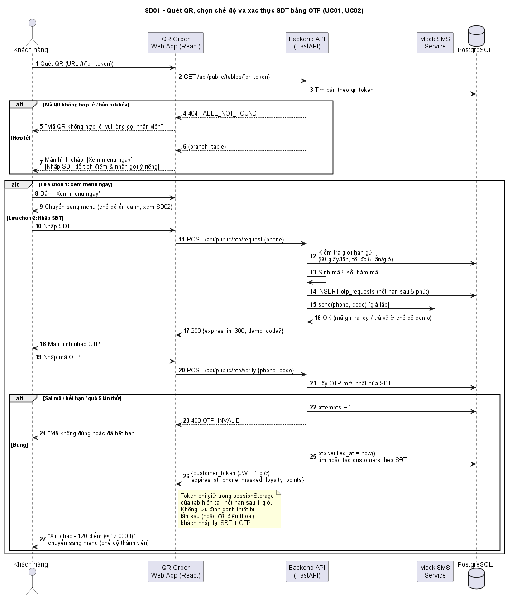

### SD02 – Xem menu và gợi ý món theo 2 chế độ
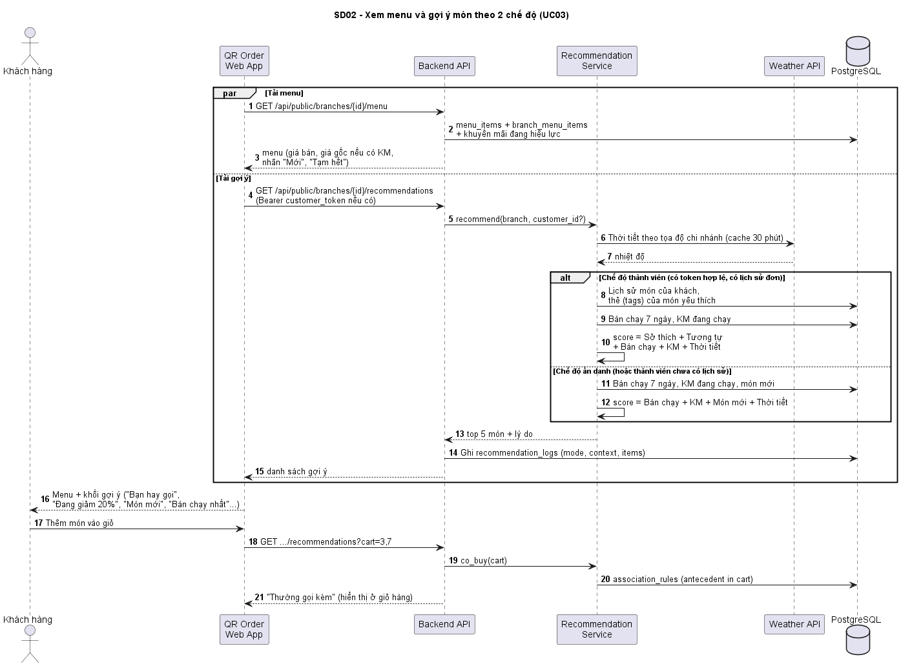

### SD03 – Đặt món và thanh toán giả lập
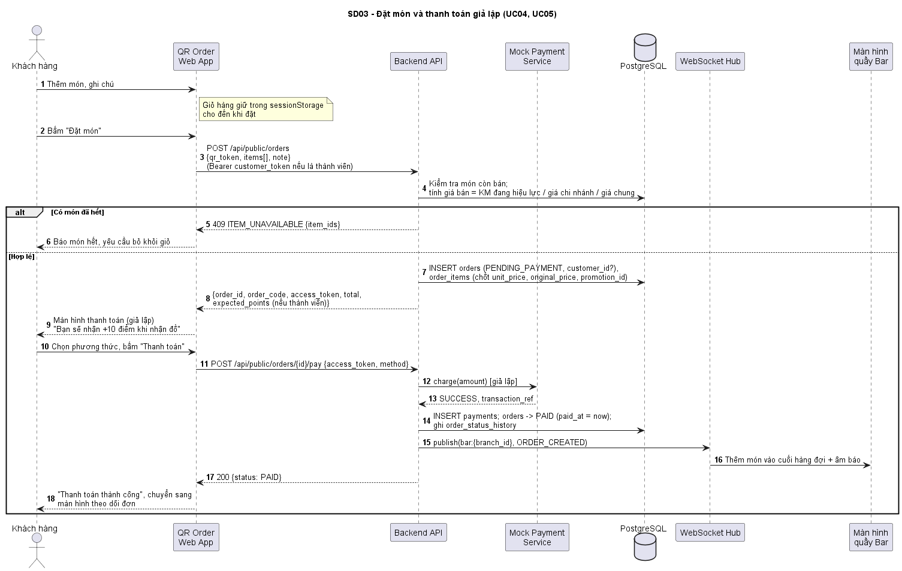

### SD04 – Pha chế theo hàng đợi trên màn hình Bar
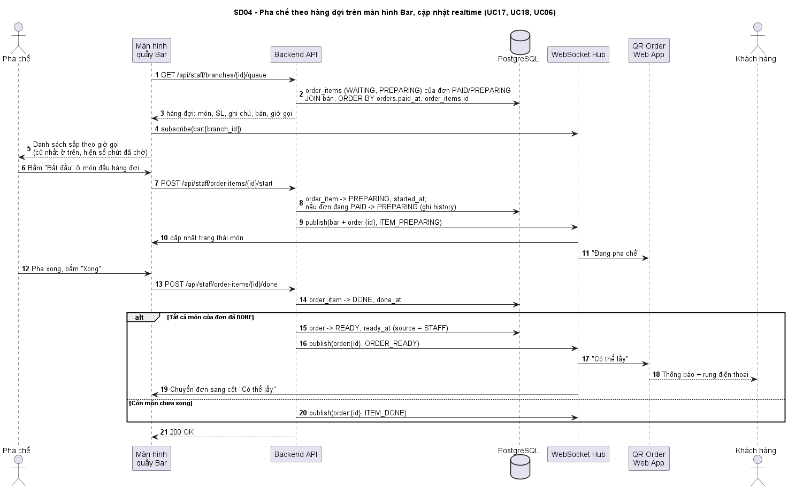

### SD05 – Đăng nhập, cấu hình menu chi nhánh và tạo khuyến mãi
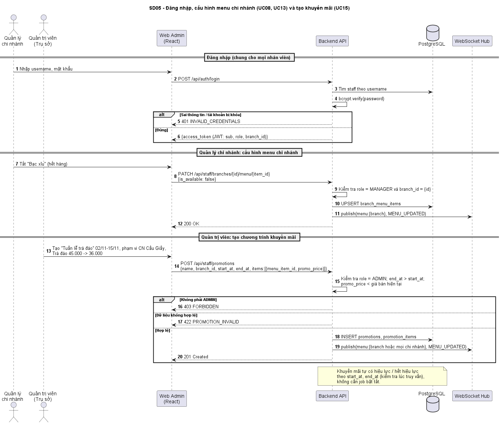

### SD06 – Thu ngân hủy đơn khi hỗ trợ khách; pha chế giao đồ và cộng điểm
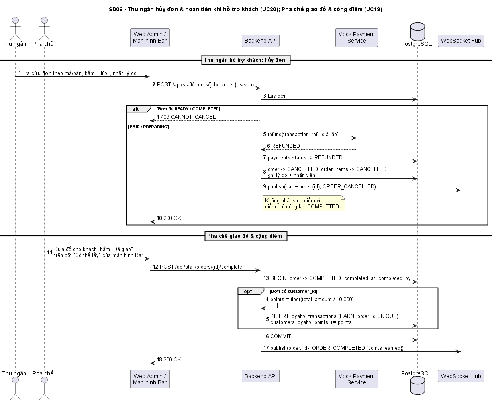
