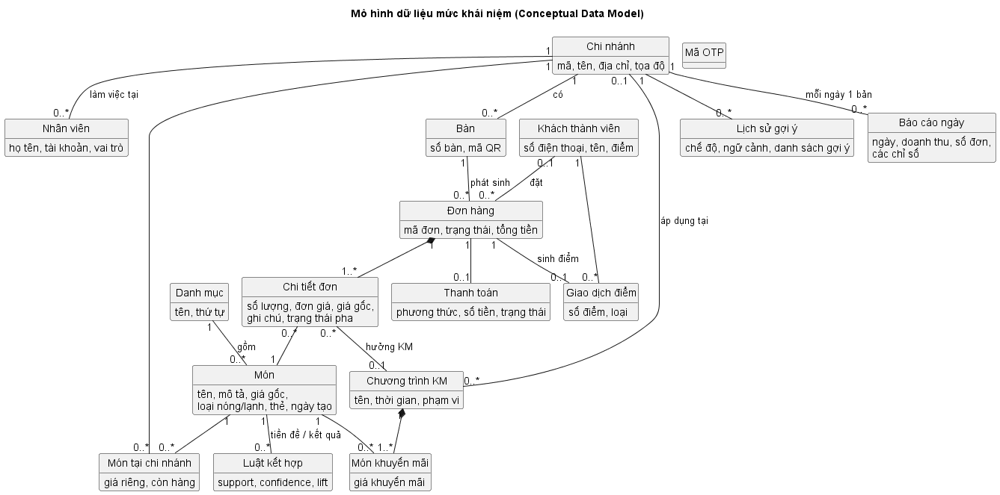

# III.2. YÊU CẦU PHI CHỨC NĂNG VÀ MÔ HÌNH DỮ LIỆU

| Thông tin | Nội dung |
|:---|:---|
| Người thực hiện | Ngô Duy Đô (D) |
| Người review | Lê Minh Sơn (C) |
| Thời gian | 05/10/2026 – 08/10/2026 (review 09/10/2026) |
| Cập nhật | 05/10/2026 – bỏ IoT; thêm OTP, tích điểm, khuyến mãi (CR-09 → CR-14); 03/11/2026 – mô hình tải NFR-P2/P3 (D39); 06/11/2026 – rà soát, đồng bộ với mã nguồn và kế hoạch D41 (CR-46) |

## 1. Yêu cầu phi chức năng (Non-functional Requirements)

Mỗi yêu cầu có **cách kiểm chứng** để Ngô Duy Đô (D) đưa vào Test Case ở giai đoạn VI.

### 1.1. Hiệu năng (Performance)
| Mã | Yêu cầu | Cách kiểm chứng |
|:---|:---|:---|
| NFR-P1 | Trang menu QR tải xong (First Contentful Paint) ≤ **2 giây** trên mạng 4G | Chrome DevTools, Lighthouse giả lập "Fast 4G" |
| NFR-P2 | API đọc (quét QR, menu, đơn) phản hồi ≤ **300 ms** (p95) với 50 người dùng đồng thời – mỗi người thao tác 3–5 giây một lần (D39) | Script tải `system_test/st_hieu_nang.py` (asyncio + httpx, tương đương Locust / k6), 50 người dùng ảo |
| NFR-P3 | API gợi ý món phản hồi ≤ **500 ms** (p95) cùng mô hình tải NFR-P2, kể cả khi gọi Weather API (có cache) | `st_hieu_nang.py` |
| NFR-P4 | Món mới xuất hiện trên hàng đợi Bar và thay đổi trạng thái hiển thị trên màn hình khách trong ≤ **2 giây** | Đo thời gian từ lúc gọi API tới lúc UI cập nhật |
| NFR-P5 | Chịu được **60 đơn/giờ/chi nhánh** × 3 chi nhánh (giả định khảo sát II.1) | Script tạo đơn tự động |
| NFR-P6 | Dashboard (W08) hiển thị ≤ **2 giây** với 30 ngày × 3 chi nhánh; job tổng hợp báo cáo ngày chạy xong ≤ **1 phút** | Đo trên dữ liệu seed |

### 1.2. Bảo mật (Security)
| Mã | Yêu cầu |
|:---|:---|
| NFR-S1 | Mật khẩu nhân viên băm bằng **bcrypt** (cost ≥ 10), không lưu dạng rõ |
| NFR-S2 | API nhân viên yêu cầu **JWT** (hết hạn sau 8 giờ = 1 ca làm). Kiểm tra **vai trò và chi nhánh** ở mọi endpoint theo ma trận RBAC (III.1). Phiên khách thành viên dùng JWT riêng (role CUSTOMER, hết hạn **1 giờ**), không gọi được API nhân viên |
| NFR-S3 | `qr_token` của bàn và `access_token` của đơn là chuỗi ngẫu nhiên ≥ 128 bit (`secrets.token_urlsafe`). Không dùng ID tăng dần trên URL công khai |
| NFR-S4 | **OTP:** 6 số ngẫu nhiên (`secrets`), lưu dạng băm, hết hạn 5 phút, tối đa 5 lần nhập sai/mã, gửi lại sau 60 giây, tối đa 5 mã/giờ/SĐT. Response không tiết lộ SĐT đã là thành viên hay chưa |
| NFR-S5 | Kiểm tra dữ liệu đầu vào bằng Pydantic. Dùng ORM với tham số hóa (chống SQL Injection). React mặc định escape output (chống XSS) |
| NFR-S6 | Giá và tổng tiền **luôn tính lại ở server**, không tin giá client gửi lên |
| NFR-S7 | Chỉ lưu SĐT khi khách chủ động chọn chế độ thành viên **và xác thực OTP thành công**; hiển thị mục đích sử dụng (tích điểm, gợi ý món). **Không lưu định danh thiết bị** (không cookie lâu dài, không fingerprint); customer token chỉ nằm trong sessionStorage |

### 1.3. Khả dụng và tin cậy (Availability & Reliability)
| Mã | Yêu cầu |
|:---|:---|
| NFR-R1 | Lỗi của module AI hoặc Weather API **không được làm hỏng** luồng đặt món (degrade gracefully) |
| NFR-R2 | Màn hình Bar mất kết nối WebSocket thì hiện cảnh báo "Mất kết nối" và tự tải lại hàng đợi qua REST mỗi 10 giây cho đến khi kết nối lại |
| NFR-R3 | Client WebSocket tự kết nối lại và đồng bộ trạng thái qua REST |
| NFR-R4 | Đổi trạng thái đơn và cộng điểm chạy trong **cùng transaction**. Thao tác lặp (bấm "Xong" 2 lần, gọi "Đã giao" 2 lần) không làm sai trạng thái và **không cộng điểm 2 lần** (ràng buộc UNIQUE `loyalty_transactions.order_id`) |
| NFR-R5 | Có script backup CSDL (`pg_dump`) trước mỗi buổi demo – `scripts/backup_db.ps1`, khôi phục bằng `scripts/restore_db.ps1` |

### 1.4. Khả năng sử dụng (Usability)
| Mã | Yêu cầu |
|:---|:---|
| NFR-U1 | Giao diện QR Order **mobile-first** (360–430px), không cần cài app, hoạt động trên Chrome Android và Safari iOS bản mới |
| NFR-U2 | Khách ẩn danh hoàn tất 1 đơn 2 món trong ≤ **6 thao tác chạm** kể từ màn hình chào (không tính nhập ghi chú) |
| NFR-U3 | Màn hình Bar đọc được từ xa 1,5 m: chữ ≥ 18px, màu phân biệt trạng thái, âm báo khi có món mới, món chờ quá 10 phút hiển thị màu đỏ |
| NFR-U4 | Toàn bộ giao diện **tiếng Việt**. Tiền hiển thị dạng `45.000đ` |

### 1.5. Bảo trì và mở rộng (Maintainability)
| Mã | Yêu cầu |
|:---|:---|
| NFR-M1 | Backend chia module theo nghiệp vụ (auth, customer, menu, branch, order, payment, bar, support, admin – gồm khuyến mãi, recommend, report). Có tài liệu API tự sinh bằng Swagger tại `/docs` |
| NFR-M2 | Migration CSDL bằng **Alembic**, không sửa schema bằng tay |
| NFR-M3 | Unit test cho service Order và Recommend đạt độ bao phủ ≥ **60%** (pytest) |
| NFR-M4 | Payment và SMS dùng interface để có thể thay cổng thanh toán / dịch vụ SMS thật mà không sửa logic nghiệp vụ |
| NFR-M5 | Chạy toàn hệ thống bằng `docker compose up`. Có file `.env.example` |

## 2. Mô hình dữ liệu mức khái niệm (Conceptual Data Model)

### 2.1. Thực thể

| Thực thể | Ý nghĩa | Thuộc tính chính |
|:---|:---|:---|
| Chi nhánh | Một quán trong chuỗi | mã, tên, địa chỉ, tọa độ (dùng lấy thời tiết) |
| Nhân viên | Người dùng hệ thống quản trị | họ tên, tài khoản, vai trò, chi nhánh |
| Danh mục | Nhóm món (Cà phê, Trà, Đá xay, Bánh…) | tên, thứ tự |
| Món | Món trong **menu chung** toàn chuỗi | tên, mô tả, giá gốc, loại nóng/lạnh, thẻ, ngày tạo (xác định "món mới") |
| Món tại chi nhánh | Tùy biến của chi nhánh cho một món | giá riêng, còn hàng |
| Chương trình KM | Đợt khuyến mãi có thời hạn, toàn chuỗi hoặc 1 chi nhánh | tên, thời gian, phạm vi |
| Món khuyến mãi | Món thuộc chương trình KM | giá khuyến mãi |
| Bàn | Bàn tại chi nhánh, gắn 1 mã QR | số bàn, mã QR |
| Khách thành viên | Khách đã xác thực SĐT bằng OTP | SĐT, tổng điểm (không thu thập tên – D31) |
| Mã OTP | Lần gửi mã xác thực | SĐT, mã đã băm, hạn, số lần thử |
| Giao dịch điểm | Mỗi lần cộng/điều chỉnh điểm | số điểm, loại, đơn liên quan |
| Đơn hàng | Một lần gọi món tại bàn | mã đơn, trạng thái, tổng tiền, các mốc thời gian |
| Chi tiết đơn | Một dòng món trong đơn | số lượng, giá gốc, **đơn giá chốt**, KM áp dụng, ghi chú, trạng thái pha |
| Thanh toán | Giao dịch giả lập của đơn | phương thức, số tiền, mã giao dịch |
| Lịch sử gợi ý | Mỗi lần AI gợi ý, dùng để đánh giá | chế độ (ẩn danh/thành viên), ngữ cảnh, danh sách món + điểm |
| Báo cáo ngày | Số liệu bán hàng tổng hợp mỗi ngày cho từng chi nhánh (dùng cho dashboard) | ngày, doanh thu, số đơn, số đơn hủy, giá trị TB, thời gian chờ TB, tỉ lệ thành viên, doanh thu KM, tỉ lệ món từ gợi ý, top món |
| Luật kết hợp | Kết quả khai phá FP-Growth | món tiền đề, món kết quả, support, confidence, lift |

### 2.2. Quy tắc nghiệp vụ ảnh hưởng đến dữ liệu
1. **Giá bán:** giá thường = `COALESCE(price_override, base_price)`; nếu có khuyến mãi đang hiệu lực (toàn chuỗi hoặc đúng chi nhánh) thì giá bán = `LEAST(giá KM thấp nhất, giá thường)`. Nếu chi nhánh chưa có dòng cấu hình cho một món thì món được bán với giá chung và mặc định còn hàng.
2. **Chốt giá:** `order_items.original_price` (giá thường), `unit_price` (giá thực bán) và `promotion_id` được lưu tại thời điểm đặt, nên đổi giá hay hết KM sau này không ảnh hưởng đơn cũ.
3. **Xóa mềm món:** món đã từng có trong đơn không được xóa vật lý (`is_deleted = true`).
4. **Khách không bắt buộc:** `orders.customer_id` có thể NULL (đơn ẩn danh). Khách thành viên được nhận diện duy nhất theo **SĐT đã xác thực OTP**; bản ghi `customers` chỉ được tạo sau khi OTP đúng.
5. **Tích điểm:** `floor(total_amount / 10.000)` điểm, cộng khi đơn COMPLETED, tối đa 1 lần/đơn. `customers.loyalty_points` luôn bằng tổng `loyalty_transactions.points`. 1 điểm có giá trị 100đ (tỉ lệ hoàn lại 1%), cấu hình bằng `POINT_VALUE_VND`. Chưa có đổi điểm.
6. **Mỗi đơn có tối đa 1 thanh toán** (trả trước toàn bộ). Hoàn tiền thì cập nhật trạng thái của chính bản ghi đó.
7. **Nhân viên trụ sở** (ADMIN) không thuộc chi nhánh nào. Mọi vai trò khác bắt buộc có chi nhánh.
8. **Lịch sử trạng thái** được ghi lại cho mọi lần đổi trạng thái đơn, kèm nguồn (Khách / Nhân viên / Hệ thống). Dữ liệu này dùng để đo thời gian chờ và thời gian pha trung bình.

Thiết kế chi tiết các bảng ở [IV.1_Thiet_ke_CSDL.md](IV.1_Thiet_ke_CSDL.md).
