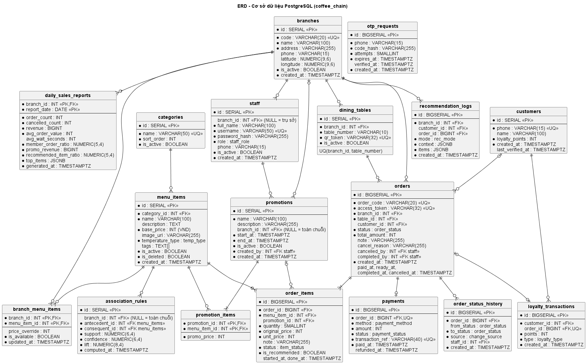

# IV.1. THIẾT KẾ CƠ SỞ DỮ LIỆU (ERD, RELATIONAL SCHEMA)

| Thông tin | Nội dung |
|:---|:---|
| Người thực hiện | Thành viên B |
| Người review | Thành viên A (PM) |
| Thời gian | 13/10/2026 – 16/10/2026 (review 17/10/2026) |
| Cập nhật | 01/11/2026 – bỏ 3 bảng IoT; thêm 4 bảng khuyến mãi, OTP, tích điểm (CR-09 → CR-14) |
| Hệ quản trị | PostgreSQL 16 – CSDL `coffee_chain` |
| Script tạo bảng | [schema.sql](schema.sql) |

## 1. Biểu đồ ERD



Hệ thống gồm **18 bảng**, chia 6 nhóm:

| Nhóm | Bảng |
|:---|:---|
| Tổ chức | `branches`, `staff` |
| Thực đơn & khuyến mãi | `categories`, `menu_items`, `branch_menu_items`, `promotions`, `promotion_items` |
| Bàn & khách | `dining_tables`, `customers`, `otp_requests`, `loyalty_transactions` |
| Đơn hàng | `orders`, `order_items`, `order_status_history`, `payments` |
| AI | `recommendation_logs`, `association_rules` |
| Báo cáo | `daily_sales_reports` |

## 2. Lược đồ quan hệ (Relational Schema)

Ký hiệu: <u>gạch chân</u> = khóa chính, `#` = khóa ngoại.

- **branches**(<u>id</u>, code, name, address, phone, latitude, longitude, is_active, created_at)
- **staff**(<u>id</u>, #branch_id, full_name, username, password_hash, role, phone, is_active, created_at)
- **categories**(<u>id</u>, name, sort_order, is_active)
- **menu_items**(<u>id</u>, #category_id, name, description, base_price, image_url, temperature_type, tags, is_active, is_deleted, created_at)
- **branch_menu_items**(<u>#branch_id, #menu_item_id</u>, price_override, is_available, updated_at)
- **promotions**(<u>id</u>, name, description, #branch_id, start_at, end_at, is_active, #created_by, created_at)
- **promotion_items**(<u>#promotion_id, #menu_item_id</u>, promo_price)
- **dining_tables**(<u>id</u>, #branch_id, table_number, qr_token, is_active)
- **customers**(<u>id</u>, phone, loyalty_points, created_at, last_verified_at)
- **otp_requests**(<u>id</u>, phone, code_hash, attempts, expires_at, verified_at, created_at)
- **loyalty_transactions**(<u>id</u>, #customer_id, #order_id, points, type, created_at)
- **orders**(<u>id</u>, order_code, order_date, access_token, #branch_id, #table_id, #customer_id, status, total_amount, note, cancel_reason, #cancelled_by, #completed_by, created_at, paid_at, ready_at, completed_at, cancelled_at)
- **order_items**(<u>id</u>, #order_id, #menu_item_id, #promotion_id, quantity, original_price, unit_price, note, status, is_recommended, started_at, done_at)
- **order_status_history**(<u>id</u>, #order_id, from_status, to_status, source, #staff_id, created_at)
- **payments**(<u>id</u>, #order_id, method, amount, status, transaction_ref, paid_at, refunded_at)
- **recommendation_logs**(<u>id</u>, #branch_id, #customer_id, #order_id, mode, context, items, created_at)
- **daily_sales_reports**(<u>#branch_id, report_date</u>, order_count, cancelled_count, revenue, avg_order_value, avg_wait_seconds, member_order_ratio, promo_revenue, recommended_item_ratio, top_items, generated_at)
- **association_rules**(<u>id</u>, #branch_id, #antecedent_id, #consequent_id, support, confidence, lift, computed_at)

## 3. Kiểu liệt kê (ENUM)

| Kiểu | Giá trị |
|:---|:---|
| `staff_role` | ADMIN, MANAGER, CASHIER, BARISTA |
| `temp_type` | HOT, COLD, BOTH, NONE (bánh, đồ ăn) |
| `order_status` | PENDING_PAYMENT, PAID, PREPARING, READY, COMPLETED, CANCELLED |
| `item_status` | WAITING, PREPARING, DONE, CANCELLED |
| `change_source` | CUSTOMER, STAFF, SYSTEM |
| `payment_method` | MOCK_EWALLET, MOCK_CARD |
| `payment_status` | SUCCESS, FAILED, REFUNDED |
| `loyalty_type` | EARN, ADJUST (chưa có REDEEM vì không làm đổi điểm) |
| `rec_mode` | ANONYMOUS, MEMBER |

## 4. Từ điển dữ liệu các bảng quan trọng

### 4.1. `menu_items` – Món (menu chung)
| Cột | Kiểu | Ràng buộc | Mô tả |
|:---|:---|:---|:---|
| id | SERIAL | PK | |
| category_id | INT | FK → categories, NOT NULL | |
| name | VARCHAR(100) | NOT NULL | Tên món |
| base_price | INT | NOT NULL, ≥ 0 | Giá chung (VND) |
| temperature_type | temp_type | NOT NULL | Dùng cho gợi ý theo thời tiết |
| tags | TEXT[] | | VD `{coffee, milk, sweet}`, dùng cho gợi ý "món tương tự" |
| is_active / is_deleted | BOOLEAN | | Ngừng bán toàn chuỗi / xóa mềm |
| created_at | TIMESTAMPTZ | | Món tạo trong 30 ngày gần nhất được coi là **món mới** |

### 4.2. `branch_menu_items` – Tùy biến menu theo chi nhánh
| Cột | Kiểu | Ràng buộc | Mô tả |
|:---|:---|:---|:---|
| branch_id, menu_item_id | INT | PK kép, FK | |
| price_override | INT | NULL, ≥ 0 | NULL = dùng `base_price` |
| is_available | BOOLEAN | NOT NULL | FALSE = "Tạm hết" |

### 4.3. `promotions` / `promotion_items` – Khuyến mãi
| Cột | Kiểu | Ràng buộc | Mô tả |
|:---|:---|:---|:---|
| promotions.branch_id | INT | FK, NULL | NULL = áp dụng toàn chuỗi |
| promotions.start_at / end_at | TIMESTAMPTZ | NOT NULL, `end_at > start_at` | KM có hiệu lực khi `is_active AND now() BETWEEN start_at AND end_at` |
| promotions.created_by | INT | FK → staff | Người tạo (chỉ ADMIN) |
| promotion_items.promo_price | INT | ≥ 0 | Giá khuyến mãi của món; nhiều KM trùng thì lấy giá thấp nhất |

### 4.4. `customers` / `otp_requests` / `loyalty_transactions` – Thành viên & tích điểm
| Cột | Kiểu | Ràng buộc | Mô tả |
|:---|:---|:---|:---|
| customers.phone | VARCHAR(15) | UNIQUE | Định danh duy nhất của thành viên (không lưu định danh thiết bị, không thu thập tên – D31) |
| customers.loyalty_points | INT | ≥ 0 | Tổng điểm hiện có (cache của tổng giao dịch điểm). Giá trị quy đổi = điểm × 100đ |
| otp_requests.code_hash | VARCHAR(255) | NOT NULL | Mã OTP đã băm, không lưu mã rõ |
| otp_requests.attempts | SMALLINT | | Số lần nhập sai; ≥ 5 thì mã vô hiệu |
| otp_requests.expires_at | TIMESTAMPTZ | | = created_at + 5 phút |
| loyalty_transactions.order_id | BIGINT | FK, **UNIQUE** | Đảm bảo mỗi đơn chỉ cộng điểm 1 lần |
| loyalty_transactions.points | INT | | `floor(total_amount / 10.000)` với EARN |

### 4.5. `orders` – Đơn hàng
| Cột | Kiểu | Ràng buộc | Mô tả |
|:---|:---|:---|:---|
| id | BIGSERIAL | PK | |
| order_code | VARCHAR(20) | NOT NULL | `CG-0142` = mã chi nhánh + số thứ tự trong ngày (đếm lại từ 0001 mỗi ngày), hiển thị cho khách và Bar |
| order_date | DATE | NOT NULL | Ngày tạo đơn theo giờ Việt Nam. **UNIQUE (order_code, order_date)**: mã đơn không trùng trong cùng ngày (D28). Dùng cho tra cứu đơn trong ngày và báo cáo |
| access_token | VARCHAR(32) | UNIQUE | Token cho trang theo dõi đơn |
| branch_id / table_id | INT | FK | Lấy từ `qr_token` |
| customer_id | INT | FK, NULL | NULL = đơn ẩn danh |
| status | order_status | NOT NULL | Xem biểu đồ trạng thái III.1 |
| total_amount | INT | ≥ 0 | = Σ quantity × unit_price (đã trừ KM), server tự tính |
| paid_at | TIMESTAMPTZ | | **Giờ gọi** dùng để sắp hàng đợi Bar |
| ready_at, completed_at, cancelled_at | TIMESTAMPTZ | | Mốc thời gian cho báo cáo (thời gian chờ trung bình) |

### 4.6. `order_items` – Chi tiết đơn
| Cột | Kiểu | Ràng buộc | Mô tả |
|:---|:---|:---|:---|
| quantity | SMALLINT | 1..20 | |
| original_price | INT | ≥ 0 | Giá thường (chi nhánh/chung) tại thời điểm đặt |
| unit_price | INT | ≥ 0 | **Giá thực bán** đã chốt (= giá KM nếu có) |
| promotion_id | INT | FK, NULL | KM đã áp dụng, dùng cho báo cáo hiệu quả KM |
| note | VARCHAR(255) | | Ghi chú của khách, hiển thị trên hàng đợi Bar |
| status | item_status | | Trạng thái pha từng món |
| started_at, done_at | TIMESTAMPTZ | | Đo thời gian pha |
| is_recommended | BOOLEAN | | Món được thêm từ khối gợi ý (đo hiệu quả AI) |

### 4.7. `association_rules`
Bảng được job hằng đêm **xóa và ghi lại** sau khi chạy FP-Growth. `branch_id = NULL` là luật tính trên toàn chuỗi, dùng khi chi nhánh chưa đủ dữ liệu.

### 4.8. `daily_sales_reports` – Báo cáo ngày
| Cột | Kiểu | Mô tả / công thức (trên các đơn của chi nhánh có `paid_at` thuộc ngày, giờ Việt Nam) |
|:---|:---|:---|
| branch_id, report_date | INT, DATE | Khóa chính kép: mỗi chi nhánh mỗi ngày 1 dòng |
| order_count | INT | Số đơn đã thanh toán, không tính đơn hủy |
| cancelled_count | INT | Số đơn bị hủy trong ngày |
| revenue | BIGINT | Σ `total_amount` các đơn không hủy |
| avg_order_value | INT | revenue / order_count |
| avg_wait_seconds | INT | TB (`ready_at − paid_at`) |
| member_order_ratio | NUMERIC | Tỉ lệ đơn có `customer_id` |
| promo_revenue | BIGINT | Σ `quantity × unit_price` của món có `promotion_id` |
| recommended_item_ratio | NUMERIC | Tỉ lệ dòng món có `is_recommended = true` |
| top_items | JSONB | Top 5 món theo số lượng `[{menu_item_id, name, qty}]` |

Job `build_daily_report(date)` chạy 00:05 hằng ngày, UPSERT theo khóa chính nên có thể chạy lại để tính lại một ngày. Ngày không có đơn vẫn có 1 dòng toàn 0. Khi backend khởi động, tự tính bù các ngày đã kết thúc còn thiếu trong 60 ngày (D36). Dashboard "Tất cả chi nhánh" chỉ đọc bảng này: tỉ lệ món từ gợi ý lấy trung bình theo số đơn, top 5 món gộp từ top 5 từng chi nhánh (D37).

## 5. Chuẩn hóa
- Các bảng đạt **3NF**: mọi thuộc tính không khóa phụ thuộc đầy đủ và trực tiếp vào khóa chính.
- **Phi chuẩn hóa có chủ đích:**
  - `orders.total_amount`, `order_items.original_price` / `unit_price`: giữ đúng giá lịch sử, tránh tính lại khi xem báo cáo.
  - `orders.branch_id` (suy ra được từ `table_id`): giữ để lọc nhanh hàng đợi theo chi nhánh trên màn hình Bar, vì đây là truy vấn chạy thường xuyên nhất.
  - `daily_sales_reports`: bảng tổng hợp (suy ra được từ `orders`/`order_items`), lưu sẵn để dashboard đọc nhanh, không phải tính lại mỗi lần mở.
  - `customers.loyalty_points` (bằng tổng `loyalty_transactions.points`): giữ để hiển thị nhanh; luôn cập nhật trong cùng transaction với giao dịch điểm.

## 6. Truy vấn mẫu

**Menu của một chi nhánh, có giá khuyến mãi (UC03):**
```sql
SELECT m.id, m.name, c.name AS category,
       COALESCE(b.price_override, m.base_price)                 AS regular_price,
       LEAST(p.promo_price, COALESCE(b.price_override, m.base_price)) AS sell_price,
       p.promotion_id,
       COALESCE(b.is_available, TRUE)                           AS is_available,
       m.created_at >= now() - INTERVAL '30 days'               AS is_new
FROM menu_items m
JOIN categories c             ON c.id = m.category_id AND c.is_active
LEFT JOIN branch_menu_items b ON b.menu_item_id = m.id AND b.branch_id = :branch_id
LEFT JOIN LATERAL (
    SELECT pi.promo_price, pi.promotion_id
    FROM promotion_items pi
    JOIN promotions pr ON pr.id = pi.promotion_id
    WHERE pi.menu_item_id = m.id
      AND pr.is_active AND now() BETWEEN pr.start_at AND pr.end_at
      AND (pr.branch_id IS NULL OR pr.branch_id = :branch_id)
    ORDER BY pi.promo_price
    LIMIT 1
) p ON TRUE
WHERE m.is_active AND NOT m.is_deleted
ORDER BY c.sort_order, m.name;
```

**Hàng đợi pha chế của chi nhánh, sắp theo giờ gọi (UC17):**
```sql
SELECT oi.id, o.order_code, t.table_number, o.paid_at AS ordered_at,
       m.name, oi.quantity, oi.note, oi.status
FROM order_items oi
JOIN orders o        ON o.id = oi.order_id
JOIN dining_tables t ON t.id = o.table_id
JOIN menu_items m    ON m.id = oi.menu_item_id
WHERE o.branch_id = :branch_id
  AND o.status IN ('PAID', 'PREPARING')
  AND oi.status IN ('WAITING', 'PREPARING')
ORDER BY o.paid_at, oi.id;
```

**Món khách thành viên hay gọi (thành phần Personal của AI):**
```sql
SELECT oi.menu_item_id,
       SUM(oi.quantity * EXP(-EXTRACT(EPOCH FROM now() - o.created_at) / (86400 * 30))) AS score
FROM order_items oi
JOIN orders o ON o.id = oi.order_id
WHERE o.customer_id = :customer_id AND o.status = 'COMPLETED'
GROUP BY oi.menu_item_id
ORDER BY score DESC;
```
(Trọng số giảm dần theo thời gian: đơn cách đây 30 ngày có trọng số ≈ 0,37.)

**Cộng điểm khi hoàn tất đơn (UC19, trong cùng transaction):**
```sql
INSERT INTO loyalty_transactions (customer_id, order_id, points, type)
SELECT customer_id, id, total_amount / 10000, 'EARN'
FROM orders WHERE id = :order_id AND customer_id IS NOT NULL
ON CONFLICT (order_id) DO NOTHING
RETURNING customer_id, points;
-- nếu có dòng trả về:
UPDATE customers SET loyalty_points = loyalty_points + :points WHERE id = :customer_id;
```

**Tổng hợp báo cáo ngày cho 1 chi nhánh (job 00:05):**
```sql
INSERT INTO daily_sales_reports (branch_id, report_date, order_count, cancelled_count, revenue,
                                 avg_order_value, avg_wait_seconds, member_order_ratio,
                                 promo_revenue, recommended_item_ratio, top_items)
SELECT :branch_id, :d,
       COUNT(*) FILTER (WHERE o.status <> 'CANCELLED'),
       COUNT(*) FILTER (WHERE o.status =  'CANCELLED'),
       COALESCE(SUM(o.total_amount) FILTER (WHERE o.status <> 'CANCELLED'), 0),
       COALESCE(AVG(o.total_amount) FILTER (WHERE o.status <> 'CANCELLED'), 0)::INT,
       AVG(EXTRACT(EPOCH FROM o.ready_at - o.paid_at))::INT,
       COALESCE(AVG((o.customer_id IS NOT NULL)::INT) FILTER (WHERE o.status <> 'CANCELLED'), 0),
       (SELECT COALESCE(SUM(oi.quantity * oi.unit_price), 0) FROM order_items oi JOIN orders o2 ON o2.id = oi.order_id
         WHERE o2.branch_id = :branch_id AND o2.status <> 'CANCELLED' AND oi.promotion_id IS NOT NULL
           AND (o2.paid_at AT TIME ZONE 'Asia/Ho_Chi_Minh')::DATE = :d),
       (SELECT COALESCE(AVG(oi.is_recommended::INT), 0) FROM order_items oi JOIN orders o2 ON o2.id = oi.order_id
         WHERE o2.branch_id = :branch_id AND o2.status <> 'CANCELLED'
           AND (o2.paid_at AT TIME ZONE 'Asia/Ho_Chi_Minh')::DATE = :d),
       :top_items_json            -- top 5 món tính bằng truy vấn riêng
FROM orders o
WHERE o.branch_id = :branch_id
  AND o.paid_at IS NOT NULL
  AND (o.paid_at AT TIME ZONE 'Asia/Ho_Chi_Minh')::DATE = :d
ON CONFLICT (branch_id, report_date) DO UPDATE
SET order_count = EXCLUDED.order_count, cancelled_count = EXCLUDED.cancelled_count,
    revenue = EXCLUDED.revenue, avg_order_value = EXCLUDED.avg_order_value,
    avg_wait_seconds = EXCLUDED.avg_wait_seconds, member_order_ratio = EXCLUDED.member_order_ratio,
    promo_revenue = EXCLUDED.promo_revenue, recommended_item_ratio = EXCLUDED.recommended_item_ratio,
    top_items = EXCLUDED.top_items, generated_at = now();
```
(Đơn bị hệ thống tự hủy khi chưa thanh toán có `paid_at = NULL` nên không được tính vào báo cáo.)

## 7. Dữ liệu mẫu (seed)
- 3 chi nhánh (Cầu Giấy `CG`, Hà Đông `HD`, Thanh Xuân `TX`), mỗi chi nhánh 20 bàn.
- 1 Quản trị viên; mỗi chi nhánh 1 Quản lý, 1 Thu ngân, 2 Pha chế.
- Sau khi seed đơn, chạy `build_daily_report` cho 60 ngày để dashboard có sẵn dữ liệu.
- 5 danh mục, 35 món (3–4 món tạo trong 30 ngày gần nhất để có "món mới").
- 2 chương trình KM (1 toàn chuỗi, 1 riêng chi nhánh Cầu Giấy) đang chạy, 1 đã kết thúc.
- Khoảng 300 khách thành viên; khoảng 5.000 đơn lịch sử trong 60 ngày, ~40% thuộc thành viên (script `seed_orders.py`, xem II.2 Mục 2.4).

> **Ghi chú kiểm tra (cập nhật 02/11/2026):** `schema.sql` đã **chạy thành công trên PostgreSQL 16.15** qua migration Alembic `0001` (chạy nguyên văn file này; tạo / xóa / tạo lại đủ 18 bảng + 9 ENUM – test F0-01…F0-04). Truy vấn menu (Mục 6) đã cài đặt và kiểm thử ở F1, bổ sung `COLLATE "vi-VN-x-icu"` khi sắp xếp tên món (BUG-F1-01). Xem [biên bản kiểm thử F0](../Kiem_thu/Bien_ban_kiem_thu_F0_Nen_tang.md).
