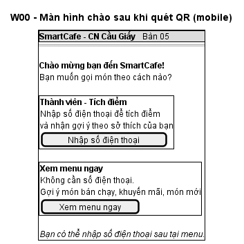
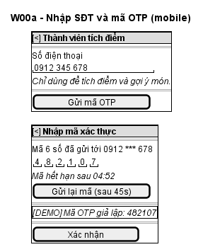
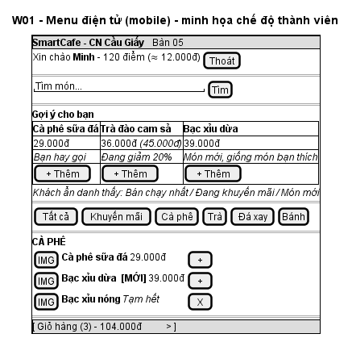
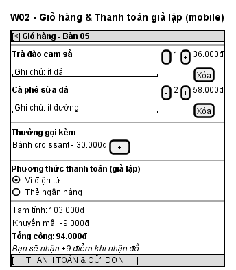
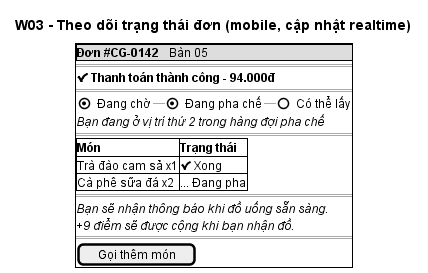
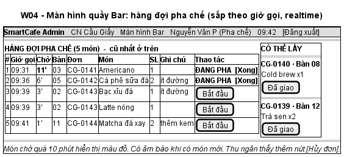
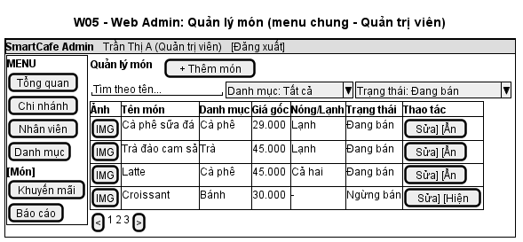
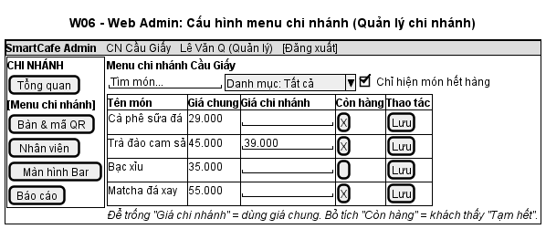
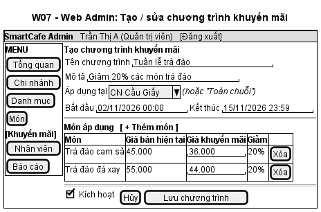
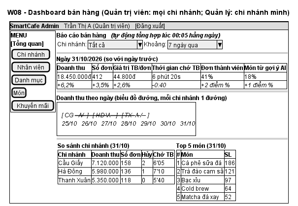

# IV.2. THIẾT KẾ MOCKUP / UI WEB ADMIN VÀ GIAO DIỆN QR

| Thông tin | Nội dung |
|:---|:---|
| Người thực hiện | Thành viên E |
| Người review | Thành viên D |
| Thời gian | 12/10/2026 – 16/10/2026 (review 17/10/2026) |
| Cập nhật | 01/11/2026 – thêm W00, W00a, W07; vẽ lại W04 dạng hàng đợi; bỏ màn hình thiết bị IoT (CR-09 → CR-14); 04/11/2026 – rà soát, đồng bộ với mã nguồn và kế hoạch D41 (CR-46) |
| Công cụ | Wireframe low-fidelity bằng PlantUML Salt (trong tài liệu này). Không làm bản Figma: giao diện thật (React + Tailwind) dựng thẳng từ wireframe, ảnh chụp ở Mục 4 |

## 1. Nguyên tắc thiết kế
- **QR Order (khách):** mobile-first, một tay thao tác được, nút chính cố định ở đáy màn hình. Luồng: Màn hình chào → (OTP) → Menu → Giỏ hàng/Thanh toán → Theo dõi.
- **Web Admin:** bố cục sidebar trái và nội dung bên phải. Menu sidebar thay đổi theo vai trò (RBAC).
- **Màn hình Bar:** chạy toàn màn hình trên tablet/TV. Bên trái là **bảng hàng đợi sắp theo giờ gọi**, bên phải là cột "Có thể lấy". Chữ lớn, có âm báo món mới.
- **Màu trạng thái thống nhất:** Đang chờ = vàng, Đang pha = xanh dương, Có thể lấy = xanh lá, Đã hủy = đỏ, Hoàn tất = xám. Nhãn "Khuyến mãi" = cam, "Mới" = tím.
- **Màu thương hiệu:** nâu cà phê `#6F4E37` làm màu chính, kem `#FDF6EC` làm nền. Font hệ thống (`system-ui`, Segoe UI / Roboto) – hiển thị tiếng Việt tốt, không phải tải font.

## 2. Sơ đồ màn hình (Sitemap)

**QR Order Web App** (`/t/:qrToken`)
| Mã | Màn hình | Use Case |
|:---|:---|:---|
| W00 | Màn hình chào: chọn "Nhập SĐT" hoặc "Xem menu ngay" | UC01 |
| W00a | Nhập SĐT và mã OTP | UC02 |
| W01 | Menu điện tử + khối gợi ý (+ tên và điểm nếu là thành viên) | UC03, UC07 |
| ~~W01a~~ | ~~Chi tiết món (popup: số lượng, ghi chú)~~ – **bỏ theo D29**: bấm "+" trên W01 là thêm ngay, số lượng và ghi chú chỉnh ở W02 | UC04 |
| W02 | Giỏ hàng & thanh toán giả lập | UC04, UC05 |
| W03 | Theo dõi trạng thái đơn | UC06 |

**Web Admin** (`/admin`)
| Mã | Màn hình | Vai trò | Use Case |
|:---|:---|:---|:---|
| A01 | Đăng nhập | Tất cả | UC08 |
| W08 | Tổng quan: dashboard bán hàng (báo cáo ngày) | ADMIN, MANAGER | UC16 |
| A03 | Quản lý chi nhánh | ADMIN | UC11 |
| A04 | Quản lý nhân viên | ADMIN, MANAGER | UC12 |
| A05 | Quản lý danh mục | ADMIN | UC09 |
| W05 | Quản lý món (menu chung) | ADMIN | UC10 |
| W06 | Menu chi nhánh | MANAGER | UC13 |
| A06 | Bàn & mã QR (xem, tải ảnh QR để in) | MANAGER | UC14 |
| W07 | Khuyến mãi (danh sách + tạo/sửa) | ADMIN | UC15 |
| W04 | Màn hình quầy Bar | MANAGER, BARISTA (CASHIER: chỉ tra cứu + hủy đơn) | UC17–UC20 |

Sau khi đăng nhập, màn hình mặc định theo vai trò: ADMIN → W08, MANAGER → W08, BARISTA → W04, CASHIER → W04 (chế độ tra cứu).

## 3. Wireframe các màn hình chính

### W00 – Màn hình chào

- Hai lựa chọn được trình bày ngang hàng, mỗi lựa chọn có mô tả lợi ích để khách tự chọn.
- Không ghi nhớ lựa chọn của lần trước (không lưu định danh thiết bị). Lần quét nào cũng hiện màn hình này.

### W00a – Nhập SĐT và OTP

- Bước 1 nhập SĐT, kèm dòng giải thích mục đích sử dụng. Bước 2 nhập 6 ô OTP, có đồng hồ đếm ngược hạn mã và nút gửi lại (khóa trong 60 giây).
- Khung **[DEMO]** hiển thị mã OTP giả lập, chỉ xuất hiện khi backend bật `OTP_DEMO_MODE`.

### W01 – Menu điện tử

- Thành viên: dòng "Xin chào – X điểm (≈ X×100đ)" (không thu thập tên – D31) và nút Thoát (xóa phiên). Phiên tự hết sau 1 giờ. Khách ẩn danh: thay bằng nút "Nhập SĐT tích điểm".
- Khối **"Gợi ý cho bạn"** dạng thẻ cuộn ngang, mỗi thẻ có lý do gợi ý. Lý do khác nhau theo chế độ (xem chú thích trong ảnh). Món thêm từ khối này được gắn `is_recommended = true`.
- Món KM hiện giá gốc gạch ngang và giá mới. Có tab danh mục **"Khuyến mãi"** để lọc nhanh. Món mới có nhãn [MỚI]. Món hết hàng hiển thị mờ, "Tạm hết".

### W02 – Giỏ hàng & thanh toán

- Mỗi món có nút tăng/giảm số lượng và ô ghi chú.
- Khối **"Thường gọi kèm"** dùng luật kết hợp.
- Hiển thị tạm tính, giảm giá KM, tổng cộng, và **"Bạn sẽ nhận +X điểm khi nhận đồ"** (chỉ với thành viên).
- Thanh toán là giả lập: popup "Đang xử lý…" khoảng 1,5 giây rồi báo "Thanh toán thành công".

### W03 – Theo dõi đơn

- Thanh tiến trình 3 bước, trạng thái từng món, **vị trí trong hàng đợi**, cập nhật qua WebSocket.
- Khi đơn READY: banner xanh lá "Đồ uống đã sẵn sàng – mời bạn đến quầy nhận", kèm rung điện thoại. Khi đơn COMPLETED: hiện "+X điểm".

### W04 – Màn hình quầy Bar (hàng đợi pha chế)

- **Bảng hàng đợi** gồm các cột: số thứ tự, **giờ gọi**, số phút đã chờ, **bàn**, mã đơn, **món**, số lượng, **ghi chú**, thao tác. Món **cũ nhất ở trên cùng**; các món cùng đơn đứng liền nhau.
- Mỗi dòng có nút **[Bắt đầu]**, bấm xong đổi thành "ĐANG PHA [Xong]". Bấm "Xong" thì dòng biến mất, có nút "Hoàn tác" trong 10 giây.
- Chữ hàng đợi và cột "Có thể lấy" cỡ 18px (NFR-U3). Mất kết nối realtime: góc phải hiện "● Mất kết nối" kèm dải cảnh báo, hàng đợi tự tải lại mỗi 10 giây (NFR-R2).
- Cột phải **"Có thể lấy"**: các đơn đã xong hết món; **pha chế** giao đồ rồi bấm [Đã giao]. Thu ngân mở màn hình này ở chế độ tra cứu: khung **"Hỗ trợ khách"** ở trên cùng (tìm đơn theo mã/bàn, nút [Hủy đơn] với đơn đang chờ / đang pha, hộp xác nhận có lý do bắt buộc và số tiền hoàn), không có nút Bắt đầu/Xong/Đã giao. Quản lý chi nhánh có cả thao tác pha chế và khung hỗ trợ khách (ở dưới).
- Món chờ quá 10 phút hiển thị màu đỏ. Có âm báo khi có món mới.

### W05 – Quản lý món (Quản trị viên)

- Form thêm/sửa món (modal) gồm: tên, danh mục, giá gốc, mô tả, ảnh (upload), **loại nóng/lạnh**, **thẻ (tags)**. Hai trường cuối là đầu vào cho AI (thời tiết, món tương tự).

### W06 – Menu chi nhánh (Quản lý chi nhánh)

- Cho phép chỉnh trực tiếp trên bảng (inline edit), nút [Lưu] từng dòng chỉ bật khi có thay đổi. Bật/tắt "Còn hàng" có hiệu lực ngay trên menu khách qua sự kiện `MENU_UPDATED`. Quản trị viên có thêm ô chọn chi nhánh.

**A03 – A06** (không có wireframe riêng, theo bố cục W05): A03 bảng chi nhánh + form (mã không sửa được, ngừng hoạt động phải xác nhận); A04 bảng nhân viên + form (Quản lý chỉ thấy chi nhánh mình, chỉ gán Thu ngân / Pha chế; không tự khóa mình); A05 bảng danh mục + form; A06 bảng bàn: thêm bàn, đổi số / khóa bàn, [Xem QR] (tải PNG) và [In tất cả mã QR]. Menu bên trái theo vai trò; mở màn hình không đúng quyền bằng URL thì báo "Bạn không có quyền truy cập màn hình này."

### W07 – Khuyến mãi

- Danh sách chương trình có 3 tab: Đang chạy / Sắp chạy / Đã kết thúc (không có trong ảnh minh họa).
- Chỉ Quản trị viên truy cập. Form tạo/sửa chọn phạm vi "Toàn chuỗi" hoặc 1 chi nhánh. Cột "Giảm" tự tính %. Báo lỗi nếu giá KM ≥ giá bán hiện tại.

### W08 – Dashboard bán hàng

- Màn hình "Tổng quan" mặc định của Quản trị viên và Quản lý chi nhánh. Dữ liệu lấy từ `daily_sales_reports`, **tự cập nhật lúc 00:05 hằng ngày**.
- Bộ lọc: chi nhánh (Quản lý chỉ thấy chi nhánh mình), khoảng thời gian 7 / 30 ngày.
- Thẻ chỉ số của ngày gần nhất kèm % thay đổi so với ngày trước; biểu đồ đường doanh thu theo ngày (mỗi chi nhánh 1 đường); bảng so sánh chi nhánh; top 5 món.
- Thư viện biểu đồ: Recharts (React). Màu mỗi chi nhánh cố định; mũi tên thay đổi xanh = tốt hơn, đỏ = xấu hơn (thời gian chờ giảm là tốt). Quản trị viên có nút "Tính lại hôm qua".

## 4. Giao diện đã cài đặt (đối chiếu với wireframe)
Giao diện thật được dựng từ các wireframe trên (React + Tailwind CSS, mobile-first 360–430px cho QR Order, Web Admin cho laptop / tablet). Ảnh chụp đầy đủ và cách dùng: [Hướng dẫn sử dụng](../Huong_dan_su_dung/Huong_dan_su_dung.md).

| Wireframe | Màn hình thật | Khác so với wireframe |
|:---|:---|:---|
| W00 Màn hình chào | [ảnh](../Huong_dan_su_dung/img/K01_man_hinh_chao.png) | – |
| W00a SĐT + OTP | [SĐT](../Huong_dan_su_dung/img/K08_nhap_so_dien_thoai.png), [OTP](../Huong_dan_su_dung/img/K09_nhap_ma_otp.png) | – |
| W01 Menu + gợi ý | [ẩn danh](../Huong_dan_su_dung/img/K02_menu_goi_y.png), [thành viên](../Huong_dan_su_dung/img/K10_menu_thanh_vien.png) | Lời chào thành viên không có tên (D31); bỏ popup W01a (D29) |
| W02 Giỏ hàng | [ảnh](../Huong_dan_su_dung/img/K04_gio_hang.png), [thành viên](../Huong_dan_su_dung/img/K11_gio_hang_thanh_vien.png) | Chọn phương thức thanh toán giả lập (Ví điện tử / Thẻ ngân hàng) ngay trong giỏ |
| W03 Theo dõi đơn | [đang chờ](../Huong_dan_su_dung/img/K05_theo_doi_don_dang_cho.png), [sẵn sàng](../Huong_dan_su_dung/img/K07_do_uong_san_sang.png), [đã hủy](../Huong_dan_su_dung/img/K13_don_da_huy_hoan_tien.png) | – |
| W04 Màn hình Bar | [hàng đợi](../Huong_dan_su_dung/img/N02_bar_hang_doi.png), [Hoàn tác](../Huong_dan_su_dung/img/N04_bar_co_the_lay_hoan_tac.png), [thu ngân](../Huong_dan_su_dung/img/N05_thu_ngan_tra_cuu.png) | Chữ 18px, cảnh báo "Mất kết nối" (giai đoạn VI) |
| W05 Quản lý món | [danh sách](../Huong_dan_su_dung/img/N16_mon.png), [thêm món](../Huong_dan_su_dung/img/N17_them_mon.png) | – |
| W06 Menu chi nhánh | [ảnh](../Huong_dan_su_dung/img/N08_menu_chi_nhanh.png) | – |
| W07 Khuyến mãi | [danh sách](../Huong_dan_su_dung/img/N18_khuyen_mai.png), [tạo](../Huong_dan_su_dung/img/N19_tao_khuyen_mai.png) | – |
| W08 Dashboard | [quản trị](../Huong_dan_su_dung/img/N13_tong_quan_quan_tri.png), [quản lý](../Huong_dan_su_dung/img/N07_tong_quan_quan_ly.png) | – |
| A01, A03–A06 | [đăng nhập](../Huong_dan_su_dung/img/N01_dang_nhap.png), [chi nhánh](../Huong_dan_su_dung/img/N14_chi_nhanh.png), [nhân viên](../Huong_dan_su_dung/img/N20_nhan_vien_quan_tri.png), [danh mục](../Huong_dan_su_dung/img/N15_danh_muc.png), [bàn & QR](../Huong_dan_su_dung/img/N09_ban_va_ma_qr.png) | – |
