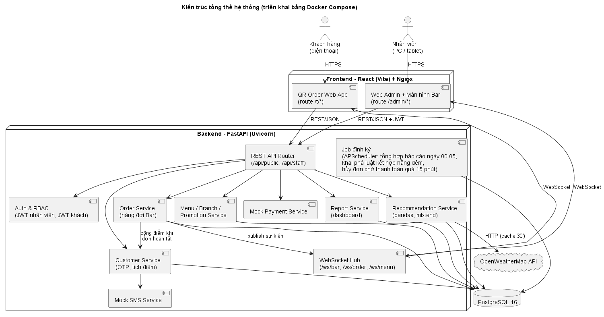

# IV.3. KIẾN TRÚC HỆ THỐNG VÀ DANH SÁCH API (bổ sung)

> Mục này không có trong bảng phân công gốc. Nó được bổ sung để làm đầu vào trực tiếp cho giai đoạn V (Lập trình): Thành viên B làm API, Thành viên E gọi API, Thành viên C làm AI. Đề xuất người review: Thành viên A.
>
> Cập nhật 01/11/2026: bỏ IoT Gateway; thêm OTP, tích điểm, khuyến mãi, API hàng đợi Bar (CR-09 → CR-14).

## 1. Kiến trúc tổng thể



- **Mô hình:** Client – Server, backend là **modular monolith** (một ứng dụng FastAPI chia module). Lựa chọn này phù hợp nhóm 5 người trong 4 tuần, không cần tách microservice.
- **Recommendation Service** chạy trong cùng tiến trình với backend, vì cùng là Python và chung CSDL.
- **WebSocket Hub:** quản lý các kênh trong bộ nhớ (in-memory). Chỉ chạy 1 instance backend nên chưa cần Redis pub/sub (ghi vào hướng mở rộng).
- **Xác thực 2 loại token:** JWT nhân viên (role ADMIN/MANAGER/CASHIER/BARISTA, 8 giờ) và JWT khách thành viên (role CUSTOMER, `sub = customer_id`, **1 giờ**, phía client chỉ giữ trong sessionStorage).

### 1.1. Cấu trúc thư mục đề xuất (thư mục `2.San_pham/smartcafe/`)
```
backend/
  app/
    main.py              # khởi tạo FastAPI, mount router, WebSocket
    core/                # config, security (JWT, bcrypt), db session
    models/              # SQLAlchemy models (theo schema.sql)
    schemas/             # Pydantic request/response
    modules/
      auth/  customer/ (OTP, điểm)  branch/  menu/  promotion/
      order/ (đơn, hàng đợi Bar)  payment/  sms/  recommend/  report/ (dashboard, báo cáo ngày)
    ws/                  # WebSocket hub
    jobs/                # APScheduler: build_daily_report (00:05), mine_rules (hằng đêm), expire_pending_orders
  alembic/
  scripts/seed_data.py  seed_orders.py
  tests/
frontend/
  src/
    pages/qr/            # W00-W03
    pages/admin/         # A01, A03-A06, W04-W08
    components/  api/  hooks/useWebSocket.ts
docker-compose.yml
```

## 2. Danh sách API

Tiền tố: `/api/public/*` dùng cho khách (một số endpoint nhận thêm customer token nếu có), `/api/staff/*` cần JWT nhân viên.

### 2.1. Khách hàng (public)
| Method | Endpoint | Mô tả | UC |
|:---|:---|:---|:---|
| GET | `/api/public/tables/{qr_token}` | Lấy chi nhánh và bàn từ mã QR | UC01 |
| POST | `/api/public/otp/request` | `{phone}` (chấp nhận dấu cách, chấm, +84): gửi OTP giả lập, trả `{expires_in, resend_after, phone_masked, demo_code?}`. SĐT sai → 422 `VALIDATION_ERROR`; gửi lại trước 60 giây / quá 5 mã một giờ → 429 `OTP_RATE_LIMITED` kèm `retry_after` (giây) | UC02 |
| POST | `/api/public/otp/verify` | `{phone, code}`: trả `{customer_token, expires_at, phone_masked, loyalty_points}`. Sai → 400 `OTP_INVALID`, `details = {reason: WRONG \| LOCKED \| EXPIRED \| NOT_FOUND, attempts_left}` | UC02 |
| GET | `/api/public/me` | *(customer token)* `{phone_masked, loyalty_points, point_value_vnd, points_value, recent_transactions:[{order_code, points, type, created_at}]}` (5 giao dịch gần nhất). Không có / sai / hết hạn token → 401 `UNAUTHORIZED` / `TOKEN_EXPIRED` | UC07 |
| GET | `/api/public/branches/{id}/menu` | Menu theo danh mục: giá thường, giá bán (đã KM), nhãn mới, tình trạng | UC03 |
| GET | `/api/public/branches/{id}/recommendations?cart=1,5` | *(customer token tùy chọn)* Top 5 gợi ý kèm lý do; nếu có `cart` thì trả thêm "thường gọi kèm" | UC03 |
| POST | `/api/public/orders` | *(customer token tùy chọn)* Tạo đơn `{qr_token, items:[{menu_item_id, quantity, note, is_recommended}], note?, expected_total?}`, trả `{order_id, order_code, access_token, status, subtotal, discount, total, expected_points, items}`. Nếu `expected_total` (tổng khách đang thấy) khác tổng server tính → 409 `PRICE_CHANGED` kèm giá mới. Gửi customer token đã hết hạn / không hợp lệ → 401 (không tự đặt ẩn danh, để khách không mất điểm mà không biết) | UC05 |
| POST | `/api/public/orders/{id}/pay` | Thanh toán giả lập `{access_token, method}` | UC05 |
| GET | `/api/public/orders/{id}?token=` | Trạng thái đơn, từng món, vị trí trong hàng đợi; đơn của khách thành viên có `expected_points` (sẽ nhận) và `points_earned` (đã cộng, khi hoàn tất) | UC06 |

### 2.2. Nhân viên (staff, JWT)
| Method | Endpoint | Mô tả | Vai trò |
|:---|:---|:---|:---|
| POST | `/api/auth/login` | Đăng nhập, trả JWT | Tất cả |
| GET | `/api/auth/me` | Thông tin người dùng hiện tại | Tất cả |
| GET/POST/PUT/DELETE | `/api/staff/categories[/{id}]` | CRUD danh mục | ADMIN |
| GET/POST/PUT/DELETE | `/api/staff/menu-items[/{id}]` | CRUD món (xóa mềm) | ADMIN |
| POST | `/api/staff/menu-items/{id}/image` | Upload ảnh món | ADMIN |
| GET/POST/PUT | `/api/staff/branches[/{id}]` | CRUD chi nhánh | ADMIN |
| GET/POST/PUT | `/api/staff/staff[/{id}]` | CRUD nhân viên, khóa tài khoản | ADMIN, MANAGER |
| GET | `/api/staff/branches/{id}/menu` | Menu chi nhánh (giá chung, giá riêng, tình trạng) | ADMIN, MANAGER |
| PATCH | `/api/staff/branches/{id}/menu/{item_id}` | `{price_override, is_available}` | MANAGER |
| GET/POST/PUT | `/api/staff/branches/{id}/tables[/{tid}]` | Quản lý bàn | MANAGER |
| GET | `/api/staff/tables/{tid}/qr.png` | Ảnh QR để in | MANAGER |
| GET | `/api/staff/promotions?status=running\|upcoming\|ended&branch_id=` | Danh sách KM | ADMIN |
| POST/PUT | `/api/staff/promotions[/{id}]` | Tạo/sửa KM `{name, description, branch_id, start_at, end_at, is_active, items:[{menu_item_id, promo_price}]}` | ADMIN |
| GET | `/api/staff/branches/{id}/queue` | **Hàng đợi pha chế**: các món WAITING/PREPARING của đơn đã thanh toán, sắp theo giờ gọi (`paid_at`), kèm bàn, ghi chú món + ghi chú đơn; trả thêm `server_time` để tính số phút đã chờ | Nhân viên CN (ADMIN xem mọi CN) |
| GET | `/api/staff/branches/{id}/orders?status=READY` | Đơn "Có thể lấy" | Nhân viên CN |
| GET | `/api/staff/orders/search?code=&table=` | Thu ngân tra cứu đơn để hỗ trợ khách | CASHIER, MANAGER |
| POST | `/api/staff/order-items/{id}/start` | Bắt đầu pha | BARISTA, MANAGER |
| POST | `/api/staff/order-items/{id}/done` | Xong món | BARISTA, MANAGER |
| POST | `/api/staff/order-items/{id}/undo` | Hoàn tác "Xong" (nút hiện 10 giây; server chấp nhận tới 15 giây để bù trễ mạng, quá hạn → 409 `UNDO_EXPIRED`). Hoàn tác món cuối của đơn READY thì đơn → PREPARING (D30) | BARISTA, MANAGER |
| POST | `/api/staff/orders/{id}/complete` | Pha chế xác nhận "Đã giao", **cộng điểm**; trả `{order_id, status, completed_at, points_earned}` (`points_earned` = null với khách ẩn danh) | BARISTA, MANAGER |
| POST | `/api/staff/orders/{id}/cancel` | `{reason}`: hủy và hoàn tiền giả lập (hỗ trợ khách) | CASHIER, MANAGER |
| GET | `/api/staff/reports/daily?branch_id=&from=&to=` | Dữ liệu dashboard từ `daily_sales_reports` (chỉ số theo ngày, top món) | ADMIN, MANAGER (chi nhánh mình) |
| POST | `/api/staff/reports/daily/rebuild` | `{date, branch_id?}`: chạy lại job tổng hợp cho 1 ngày | ADMIN |

### 2.3. WebSocket
| Kênh | Người nghe | Sự kiện |
|:---|:---|:---|
| `/ws/bar/{branch_id}?token=<JWT>` | Màn hình Bar | `QUEUE_ITEM_ADDED`, `ITEM_UPDATED {item_id, item_status, order_id, order_status}`, `ORDER_READY`, `ORDER_COMPLETED {order_id}`, `ORDER_CANCELLED`. JWT sai/hết hạn/bị khóa: đóng mã 4401; khác chi nhánh: 4403. Kết nối (lại) xong client tự tải lại hàng đợi qua REST |
| `/ws/order/{order_id}?token=<access_token>` | Khách | `ORDER_SNAPSHOT` (gửi ngay khi kết nối / kết nối lại), `ORDER_PAID`, `ITEM_PREPARING`, `ITEM_DONE`, `QUEUE_POSITION`, `ORDER_READY`, `ORDER_COMPLETED` (dữ liệu đơn có `points_earned`), `ORDER_CANCELLED`; các sự kiện của đơn mang toàn bộ dữ liệu đơn như `GET /api/public/orders/{id}`, riêng `QUEUE_POSITION` chỉ gồm `{order_id, queue_position}`. Sai mã đơn / token: đóng kết nối mã 4404 |
| `/ws/menu/{branch_id}` | QR Web App | `MENU_UPDATED` (tình trạng món, khuyến mãi) |

Định dạng message: `{"type": "ORDER_READY", "data": {...}, "ts": "2026-11-20T08:15:00Z"}`.

### 2.4. Định dạng lỗi thống nhất
```json
{ "error": { "code": "ITEM_UNAVAILABLE", "message": "Món 'Bạc xỉu' đã tạm hết", "details": {"item_ids": [12]} } }
```
Mã lỗi chính: `VALIDATION_ERROR`, `TABLE_NOT_FOUND`, `BRANCH_NOT_FOUND`, `ORDER_NOT_FOUND`, `ITEM_NOT_FOUND`, `UNDO_EXPIRED`, `ITEM_UNAVAILABLE`, `QUANTITY_LIMIT`, `PRICE_CHANGED`, `UNAUTHORIZED`, `TOKEN_EXPIRED`, `ACCOUNT_LOCKED`, `OTP_INVALID`, `OTP_RATE_LIMITED`, `INVALID_CREDENTIALS`, `FORBIDDEN`, `INVALID_STATE_TRANSITION`, `CANNOT_CANCEL`, `PAYMENT_FAILED`, `PROMOTION_INVALID`.

## 3. Mốc tích hợp đề xuất cho giai đoạn V
| Tuần | Mốc | Người |
|:---|:---|:---|
| 02–08/11 | Skeleton backend + Docker Compose + Alembic + seed; skeleton frontend + routing | B, E |
| 09–13/11 | API Auth, Menu, Chi nhánh, Khuyến mãi; Swagger chia sẻ cho E | B |
| 09–13/11 | API OTP + tích điểm; script sinh dữ liệu mẫu `seed_data.py`, `seed_orders.py` | C |
| 09–15/11 | API Đơn hàng, hàng đợi Bar + WebSocket + Payment giả lập; Service gợi ý 2 chế độ + FP-Growth | B, C |
| 16–18/11 | API báo cáo + job `build_daily_report` | B |
| 16–20/11 | Hoàn thiện giao diện, ráp API thật thay dữ liệu giả | E |
| 21–25/11 | Tích hợp toàn hệ thống, chạy thử 2 luồng demo end-to-end (ẩn danh, thành viên) | B, C, E |

> Các mốc trên đã được dời so với kế hoạch gốc (giai đoạn V bắt đầu từ 23/10) vì thiết kế vừa thay đổi ở Tuần 06. Cần PM xác nhận.
